# Learn JavaScript, TypeScript & Playwright (4x)

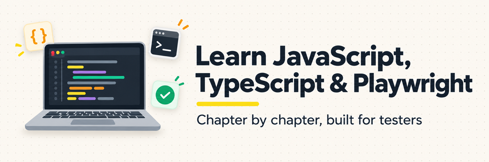


A chapter-by-chapter learning repo for testers moving into JavaScript, TypeScript, and Playwright automation. Every chapter is a folder, every lesson is a small file you can run on its own.

## Overview

This repository is designed to help QA engineers, manual testers, and automation beginners build real automation skills in a practical, step-by-step way. It starts with JavaScript fundamentals, expands into TypeScript concepts, and ends with Playwright-based browser automation.

### What you will learn

- Core JavaScript syntax and logic building blocks
- Modern JavaScript patterns used in real automation code
- TypeScript basics and safe coding habits
- Browser automation with Playwright
- How to structure small test exercises and run them locally

### Quick start

```bash
# install dependencies
npm install

# install browsers for Playwright
npx playwright install

# run the sample Playwright tests
npx playwright test
```

To run a single spec:

```bash
npx playwright test tests/example.spec.ts --project=chromium
```

---

## Table of Contents

- [Roadmap](#roadmap)
- [Chapter Summary](#chapter-summary)
- [Project Structure](#project-structure)
- [Getting Started](#getting-started)
- [Chapter 00: Prompt Engineering](#chapter-00-prompt-engineering)
  - [00: RICE-POT Prompt Engineering](#00-rice-pot-prompt-engineering)
- [Chapter 01: JavaScript Basics](#chapter-01-javascript-basics)
  - [01: Hello World](#01-hello-world)
  - [02: Math with Numbers](#02-math-with-numbers)
- [Chapter 02: Keywords and Identifiers](#chapter-02-keywords-and-identifiers)
  - [03: The JavaScript Engine](#03-the-javascript-engine)
  - [05: Keywords vs Identifiers: var, let, const](#05-keywords-vs-identifiers-var-let-const)
  - [06: Identifier Rules](#06-identifier-rules)
  - [07: Naming Conventions](#07-naming-conventions)
  - [08: Comments](#08-comments)
  - [09: Interview Questions on Identifiers](#09-interview-questions-on-identifiers)
- [Chapter 03: Literals](#chapter-03-literals)
  - [10: Literals and typeof](#10-literals-and-typeof)
  - [12: null vs undefined](#12-null-vs-undefined)
  - [14: Number Literals: Bases and Exponents](#14-number-literals-bases-and-exponents)
  - [16: Numeric Separators and BigInt](#16-numeric-separators-and-bigint)
  - [17: Special Numbers: Infinity and NaN](#17-special-numbers-infinity-and-nan)
- [Chapter 04: Operators](#chapter-04-operators)
  - [19: Expressions and Data Types](#19-expressions-and-data-types)
  - [20: Assignment Operators](#20-assignment-operators)
  - [21: Arithmetic Operators](#21-arithmetic-operators)
  - [22: Comparison Operators (Loose vs Strict)](#22-comparison-operators-loose-vs-strict)
  - [23: Logical Operators](#23-logical-operators)
  - [24: Confusing Comparisons](#24-confusing-comparisons)
  - [27: String Concatenation and Template Literals](#27-string-concatenation-and-template-literals)
  - [28: Ternary Operator](#28-ternary-operator)
  - [30: Ternary in Test Code (Interview Practice)](#30-ternary-in-test-code-interview-practice)
  - [34: Nested Ternary](#34-nested-ternary)
  - [37: The typeof Operator](#37-the-typeof-operator)
- [Chapter 05: Increment, Decrement and Nullish](#chapter-05-increment-decrement-and-nullish)
  - [38: Pre vs Post Increment and Decrement](#38-pre-vs-post-increment-and-decrement)
  - [40: Increment Interview Questions](#40-increment-interview-questions)
  - [45: Nullish Coalescing (??)](#45-nullish-coalescing-)
- [Chapter 06: if, else and else if](#chapter-06-if-else-and-else-if)
  - [46: if and else](#46-if-and-else)
  - [47: Nested if](#47-nested-if)
  - [48: Ternary vs if and else](#48-ternary-vs-if-and-else)
  - [49: else if Ladder: Grade Calculator](#49-else-if-ladder-grade-calculator)
- [Chapter 07: switch](#chapter-07-switch)
  - [50: switch Basics](#50-switch-basics)
  - [51: Fall-Through (Missing break)](#51-fall-through-missing-break)
  - [53: Status Codes and Grouped Cases](#53-status-codes-and-grouped-cases)
  - [56: switch (true) for Ranges](#56-switch-true-for-ranges)
  - [57: switch Gotchas: Duplicate Cases, let and Strict Matching](#57-switch-gotchas-duplicate-cases-let-and-strict-matching)
- [Chapter 08: User Input](#chapter-08-user-input)
  - [59: prompt() in the Browser](#59-prompt-in-the-browser)
  - [60: readline in Node](#60-readline-in-node)
  - [61: prompt-sync](#61-prompt-sync)
  - [62: Reading Piped Input with fs.readFileSync](#62-reading-piped-input-with-fsreadfilesync)
- [Chapter 09: for Loop](#chapter-09-for-loop)
  - [63: Why Loops: the for Loop](#63-why-loops-the-for-loop)
  - [66: Loop Boundaries, Zero Runs and Infinite Loops](#66-loop-boundaries-zero-runs-and-infinite-loops)
  - [69: if Inside a Loop](#69-if-inside-a-loop)
- [Chapter 10: while Loop](#chapter-10-while-loop)
  - [70: while Loop](#70-while-loop)
  - [73: while (true) and break](#73-while-true-and-break)
- [Chapter 11: do...while and Nested Loops](#chapter-11-dowhile-and-nested-loops)
  - [74: do...while](#74-dowhile)
  - [75: while vs do...while](#75-while-vs-dowhile)
  - [76: Nested Loops](#76-nested-loops)
- [Chapter 12: Arrays](#chapter-12-arrays)
  - [78: Arrays: Index, length and at()](#78-arrays-index-length-and-at)
  - [82: Creating Arrays](#82-creating-arrays)
  - [83: Accessing and Modifying](#83-accessing-and-modifying)
  - [84: Adding and Removing Items](#84-adding-and-removing-items)
  - [86: Searching: indexOf, includes and find](#86-searching-indexof-includes-and-find)
  - [88: Iterating Over an Array](#88-iterating-over-an-array)
  - [89: Transforming: map and filter](#89-transforming-map-and-filter)
  - [90: Sorting: Text Order vs Number Order](#90-sorting-text-order-vs-number-order)
  - [93: slice: Copy Part of an Array](#93-slice-copy-part-of-an-array)
  - [94: Combining Arrays: concat and Spread](#94-combining-arrays-concat-and-spread)
  - [95: Array.isArray](#95-arrayisarray)
  - [96: every and some](#96-every-and-some)
  - [97: Copy vs Reference](#97-copy-vs-reference)
  - [98: Destructuring](#98-destructuring)
  - [100: Swapping Two Variables](#100-swapping-two-variables)
- [Chapter 13: Functions](#chapter-13-functions)
  - [101: Defining and Calling a Function](#101-defining-and-calling-a-function)
  - [102: The Four Types of Functions](#102-the-four-types-of-functions)
  - [106: Declarations, Expressions and Arrow Functions](#106-declarations-expressions-and-arrow-functions)
  - [112: One Check, Three Syntaxes](#112-one-check-three-syntaxes)
  - [113: IIFE: Run a Function Immediately](#113-iife-run-a-function-immediately)
  - [114: Rest Parameters and Spread Arguments](#114-rest-parameters-and-spread-arguments)
  - [115: return](#115-return)
- [Chapter 14: var, let, const: Scope, Hoisting and TDZ](#chapter-14-var-let-const-scope-hoisting-and-tdz)
  - [117: var Is Function-Scoped](#117-var-is-function-scoped)
  - [119: let Is Block-Scoped](#119-let-is-block-scoped)
  - [120: const](#120-const)
  - [121: Hoisting: var vs let](#121-hoisting-var-vs-let)
  - [124: var in a Block, and Redeclaring var](#124-var-in-a-block-and-redeclaring-var)
  - [125: The Temporal Dead Zone (TDZ)](#125-the-temporal-dead-zone-tdz)
- [Chapter 15: Closures](#chapter-15-closures)
  - [128: Closures](#128-closures)
- [Chapter 16: Strings](#chapter-16-strings)
  - [129: Creating Strings and Converting to a String](#129-creating-strings-and-converting-to-a-string)
  - [130: length, Index, at() and charAt()](#130-length-index-at-and-charat)
  - [131: Searching Inside a String](#131-searching-inside-a-string)
- [Chapter 17: Objects](#chapter-17-objects)
  - [132: Objects: Keys, Values, Dot and Bracket](#132-objects-keys-values-dot-and-bracket)
  - [133: Value vs Reference](#133-value-vs-reference)
  - [134: Nested Objects and Methods](#134-nested-objects-and-methods)
  - [136: Adding, Changing and Deleting Properties](#136-adding-changing-and-deleting-properties)
  - [139: Shallow Copy vs Deep Copy](#139-shallow-copy-vs-deep-copy)
- [Chapter 18: Multi-Dimensional Arrays and Patterns](#chapter-18-multi-dimensional-arrays-and-patterns)
  - [140: 2D Arrays: Rows and Columns](#140-2d-arrays-rows-and-columns)
  - [142: Looping Over a 2D Array](#142-looping-over-a-2d-array)
  - [143: Row Totals with map and reduce](#143-row-totals-with-map-and-reduce)
  - [144: Right and Left Triangle Patterns](#144-right-and-left-triangle-patterns)
  - [146: Pyramid Pattern](#146-pyramid-pattern)
- [Chapter 19: Callbacks](#chapter-19-callbacks)
  - [147: What Is a Callback?](#147-what-is-a-callback)
  - [149: Sync vs Async Callbacks](#149-sync-vs-async-callbacks)
  - [151: Callback Hell](#151-callback-hell)
- [Chapter 20: Promises](#chapter-20-promises)
  - [155: Promises: then, catch and finally](#155-promises-then-catch-and-finally)
  - [157: Chaining Promises](#157-chaining-promises)
  - [158: Promise.all, allSettled and race](#158-promiseall-allsettled-and-race)
  - [161: Promise Interview Questions](#161-promise-interview-questions)
- [Chapter 21: Async and Await](#chapter-21-async-and-await)
  - [162: async and await](#162-async-and-await)
  - [163: try, catch and finally](#163-try-catch-and-finally)
  - [164: await in a Playwright Test](#164-await-in-a-playwright-test)
  - [166: Sequential vs Parallel](#166-sequential-vs-parallel)
  - [168: Retry Pattern](#168-retry-pattern)
  - [169: Async Interview Questions](#169-async-interview-questions)
- [Chapter 22: Export and Import](#chapter-22-export-and-import)
  - [172: Named Exports and Imports](#172-named-exports-and-imports)
  - [173: Renaming Imports with as](#173-renaming-imports-with-as)
  - [174: Default vs Named Exports](#174-default-vs-named-exports)
- [Chapter 23: Classes and Objects](#chapter-23-classes-and-objects)
  - [175: Class and Objects](#175-class-and-objects)
- [Chapter 24: Playwright](#chapter-24-playwright)
  - [Your First Playwright Project](#your-first-playwright-project)
- [Learning Notes](#learning-notes)
- [Coming Up](#coming-up)

---

## Roadmap


---

## Chapter Summary

| # | Chapter | Folder | Status | What you learn |
|:--|:--------|:-------|:------:|:---------------|
| 00 | Prompt Engineering | [00_chapter_Prompt_Eng](00_chapter_Prompt_Eng/) | ✅ Done | RICE-POT prompts, anti-hallucination rules, the Selenium framework a prompt generated |
| 01 | JavaScript Basics | [01_chapter_JS_Basics](01_chapter_JS_Basics/) | ✅ Done | Running a file with Node, `console.log`, arithmetic expressions |
| 02 | Keywords and Identifiers | [02_chapter_JS_Keywrods_Identifiers](02_chapter_JS_Keywrods_Identifiers/) | ✅ Done | How V8 runs code, `var`/`let`/`const`, identifier rules, naming conventions, comments |
| 03 | Literals | [03_chapter_JS_Literals](03_chapter_JS_Literals/) | ✅ Done | `typeof`, `null` vs `undefined`, number bases, exponents, numeric separators, BigInt, `Infinity`, `NaN` |
| 04 | Operators | [04_chapter_JS_Operators](04_chapter_JS_Operators/) | ✅ Done | Data types, assignment, arithmetic, `==` vs `===`, `&&` `\|\|` `!`, coercion traps, strings and template literals, ternary, `typeof` |
| 05 | Increment, Decrement and Nullish | [05_chapter_JS_Incre_Decr_Op](05_chapter_JS_Incre_Decr_Op/) | ✅ Done | `++a` vs `a++`, `--a` vs `a--`, step-by-step interview questions, `??` |
| 06 | if, else and else if | [06_chatper_if_else_statement_Condition](06_chatper_if_else_statement_Condition/) | ✅ Done | `if`/`else`, nested `if`, ternary vs `if`, `else if` ladder (grade calculator) |
| 07 | switch | [07_chapter_switch](07_chapter_switch/) | ✅ Done | `case`, `break`, `default`, fall-through, grouped cases, `switch (true)`, strict matching |
| 08 | User Input | [08_chapter_UserInput](08_chapter_UserInput/) | ✅ Done | `prompt()` in the browser, `readline`, `prompt-sync`, reading stdin with `fs` |
| 09 | for Loop | [09_chapter_Loops](09_chapter_Loops/) | ✅ Done | Why loops, `for (init; condition; update)`, `<` vs `<=`, zero-run and infinite loops, `if` inside a loop |
| 10 | while Loop | [10_chapter_Loops_WHILE](10_chapter_Loops_WHILE/) | ✅ Done | `while`, retry counters, `while (true)` with `break` |
| 11 | do...while and Nested Loops | [11_chapter_Loops_DoWhile](11_chapter_Loops_DoWhile/) | ✅ Done | `do...while`, `while` vs `do...while`, nested `for` loops |
| 12 | Arrays | [12_chapters_Arrays](12_chapters_Arrays/) | ✅ Done | Index, `length`, `at()`, creating arrays, `push`/`pop`/`shift`/`unshift`/`splice`, `indexOf`/`includes`/`find`, `for...of`/`forEach`, `map`/`filter`, `sort`, `slice`, `concat` and spread, `every`/`some`, copy vs reference, destructuring |
| 13 | Functions | [13_chapter_Functions](13_chapter_Functions/) | ✅ Done | Defining and calling, the 4 function types, expressions and arrow functions, IIFE, rest and spread, `return` |
| 14 | var, let, const: Scope, Hoisting and TDZ | [14_chapter_Var_Let_Const_Hoisting_TDZ](14_chapter_Var_Let_Const_Hoisting_TDZ/) | ✅ Done | Function scope vs block scope, shadowing, `const`, hoisting, the TDZ, `typeof` in the TDZ, redeclaring `var` |
| 15 | Closures | [15_chapter_Functions_Closure](15_chapter_Functions_Closure/) | ✅ Done | Inner functions that remember the outer function's variables |
| 16 | Strings | [16_chapter_String](16_chapter_String/) | ✅ Done | Quotes and template literals, `String()`, `length`, index, `at()`, `charAt()`, `includes`, `startsWith`, `endsWith`, `indexOf` |
| 17 | Objects | [17_Objects_JS](17_Objects_JS/) | ✅ Done | Keys and values, dot vs bracket, value vs reference, nested objects, methods and `this`, adding and deleting properties, shallow vs deep copy |
| 18 | Multi-Dimensional Arrays and Patterns | [18_Multi_Dimensions_Array](18_Multi_Dimensions_Array/) | ✅ Done | 2D arrays, `grid[row][col]`, nested loops over a grid, row totals with `map` and `reduce`, triangle and pyramid star patterns |
| 19 | Callbacks | [19_Callback](19_Callback/) | ✅ Done | Passing functions, sync vs async callbacks, `setTimeout`, callback hell |
| 20 | Promises | [20_Promise](20_Promise/) | ✅ Done | `then`, `catch`, `finally`, chaining, `Promise.all`, `allSettled`, `race`, interview drills |
| 21 | Async and Await | [21_Async_Await](21_Async_Await/) | ✅ Done | `async` functions, `await`, `try/catch/finally`, `await` in Playwright tests, sequential vs parallel, retries, interview drills |
| 22 | Export and Import | [22_Export_Import](22_Export_Import/) | ✅ Done | Named exports, `import { }`, renaming with `as`, default vs named exports |
| 23 | Classes and Objects | [23_Class_Objects](23_Class_Objects/) | 🟡 In progress | `class`, `new`, private `#` fields, methods |
| 24 | Playwright | [24_Playwright](24_Playwright/) | 🟡 In progress | A real Playwright project: config, first tests, running them in three browsers |

---

## Project Structure

```text
LearnJSTSPlaywright4x/
├── README.md
├── .gitignore
├── package.json                            # One dependency: prompt-sync (chapter 08)
├── package-lock.json
├── assets/images/                          # Banner and chapter cheat-sheet images used in this README
├── 00_learning/                            # Short explainer notes (see Learning Notes below)
│   ├── Default vs Named Exports.pdf        # The same explainer, saved from the browser (landscape)
│   ├── chatAt_vs_At_string.md              # charAt(i) vs at(i)
│   ├── default_vs_named_export_eli5.pdf    # ELI5 picture explainer: default vs named exports
│   ├── object_reference_copy_eli5.html     # ELI5 picture page: why let b = a changes a
│   ├── playwright_page_methods_await.md    # Every page. method and whether it needs await
│   └── rarely_needed_string_methods.md     # isWellFormed, normalize, legacy HTML wrappers
├── 00_chapter_Prompt_Eng/
│   ├── 00_RICE_POT_FullForm.md             # What each RICE-POT letter means
│   ├── 01_RICE_POT_Prompt.md               # Worked prompt: Salesforce login (Selenium + TestNG)
│   ├── 02_Problem_Statement.md             # The objective the prompt solves
│   ├── 03_Anti_Hallucinations.md           # Version anchors, negative constraints, self-checks
│   ├── 04_RICE_POT_Generic_QA_Template.md  # Reusable template: test plans, cases, automation
│   └── Selenium_Framework/                 # The framework the prompt produced (Java 17, TestNG)
├── 01_chapter_JS_Basics/
│   ├── 01_HelloWorld.js                    # First program: console.log
│   └── 02_Math.js                          # Arithmetic expressions
├── 02_chapter_JS_Keywrods_Identifiers/
│   ├── 03_js_engine.js                     # How V8 runs a file, hot code and JIT
│   ├── 04_letengine.js                     # Smallest program: one let declaration
│   ├── 05_KW_IND.js                        # Keyword vs identifier: var, let, const
│   ├── 06_KW_IND_Rules.js                  # Identifier rules: what a name may contain
│   ├── 07_IND_Rules2.js                    # Naming conventions: camelCase, PascalCase, ...
│   ├── 08_Comments.js                      # Single-line, multi-line and JSDoc comments
│   └── 09_IQ.js                            # Interview drill: valid vs invalid identifiers
├── 03_chapter_JS_Literals/
│   ├── 10_Literal.js                       # A literal is the value you write: let a = 10
│   ├── 11_Numberal.js                      # String, number, boolean, null literals + typeof
│   ├── 12_Null_Undefined.js                # null vs undefined, typeof null is "object"
│   ├── 13_Null.js                          # Practice: a null and an undefined variable
│   ├── 14_Literals.js                      # Integers, hex, octal, exponent literals
│   ├── 15_Number.js                        # Binary, octal, hex, floats, exponential notation
│   ├── 16_Numbers_PART2.js                 # Numeric separators (1_000_000) and BigInt
│   ├── 17_Special.js                       # Infinity, -Infinity, NaN
│   └── 18_undefined.js                     # Practice: undefined vs null
├── 04_chapter_JS_Operators/
│   ├── 19_Arch.js                          # Anatomy of an expression, JS data types
│   ├── 20_Assigment_Op.js                  # = and reassigning a variable
│   ├── 21_Arithematic_Op.js                # + - * / % ** and the odd/even check
│   ├── 22_Comparsion_Op.js                 # == vs ===, != vs !==
│   ├── 23_Logical_Op.js                    # && || !
│   ├── 24_Confusing_Comparsion.js          # "" == 0, "0" == 0, "" == "0"
│   ├── 25_CC.js                            # (empty, work in progress)
│   ├── 26_Question.js                      # Quiz: != vs !==, and why !=== does not exist
│   ├── 27_String.js                        # + and += on strings, console.log with commas
│   ├── 28_Ternary_Op.js                    # condition ? "Yes" : "No"
│   ├── 29_T_Op.js                          # Ternary as a test verdict: PASS / FAIL
│   ├── 30_IQ.js                            # Ternary: pick a base URL per environment
│   ├── 31_IQ.js                            # Ternary: headless on CI, headed locally
│   ├── 32_IQ.js                            # Ternary + template literal: SLA check
│   ├── 33_IQ.js                            # Redundant ternary: condition ? true : false
│   ├── 34_Nested_Ternary.js                # Ternary inside a ternary
│   ├── 35_IQ.js                            # Chained ternary: HTTP status categories
│   ├── 36_IQ.js                            # Chained ternary: temperature bands
│   └── 37_TypeOf.js                        # typeof on strings and numbers
├── 05_chapter_JS_Incre_Decr_Op/
│   ├── 38_ID_Op.js                         # Pre-increment: ++a
│   ├── 39_ID.js                            # Post-increment: a++
│   ├── 40_IQ.js                            # ++a + a
│   ├── 41_IQ.js                            # ++a + a + a++
│   ├── 42_IQ.js                            # i++ + ++i
│   ├── 43_De.js                            # Pre-decrement: --a
│   ├── 44.js                               # Post-decrement: a--
│   └── 45_Nullish.js                       # ?? : fallback only for null / undefined
├── 06_chatper_if_else_statement_Condition/
│   ├── 46_IF.js                            # if / else: Go Goa or No Goa
│   ├── 47_IF_Else_Nested.js                # An if inside an if
│   ├── 48_TO_IfElse.js                     # Same decision as a ternary and as if / else
│   └── 49_Multiple_ifelse.js               # Interview task: grade calculator with else if
├── 07_chapter_switch/
│   ├── 50_switch.js                        # Day number to day name, break, default
│   ├── 51_IQ.js                            # Fall-through: no break anywhere
│   ├── 52_IQ.js                            # Same switch with break, value 10 hits default
│   ├── 53_API_Switch.js                    # switch on an HTTP response code
│   ├── 54_Switch_Group.js                  # Grouped cases: Chromium browsers
│   ├── 55_IQ.js                            # Fall-through with strings
│   ├── 56_IQ.js                            # switch (true) for score ranges
│   ├── 57_IQ.js                            # Duplicate case labels, let inside cases
│   └── 58.IQ.js                            # switch uses ===: 0 does not match false
├── 08_chapter_UserInput/
│   ├── 59_UI.js                            # prompt(): browser only
│   ├── 60_Node_UI.js                       # readline: built into Node
│   ├── 61_Prompt_sync.js                   # prompt-sync: synchronous prompt in Node
│   └── 62_FS_readFile.js                   # fs.readFileSync(0): read piped stdin
├── 09_chapter_Loops/
│   ├── 63_Loop.js                          # Printing 1 to 10 by hand: why loops exist
│   ├── 64_For_loop.js                      # for loop: init, condition, update (ICU)
│   ├── 65_Foor_Loop.js                     # (commented out) any valid name works as the counter
│   ├── 66_iq.JS                            # Count 1 to 10 with <=
│   ├── 67_iq.js                            # (commented out) _1 as a counter, a loop that never runs
│   ├── 68_IQ.js                            # (commented out) no condition: infinite loop
│   └── 69_IQ.js                            # if / else inside a for loop
├── 10_chapter_Loops_WHILE/
│   ├── 70.js                               # while loop: ICU spread over three lines
│   ├── 71_IQ.js                            # Retry counter: 3 attempts
│   ├── 72.js                               # Count 1 to 15 with while
│   └── 73_break.IQ.js                      # while (true) stopped by break
├── 11_chapter_Loops_DoWhile/
│   ├── 74.js                               # do...while retry: body first, check after
│   ├── 75_IQ.js                            # do...while runs once even when the condition is false
│   ├── 76_Nested.js                        # Nested for loops: a 3 x 3 grid
│   └── 77_IQ.js                            # for loop false at the start: 0 runs
├── 12_chapters_Arrays/
│   ├── 78_Array.js                         # Index, at(-1), length
│   ├── 79_Arrays.js                        # typeof [] is "object", [-1] vs at(-1)
│   ├── 80_Arrays.js                        # Out-of-range index gives undefined
│   ├── 81_Array.js                         # Arrays can mix types
│   ├── 82_Create.js                        # Literal, new Array, Array.of, Array.from
│   ├── 83_Access_Modify.js                 # Read and change items by index
│   ├── 84_Adding_Remove.js                 # push, pop, unshift, shift, splice
│   ├── 85_ARRAY.js                         # pop, shift, then loop and check each item
│   ├── 86_Searching.js                     # indexOf, lastIndexOf, includes
│   ├── 87_Find.js                          # find, findIndex, findLast, findLastIndex
│   ├── 88_Iterate.js                       # for, for...of, forEach, entries(), for...in
│   ├── 89_Arrays_Transform.js              # map and filter
│   ├── 90_Array_Sorting.js                 # sort() on strings
│   ├── 91_Array_Sorting.js                 # sort() on numbers: compared as text
│   ├── 91_Lexicographic_Explain.md         # Note: what lexicographic (dictionary) order means
│   ├── 92_Array_Normal_Sorting.js          # Compare functions: a - b, b - a, localeCompare
│   ├── 93_Array_Slicing.js                 # slice(start, end), negative indexes
│   ├── 93_Slice_Explain.md                 # Note: why slice(-3, -5) is empty
│   ├── 94_Array_Concat.js                  # concat and the spread operator
│   ├── 95_ARRAY_Check.js                   # Array.isArray
│   ├── 96_Array_Transform.js               # every vs some
│   ├── 97_Array_Copy.js                    # Copy (spread, slice) vs reference (=)
│   ├── 98_Array_Destructing.js             # Destructuring into variables
│   ├── 99.js                               # Rest element and skipping items
│   └── 100_Swap.js                         # Swap two variables with destructuring
├── 13_chapter_Functions/
│   ├── 101_Fn.js                           # Define a function, then call it
│   ├── 102_Type1_Fn.js                     # Type 1: no input, no return
│   ├── 103_Type2_Fn.js                     # Type 2: no input, returns a value
│   ├── 104_Type3_Fn.js                     # Type 3: takes input, no return
│   ├── 105_Type4_Fn.js                     # Type 4: takes input, returns a value
│   ├── 106_Template_Literal.js             # Returning a template literal
│   ├── 107_Fn_Exp.js                       # Function expression (anonymous function)
│   ├── 108_Fn_Arrow.js                     # Turning a function into an arrow function
│   ├── 109_Arrow.js                        # One-line arrow function
│   ├── 110_Arrow_Multiple.js               # Multi-line arrow function with if
│   ├── 110_Fn.js                           # doubleMe as a function and as an arrow
│   ├── 112_Fn_REAL.js                      # Status code check in all three syntaxes
│   ├── 113_Fn_IIFE.js                      # IIFE: runs as soon as it is defined
│   ├── 114_Spread_As_Argument_Fn.js        # Rest parameters (...codes) and spread arguments
│   ├── 115_Fn_Return.js                    # Several return paths: status code categories
│   └── 116_Return_Fn.js                    # No return statement: undefined
├── 14_chapter_Var_Let_Const_Hoisting_TDZ/
│   ├── 117.js                              # var, let and const side by side
│   ├── 118_var_let_const.js                # var is function-scoped: the if block overwrites it
│   ├── 119_let.js                          # let is block-scoped: each block keeps its own b
│   ├── 120_Const.js                        # const cannot be reassigned
│   ├── 121_Var_Hoisting.js                 # var is hoisted: undefined before its line
│   ├── 122_Let_Hoisting.js                 # let used before its line: error
│   ├── 123_Fn_Hoisting.js                  # var hoisting inside a function
│   ├── 124_Let_TDZ.js                      # var inside an if block overwrites the outer var
│   ├── 125_let_tds.js                      # The TDZ: ReferenceError before let's line
│   ├── 126_Var.js                          # var can be declared again with no error
│   └── 127_TDZ_TypeOf.js                   # typeof on an undeclared name
├── 15_chapter_Functions_Closure/
│   └── 128_Closure.js                      # An inner function remembers the outer variable
├── 16_chapter_String/
│   ├── 129_String.js                       # Quotes, template literals, String()
│   ├── 130_String_Fn.js                    # length, [index], at(), charAt(), charCodeAt()
│   └── 131_String_Search.js                # includes, startsWith, endsWith, indexOf
├── 17_Objects_JS/
│   ├── 132_Objects.js                      # Dot vs bracket access, keys are case-sensitive
│   ├── 133_Object_Copy.js                  # let b = a copies the reference
│   ├── 134.js                              # A big nested test-data object with methods
│   ├── 135.js                              # A method that uses this
│   ├── 136_Normal.js                       # Read, add and change properties
│   ├── 137_Config.js                       # Build a config object, overwrite, delete
│   ├── 138_Call_By_Ref_By_Value.js         # Primitives copy the value, objects the reference
│   └── 139_Shallow_Copy_Deep_Copy.js       # Reference vs ...spread vs structuredClone
├── 18_Multi_Dimensions_Array/
│   ├── 140_MDArrays.js                     # A 1D array (a plain list)
│   ├── 141_2D.js                           # A 3 x 3 grid: grid[row][col], rows and columns
│   ├── 142_REAL_Exmaple.js                 # Nested loops over a test-results matrix
│   ├── 143_array_Fn.js                     # Row totals with map + reduce
│   ├── 144_Right_Hand_Pattern.js           # Right triangle: 1, 2, 3 stars
│   ├── 145_Left_Hand_Triablge_Pattern.js   # Upside-down triangle: 3, 2, 1 stars
│   └── 146_Pyamid_Pattern.js               # Centered pyramid: spaces + stars
├── 19_Callback/
│   ├── 147_Callback.js                     # Callback as named, anonymous and arrow function
│   ├── 148_More_CB.js                      # A test() that takes a callback, like Playwright's
│   ├── 149_CB_Sync.js                      # forEach: a synchronous callback
│   ├── 150_CB_Async.js                     # setTimeout: an asynchronous callback
│   ├── 151_CallBackHell.js                 # A login flow as nested callbacks
│   ├── 152_REAL_QA.js                      # Shape of a 10-step callback pyramid (demo only)
│   ├── 153_Callbacl_Return.js              # A callback that returns a value
│   └── 154_Pyramid_DOOM.js                 # Pyramid of doom in four steps
├── 20_Promise/
│   ├── 155_Promise.js                      # resolve, reject, then, catch
│   ├── 156_Promise_Finally.js              # finally always runs
│   ├── 157_Promise_Improve.js              # The login flow as a promise chain
│   ├── 158_Promise.All.js                  # Promise.all: all pass, or fail fast
│   ├── 159_Promise.Settle.js               # Promise.allSettled: report every result
│   ├── 160_Promise.race.js                 # Promise.race: first to finish wins
│   └── 161_IQ.js                           # Interview drills: chains, throw, finally
├── 21_Async_Await/
│   ├── 162_Async_Await.js                  # async function + await on an API call
│   ├── 163_AA.js                           # An async function's promise, try/catch/finally
│   ├── 164_Playwright.spec.ts              # await page.goto in a real Playwright test
│   ├── 165_Playwright2.spec.ts             # await on page.goto and on your own async function
│   ├── 166_SEQ.executin.js                 # Sequential awaits: about 3 seconds
│   ├── 167_Parallel_Ex.js                  # Promise.all: about 1 second
│   ├── 168_API_Flaky_Finder.js             # Start of a retry helper for flaky APIs
│   ├── 169_IQ.js                           # Interview drills: then, await, steps in order
│   ├── 170_IQ.js                           # Interview drills: try, catch, finally
│   └── 171_IQ.js                           # Interview drill: prints A, B, D, C
├── 22_Export_Import/
│   ├── testutils.js                        # Named exports: BASE_URL, formatUpperCaseString
│   ├── 172_IE.js                           # import { BASE_URL, formatUpperCaseString }
│   ├── utils.js                            # Another BASE_URL, formatTestName (plus a LoginPage sketch)
│   ├── 173.js                              # Renaming imports with as
│   ├── logs/logger.js                      # export default log, plus named logBetter, logBetter2
│   └── 174_Logs.js                         # Importing a default and named exports
├── 23_Class_Objects/
│   └── 175_Class.js                        # class Person: private # fields, methods, new
└── 24_Playwright/                          # Its own Playwright project (run commands inside it)
    ├── package.json                        # @playwright/test
    ├── playwright.config.ts                # testDir, retries, reporter, 3 browser projects
    ├── tests/example.spec.ts               # Two tests against playwright.dev
    └── .gitignore                          # node_modules, test-results, playwright-report
```

---

## Getting Started

You only need [Node.js](https://nodejs.org/) 18 or newer. The JavaScript examples use [prompt-sync](https://www.npmjs.com/package/prompt-sync), and the root-level Playwright tests use `@playwright/test`; run `npm install` once after cloning.

```bash
git clone https://github.com/PramodDutta/LearnJSTSPlaywright4x.git
cd LearnJSTSPlaywright4x
npm install                                 # installs prompt-sync for chapter 08
node --version                              # v18+ (tested on v22)
node 01_chapter_JS_Basics/01_HelloWorld.js  # Hello World!
```

Every `.js` lesson runs the same way: `node <chapter folder>/<file>.js`. The root-level Playwright tests are in `tests/`; install the browser binaries once with `npx playwright install`, then run them with `npm test`. Chapter 24 is a separate Playwright project with its own dependencies: `cd 24_Playwright && npm install && npx playwright install && npx playwright test`.

---

## Chapter 00: Prompt Engineering

### 00: RICE-POT Prompt Engineering

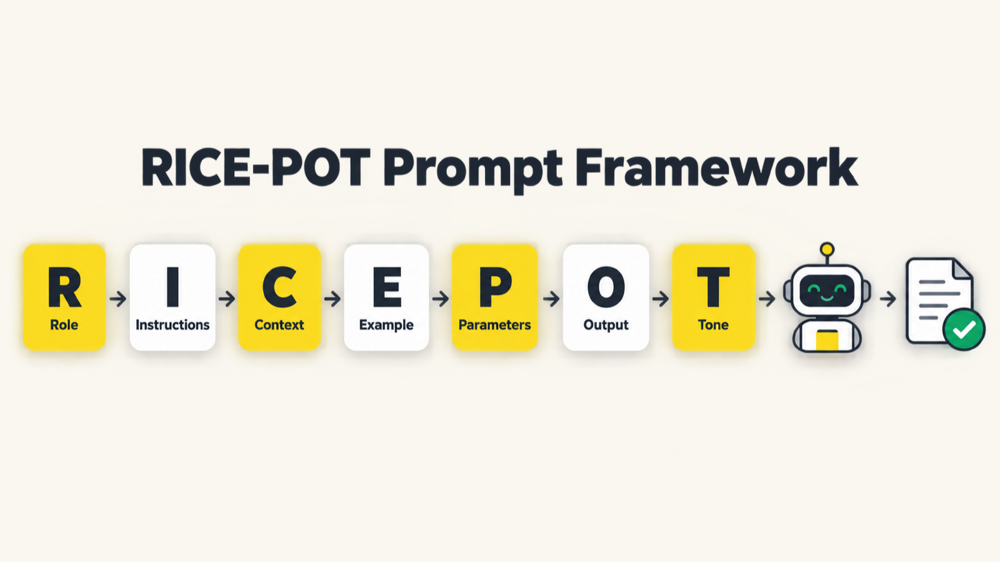

**Concept:** RICE-POT is a seven-part prompt template (**R**ole, **I**nstructions, **C**ontext, **E**xample, **P**arameters, **O**utput, **T**one) for getting production-quality test artifacts out of an LLM instead of toy snippets.

**Why:** A one-line prompt like "write Selenium code" gets you outdated APIs and invented methods; RICE-POT plus explicit anti-hallucination rules pins the model to real versions, real patterns, and a fixed output shape.

**Q&A: why use this?**
- **Q: When do I reach for it?** A: Any time you ask an AI for a framework, test plan, or test cases. The [generic QA template](00_chapter_Prompt_Eng/04_RICE_POT_Generic_QA_Template.md) covers all four task types.
- **Q: What does it replace?** A: Ad-hoc, one-line prompts that leave the model to guess your stack, your versions, and what "done" looks like.
- **Q: What's the gotcha?** A: A well-structured prompt can still produce invented APIs. Pin library versions and add "do NOT" rules ([03_Anti_Hallucinations.md](00_chapter_Prompt_Eng/03_Anti_Hallucinations.md)), then review the code before trusting it.

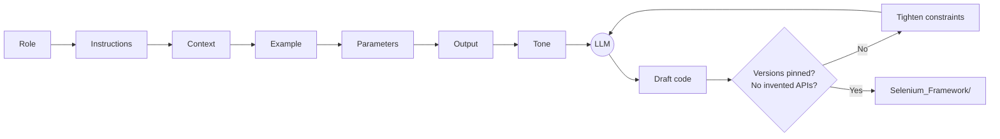

The anti-hallucination block from [03_Anti_Hallucinations.md](00_chapter_Prompt_Eng/03_Anti_Hallucinations.md), ready to paste under any RICE-POT prompt:

```markdown
Role: Senior SDET Automation Architect.
Task: Generate a test automation script for [Application/Workflow].

Constraints & Anti-Hallucination Rules:
1. Version Anchors: Java 17+, Selenium 4.x, TestNG 7.x.
2. Deprecation Checks:
   - Use `java.time.Duration` for timeouts.
   - Use `ChromeOptions` / `FirefoxOptions` (no `DesiredCapabilities`).
   - Use `WebDriverWait(driver, Duration.ofSeconds(x))` (no two-argument timeout with integer and TimeUnit).
3. Grounding: Rely strictly on standard Selenium 4 API calls. Do not invent custom methods on WebDriver or WebElement.
4. Completeness: Ensure all import statements are fully qualified and valid.
```

The full result of this prompt lives in [Selenium_Framework/](00_chapter_Prompt_Eng/Selenium_Framework/README.md).

---

## Chapter 01: JavaScript Basics

### 01: Hello World

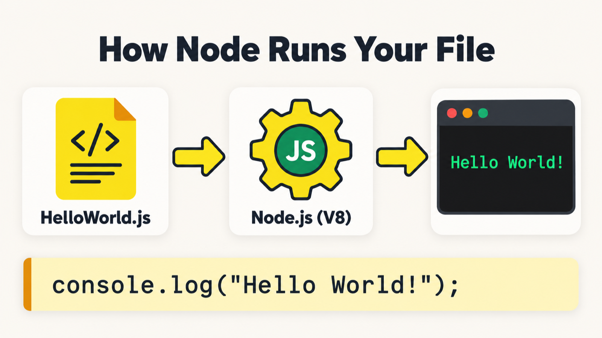

**Concept:** `console.log()` prints a value to the output. Run a `.js` file with `node <file>` and whatever you log appears in your terminal.

**Why:** Before variables, functions, or Playwright, you need one reliable way to see what your code is doing, and `console.log` is that tool.

**Q&A: why use this?**
- **Q: When do I reach for it?** A: Whenever you want to see a value while learning or debugging. In Playwright tests it is the first debugging tool you will use, long before the trace viewer.
- **Q: What does it replace?** A: Java's `System.out.println` or Python's `print`. Same idea, but JavaScript needs no class and no `main` method: one line is a whole program.
- **Q: What's the gotcha?** A: Where the output lands depends on where the code runs. With `node` it prints to your terminal; inside the browser (for example in Playwright's `page.evaluate`) it prints to the browser's DevTools console instead.

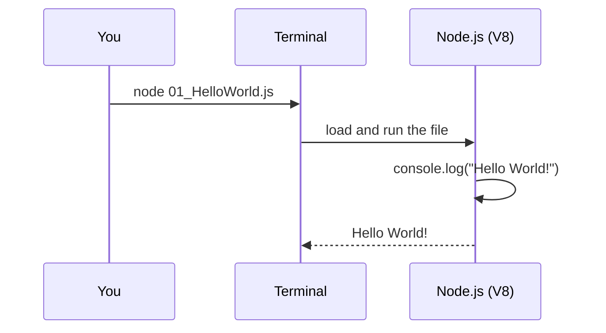

```js
// 01_chapter_JS_Basics/01_HelloWorld.js
console.log("Hello World!");
```

```bash
$ node 01_chapter_JS_Basics/01_HelloWorld.js
Hello World!
```

### 02: Math with Numbers

**Concept:** JavaScript evaluates an expression like `1+2` first and then hands the result to `console.log`, so you see `3`, not the text `1+2`.

**Why:** Tests constantly compute expected values (cart totals, row counts, page numbers), so you need to know how JavaScript does arithmetic before you assert on it.

**Q&A: why use this?**
- **Q: When do I reach for it?** A: Calculating an expected value inside a test, for example `expect(total).toBe(price * qty)` instead of hard-coding the answer.
- **Q: What does it replace?** A: Working numbers out by hand or in a calculator and pasting them into test data, which breaks as soon as the inputs change.
- **Q: What's the gotcha?** A: `+` is overloaded. If either side is a string it concatenates: `"1" + 2` gives `"12"`. Also, every JavaScript number is a 64-bit float, so `0.1 + 0.2` prints `0.30000000000000004`.

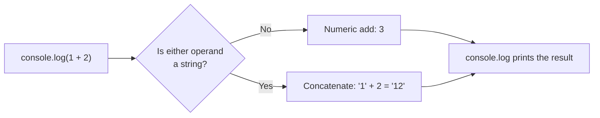

```js
// 01_chapter_JS_Basics/02_Math.js
console.log(1+2);
console.log(2*2);
```

```bash
$ node 01_chapter_JS_Basics/02_Math.js
3
4
```

| Operator | Meaning | Example | Result |
|:--------:|:--------|:--------|:------:|
| `+` | Add (or concatenate strings) | `1 + 2` | `3` |
| `-` | Subtract | `5 - 2` | `3` |
| `*` | Multiply | `2 * 2` | `4` |
| `/` | Divide (always a float) | `7 / 2` | `3.5` |
| `%` | Remainder | `7 % 2` | `1` |
| `**` | Power | `2 ** 3` | `8` |

---

## Chapter 02: Keywords and Identifiers

### 03: The JavaScript Engine

**Concept:** `node` hands your file to V8, Google's JavaScript engine. V8 parses the whole file, turns it into bytecode, runs that in an interpreter (Ignition), and recompiles "hot" code, code that runs many times like a loop body, into fast machine code (TurboFan). This is Just-In-Time (JIT) compilation.

**Why:** Knowing that JavaScript is compiled just in time, not read line by line, explains why a single syntax error stops the whole file and why loops get faster the longer they run.

**Q&A: why use this?**
- **Q: When do I reach for it?** A: When a file fails with `SyntaxError` and nothing prints, not even the `console.log` on line 1. V8 parses the entire file before it runs any of it.
- **Q: What does it replace?** A: The idea that JavaScript is "just interpreted". V8 interprets first, then optimises the hot paths, and drops back to the interpreter (deoptimises) if its assumptions about your values break.
- **Q: What's the gotcha?** A: The hot-code loop in `03_js_engine.js` is commented out for a reason: 100,000 iterations, each calling `console.log` twice, floods the terminal. It also calls `badCodeFn()` before the function is written, which works because function declarations are hoisted.

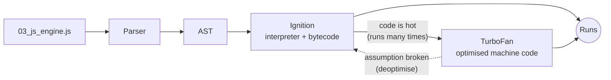

```js
// 02_chapter_JS_Keywrods_Identifiers/03_js_engine.js
let a = 10;
console.log(a);

// Hot Code
//  for (let a = 0; a < 100000; a++) {
//     console.log(a);
//     badCodeFn();
// }

// function badCodeFn() {
//     console.log("Hello");
// }
```

```bash
$ node 02_chapter_JS_Keywrods_Identifiers/03_js_engine.js
10
```

`04_letengine.js` is the smallest program you can feed the engine: a single `let x = 10;`. It prints nothing, but V8 still parses, compiles and runs it.

### 05: Keywords vs Identifiers: var, let, const

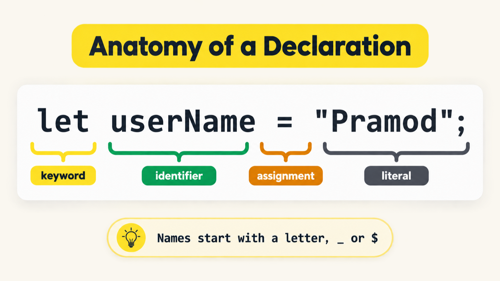

**Concept:** A keyword is a word the language owns (`var`, `let`, `const`, `if`, `class`, `return`). An identifier is the name you choose. In `let l = 10;`, `let` is the keyword, `l` is the identifier and `10` is the literal value.

**Why:** Every variable in a test (a URL, a timeout, an expected value) starts with one of these three keywords, so choosing between them is the first decision you make on every line.

**Q&A: why use this?**
- **Q: When do I reach for it?** A: `let` for values that change, `const` for values that are never reassigned (URLs, timeouts, config), `var` only when reading older code. The lesson's rule of thumb for QA scripts: `let` about 96%, `const` about 3%, `var` about 1%.
- **Q: What does it replace?** A: `var` was the only option before ES6 (2015). `var` is function-scoped and can be declared twice; `let` and `const` are block-scoped and a second declaration in the same scope is a `SyntaxError`.
- **Q: What's the gotcha?** A: `const` blocks reassignment, not change: `const arr = []; arr.push(1)` is fine. Reassigning a `const` throws `TypeError: Assignment to constant variable.`

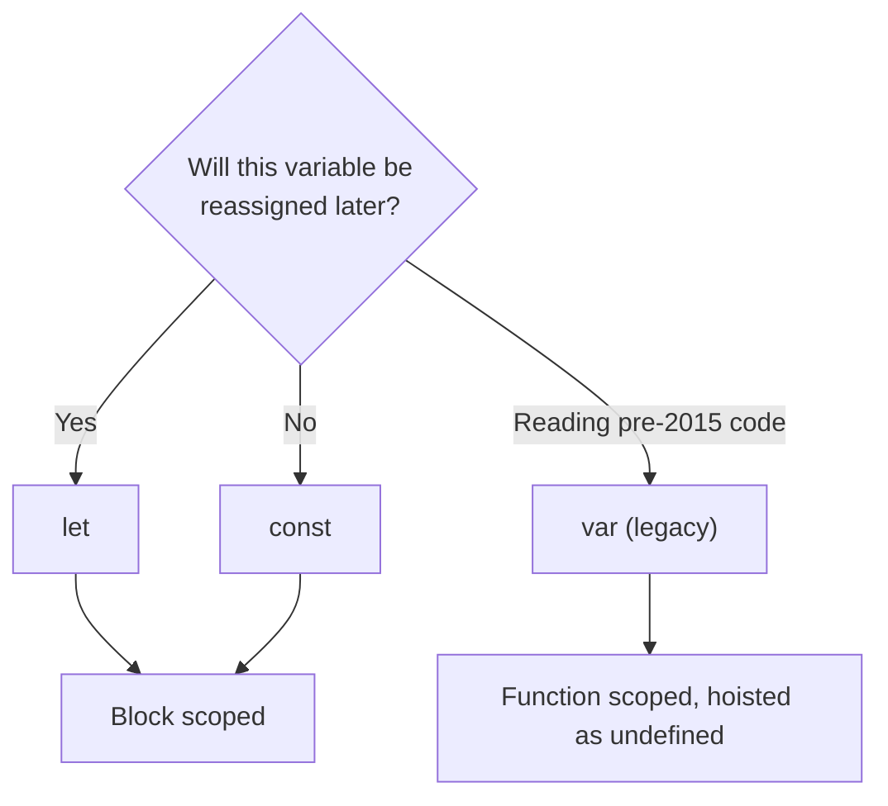

| | `var` | `let` | `const` |
|:--|:--:|:--:|:--:|
| Scope | Function | Block | Block |
| Declare twice in the same scope | ✅ Allowed | ❌ `SyntaxError` | ❌ `SyntaxError` |
| Reassign | ✅ | ✅ | ❌ `TypeError` |
| Use before the declaration line | `undefined` | ❌ `ReferenceError` | ❌ `ReferenceError` |

```js
// 02_chapter_JS_Keywrods_Identifiers/05_KW_IND.js
var v = 10;   // keyword: var,   identifier: v
let l = 10;   // keyword: let,   identifier: l
const c = 10; // keyword: const, identifier: c

// What happens when you break the rules:
// let l = 20;      SyntaxError: Identifier 'l' has already been declared
// c = 20;          TypeError: Assignment to constant variable.
```

### 06: Identifier Rules

**Concept:** An identifier must start with a letter, `_` or `$`. After the first character it may also contain digits. No spaces, no hyphens, no reserved words, and names are case sensitive.

**Why:** Breaking a rule is a `SyntaxError`, and because V8 parses the whole file first, one bad name stops the entire file from running.

**Q&A: why use this?**
- **Q: When do I reach for it?** A: Every time you name something. Check three things: the first character is a letter, `_` or `$`; the rest are letters, digits, `_` or `$`; the name is not a reserved word.
- **Q: What does it replace?** A: Nothing new if you know Java: the rules are nearly identical. Even `$` and `_` on their own are legal names (`var $ = 10; var _ = 10;`).
- **Q: What's the gotcha?** A: Names are case sensitive, so `Name` and `name` are two different variables. And the error rarely says "bad name": `var 45 = 34` throws `SyntaxError: Unexpected number`.

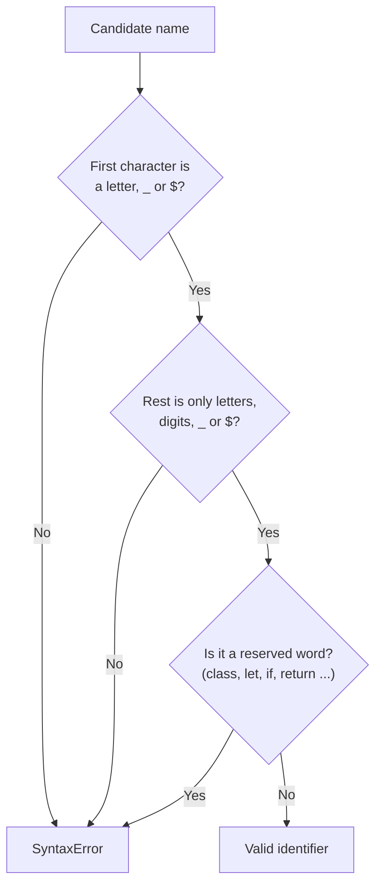

```js
// 02_chapter_JS_Keywrods_Identifiers/06_KW_IND_Rules.js (excerpt)
var a = 10;
var $ = 10;               // $ alone is a valid name
var _a = 23;
var _ = 10;               // _ alone is a valid name
var ab123 = 23;           // digits are fine after the first character

var Name = "pramod";      // Name and name are two
var name = "Amit";        // different variables

var pramod_dutta = "hello";
var pramod$dutta = "hello";

// var 45 = 34;              SyntaxError: Unexpected number
// var pramod dutta = "x";   SyntaxError: Unexpected identifier 'dutta'
```

### 07: Naming Conventions

**Concept:** Conventions are team agreements on how to write a name: camelCase for variables and functions, PascalCase for classes and constructors, SCREAMING_SNAKE_CASE for constants, snake_case mostly outside JavaScript.

**Why:** The engine accepts all of them; people reading your test need the casing to tell a class from a variable from a fixed config value at a glance.

**Q&A: why use this?**
- **Q: When do I reach for it?** A: camelCase for almost everything (`userName`, `isLoggedIn`), PascalCase for Page Object classes (`LoginPage`), SCREAMING_SNAKE_CASE for values that never change (`BASE_URL`, `MAX_RETRIES`).
- **Q: What does it replace?** A: Hungarian notation (`strName`, `bActive`, `nCount`), an older style that put the type in the name. TypeScript types do that job now, so modern style guides avoid it.
- **Q: What's the gotcha?** A: Conventions are not enforced. `This_is_a_very_long_name_variable` runs fine; only a linter (ESLint's `camelcase` rule) or a code review will catch it.

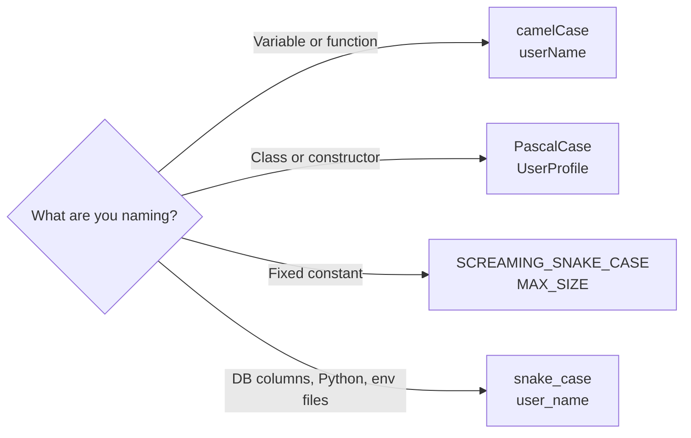

| Convention | Example | Used for in JS |
|:-----------|:--------|:---------------|
| camelCase | `totalPrice` | Variables, functions (the default) |
| PascalCase | `ShoppingCart` | Classes, constructors, Page Objects |
| SCREAMING_SNAKE_CASE | `API_KEY` | Constants and config |
| snake_case | `total_price` | Rare in JS; common in Python and SQL |
| Hungarian | `bActive` | Legacy code only |

```js
// 02_chapter_JS_Keywrods_Identifiers/07_IND_Rules2.js (excerpt)
let userName = "camelCase";          // 1. camelCase
let isLoggedIn = true;

let UserProfile = "PascalCase";      // 2. PascalCase

let user_name = "snake_case";        // 3. snake_case

const MAX_SIZE = 100;                // 4. SCREAMING_SNAKE_CASE
const API_KEY = "abc123";
// MAX_SIZE = 90;                    TypeError: Assignment to constant variable.

let strName = "string prefix";       // 5. Hungarian notation (older style)
let bActive = true;
```

### 08: Comments

**Concept:** Comments are text the engine skips. `//` comments out the rest of the line, `/* ... */` spans multiple lines, and `/** ... */` is a JSDoc block that editors like VS Code show as hover documentation.

**Why:** Comments explain why code exists, and commenting out a line is the fastest way to switch it off while debugging a test.

**Q&A: why use this?**
- **Q: When do I reach for it?** A: To explain intent, to switch a line off temporarily (`Cmd + /` on Mac, `Ctrl + /` on Windows and Linux in VS Code), and to add JSDoc to functions other people will call.
- **Q: What does it replace?** A: Nothing new if you know Java: the same `//`, `/* */` and `/** */` syntax. Javadoc becomes JSDoc.
- **Q: What's the gotcha?** A: Block comments do not nest. In `/* outer /* inner */ still code */` the comment ends at the first `*/`, so `still code */` is parsed as code and throws a `SyntaxError`.

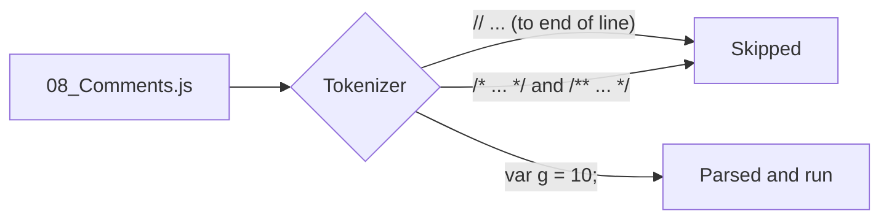

```js
// 02_chapter_JS_Keywrods_Identifiers/08_Comments.js
// This is a single-line comment, it will be ignored
// this line will not be executed

/*
 *  This is a multi-line comment
 *  Author : Pramod Dutta
 *  Date : 11-Jul-2026
 */

/**
 *  This is a JSDoc comment
 *  Author : Pramod Dutta
 *  Date : 14-Feb-2026
 **/

var g = 10; // cmd + /, ctrl + /
```

### 09: Interview Questions on Identifiers

**Concept:** A drill file of the identifier cases interviewers like to ask about: legal first characters, digits, Unicode names, escape sequences, case sensitivity, and the characters that break a name.

**Why:** These questions check whether you know the actual rule or only the everyday cases, and the edge cases (Unicode, escapes) are where people get caught.

**Q&A: why use this?**
- **Q: When do I reach for it?** A: Before an interview, or when a reviewer asks "is that even legal?". Run `node 02_chapter_JS_Keywrods_Identifiers/09_IQ.js`: it exits silently, which proves every uncommented line is valid.
- **Q: What does it replace?** A: Memorising a list. It is the same rule as lesson 06, applied to Unicode: `café` and `变量` are valid because `é` and `变` count as letters.
- **Q: What's the gotcha?** A: `let A = ...` declares a variable named `A`, because the escape is decoded before the name is checked. And `Function` is a built-in, not a reserved word: `let Function = "x"` runs and shadows the global. Reserved words such as `class` or `let` are the ones that fail.

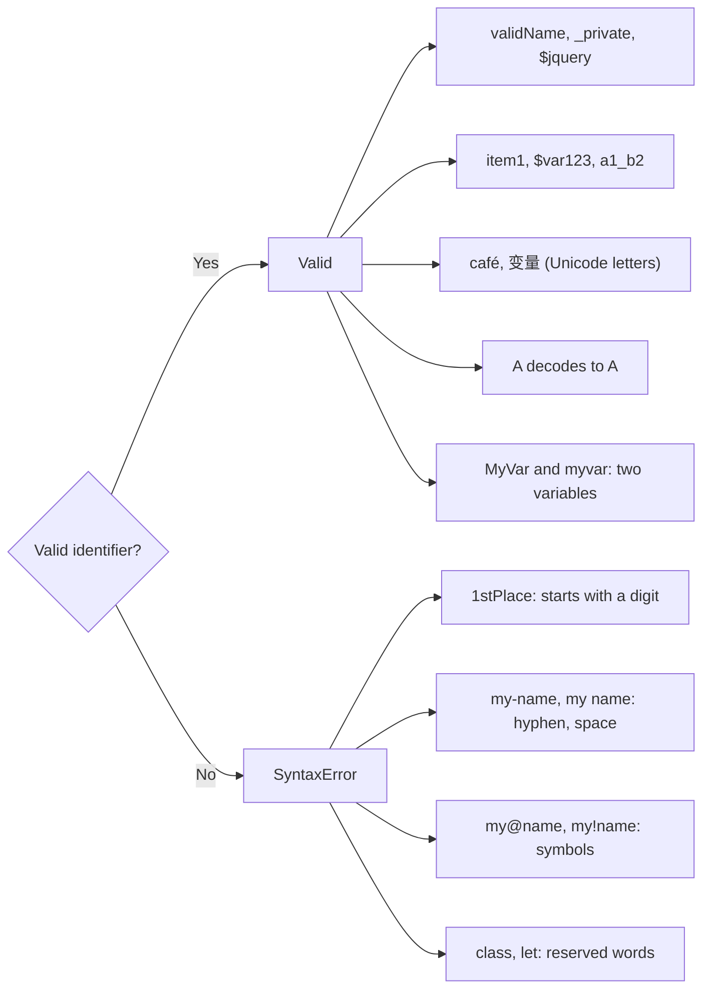

```js
// 02_chapter_JS_Keywrods_Identifiers/09_IQ.js (excerpt)
let validName = "starts with letter";
let _private = "starts with underscore";
let $jquery = "starts with dollar sign";
let a1_b2 = "mixed letters digits underscore";

// let 1stPlace = "invalid";     SyntaxError: Invalid or unexpected token

// let Function = "invalid";     but it actually works: Function is a
//                               built-in name, not a reserved word
let MyVar = "uppercase M";       // case sensitive:
let myvar = "lowercase v";       // two separate variables

let café = "Unicode letter é";
let 变量 = "Chinese characters";
let A = "Unicode escape for A";  // this variable is named A

// let my-name = "invalid";      SyntaxError: Unexpected token '-'
// let my name = "invalid";      SyntaxError: Unexpected identifier
// let my@name = "invalid";      SyntaxError: Unexpected token '@'
```

---

## Chapter 03: Literals

### 10: Literals and typeof

**Concept:** A literal is a fixed value typed straight into your code: `10`, `"pramod"`, `3.14`, `true`, `null`. `typeof` is an operator that tells you, as a string, which type a value has.

**Why:** Test data is full of literals (usernames, expected counts, flags), and `typeof` is the quickest way to check that a value read from a page or an API is the type you think it is.

**Q&A: why use this?**
- **Q: When do I reach for it?** A: When an assertion fails and you suspect a type mismatch, for example a count read from the page is `"5"` (string), not `5` (number). `console.log(typeof value)` settles it in one line.
- **Q: What does it replace?** A: Java's typed declarations (`String name = "pramod";`). In JavaScript the variable has no type, the value does, and `typeof` reads it at runtime.
- **Q: What's the gotcha?** A: `typeof null` is `"object"`, a bug from the first version of JavaScript that can never be fixed without breaking old websites. Also, `'single'` and `"double"` quotes make exactly the same string.

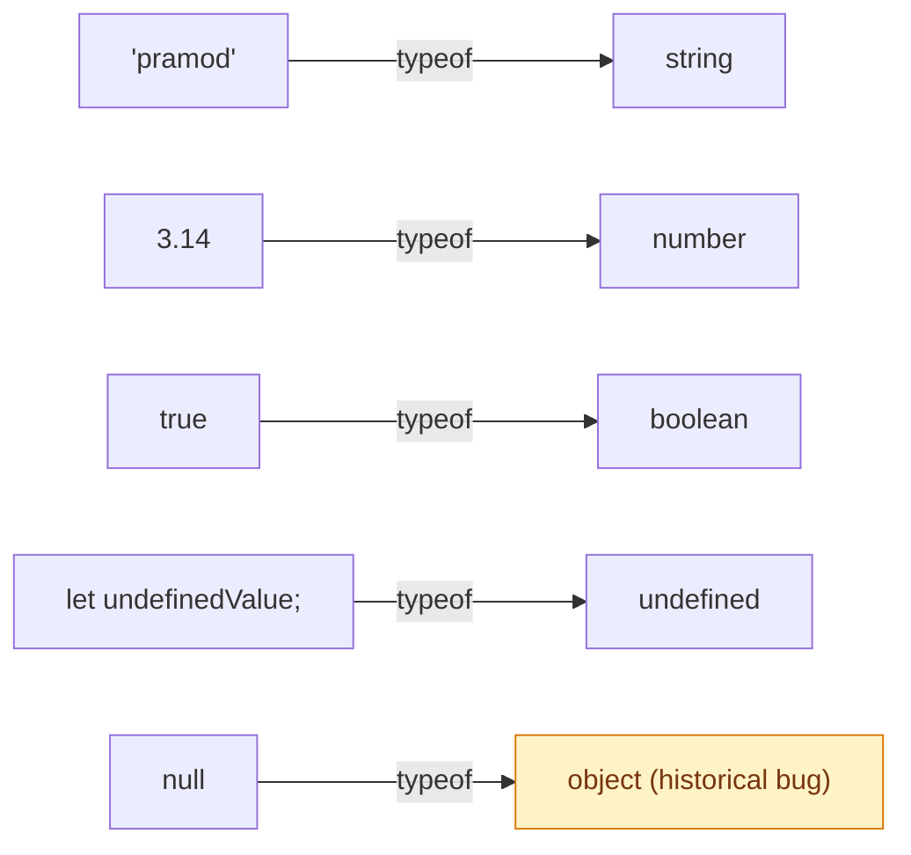

```js
// 03_chapter_JS_Literals/11_Numberal.js
let age = "pramod";     // string literal
let age2 = 'pramod';    // same string, single quotes
let isStudent = true;   // boolean literal
let pi = 3.14;          // numeric literal
let nullValue = null;   // null literal
let undefinedValue;     // no literal: JavaScript fills in undefined

console.log(typeof age);            // string
console.log(typeof age2);           // string
console.log(typeof pi);             // number
console.log(typeof isStudent);      // boolean
console.log(typeof nullValue);      // object
console.log(typeof undefinedValue); // undefined
```

`10_Literal.js` is the one-line version: in `let a = 10;` the literal is `10`.

### 12: null vs undefined

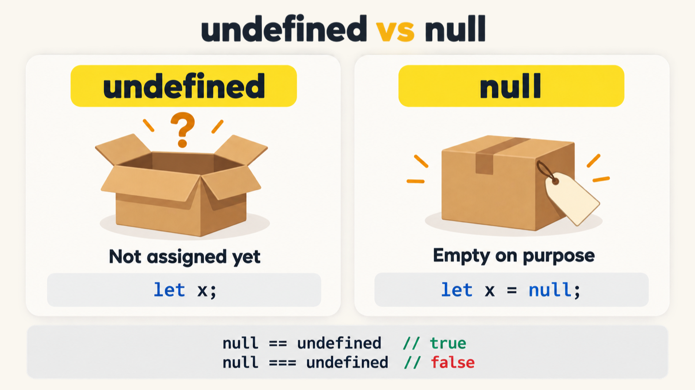

**Concept:** `undefined` means a variable exists but nothing has been assigned to it yet, and JavaScript sets it for you. `null` means "intentionally empty", and only you (or an API) set it.

**Why:** Both show up whenever a value might be missing (an optional field in an API response, an attribute that is not on the element), and they behave differently in comparisons.

**Q&A: why use this?**
- **Q: When do I reach for it?** A: Assign `null` when you mean "no value, on purpose" (`let profilePicture = null`). Leave `undefined` to JavaScript. In Playwright, `locator.getAttribute('href')` resolves to `null` when the attribute is missing.
- **Q: What does it replace?** A: Java has only `null`. JavaScript splits "not set yet" (`undefined`) from "deliberately empty" (`null`).
- **Q: What's the gotcha?** A: `null == undefined` is `true` but `null === undefined` is `false`, and `typeof null` is `"object"`. To test for null, write `value === null`; `typeof` cannot tell you.

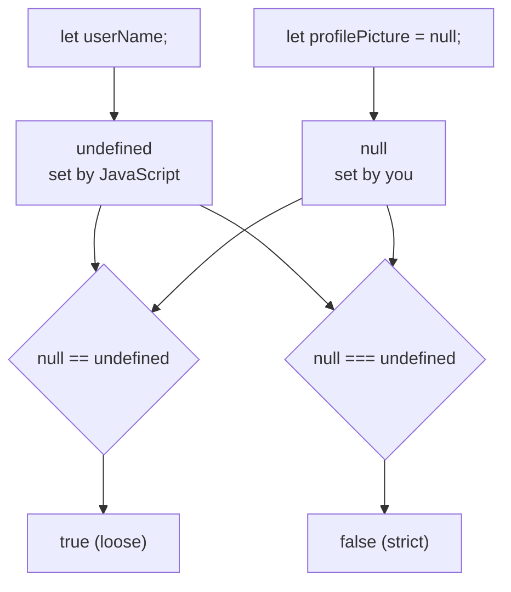

| Feature | `undefined` | `null` |
|:--------|:------------|:-------|
| Meaning | Not assigned yet | Intentionally empty |
| Who sets it? | JavaScript, automatically | The developer, manually |
| `typeof` | `"undefined"` | `"object"` (historical bug) |
| `null == undefined` | `true` | `true` |
| `null === undefined` | `false` | `false` |

```js
// 03_chapter_JS_Literals/12_Null_Undefined.js (excerpt)
let userName;                       // declared but not assigned
console.log(userName);              // undefined
console.log(typeof userName);       // undefined

let x;
x = 10;
console.log(x);                     // 10

let profilePicture = null;          // intentionally empty
console.log(profilePicture);        // null
console.log(typeof profilePicture); // object   <-- known JS quirk!
```

`13_Null.js` and `18_undefined.js` are two-line practice files: one variable left `undefined`, one set to `null`.

### 14: Number Literals: Bases and Exponents

**Concept:** JavaScript has one `number` type for whole numbers and decimals alike. You can write the same number in decimal (`42`), binary (`0b101010`), octal (`0o52`) or hex (`0x2A`), and very large or very small numbers in exponent form (`1.5e3`, `1.5e-4`).

**Why:** Hex shows up in colour codes (`0xFF0000`), exponent form keeps big values readable (`1e6`), and all of them are plain `number` underneath, so they mix freely.

**Q&A: why use this?**
- **Q: When do I reach for it?** A: Hex for colours and byte values, exponent form for very large or very small numbers, plain decimal for everything else.
- **Q: What does it replace?** A: Java's `int`, `long`, `float` and `double`. JavaScript has one `number` type (a 64-bit float), so `typeof 0xFF` is `"number"` and `5.` is the same value as `5`.
- **Q: What's the gotcha?** A: Always write octal with the `0o` prefix. A legacy leading zero (`017`) silently means 15 in a normal script and is a `SyntaxError` in strict mode. And skip `.5` and `5.`: they are valid but easy to misread.

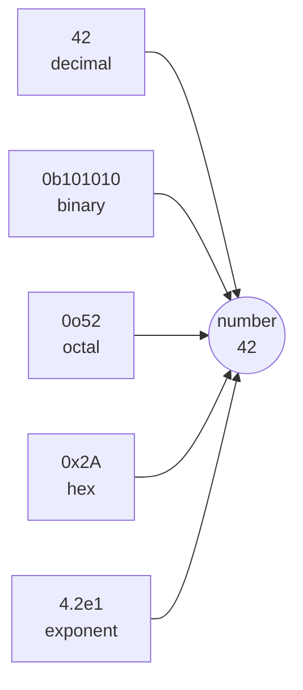

| Prefix | Base | Example | Value |
|:------:|:-----|:--------|:-----:|
| (none) | 10, decimal | `42` | 42 |
| `0b` | 2, binary | `0b1010` | 10 |
| `0o` | 8, octal | `0o52` | 42 |
| `0x` | 16, hex | `0x2A` | 42 |
| `e` | exponent (x 10ⁿ) | `1.5e3` | 1500 |

```js
// 03_chapter_JS_Literals/15_Number.js (excerpt)
let decimal = 42;
let binary = 0b1010;  // 10 in decimal
let octal = 0o52;     // 42 in decimal
let hex = 0x2A;       // 42 in decimal
console.log(decimal, binary, octal, hex);  // 42 10 42 42

let float1 = 3.14;
let float3 = .5;      // valid, but avoid for readability
let float4 = 5.;      // valid, but avoid for readability
console.log(float1, float3, float4);       // 3.14 0.5 5

let exp1 = 1.5e3;     // 1.5 * 10^3  = 1500
let exp2 = 1.5e-3;    // 1.5 * 10^-3 = 0.0015
let exp3 = 2E10;      // 2 * 10^10   = 20000000000
console.log(exp1, exp2, exp3);             // 1500 0.0015 20000000000

let h = 0xFF;         // from 14_Literals.js
console.log(typeof h);                     // number
```

### 16: Numeric Separators and BigInt

**Concept:** Underscores inside a number literal (`1_000_000`) are visual separators that the engine ignores. BigInt is a separate type for whole numbers too big for `number`: add an `n` to the end (`123n`) or call `BigInt("...")`.

**Why:** Separators make long numbers readable at a glance, and BigInt keeps very large integers exact where `number` would silently round them.

**Q&A: why use this?**
- **Q: When do I reach for it?** A: Separators in any long constant (`const TIMEOUT_MS = 30_000`). BigInt when an integer can go past `Number.MAX_SAFE_INTEGER` (9,007,199,254,740,991), for example 64-bit database IDs.
- **Q: What does it replace?** A: Java's `BigInteger`, but with literal syntax (`10n`) and the normal operators (`+`, `*`, `/`) instead of method calls.
- **Q: What's the gotcha?** A: You cannot mix the two types: `1n + 1` throws `TypeError: Cannot mix BigInt and other types`. And separators only work in code: `Number("1_000")` is `NaN`.

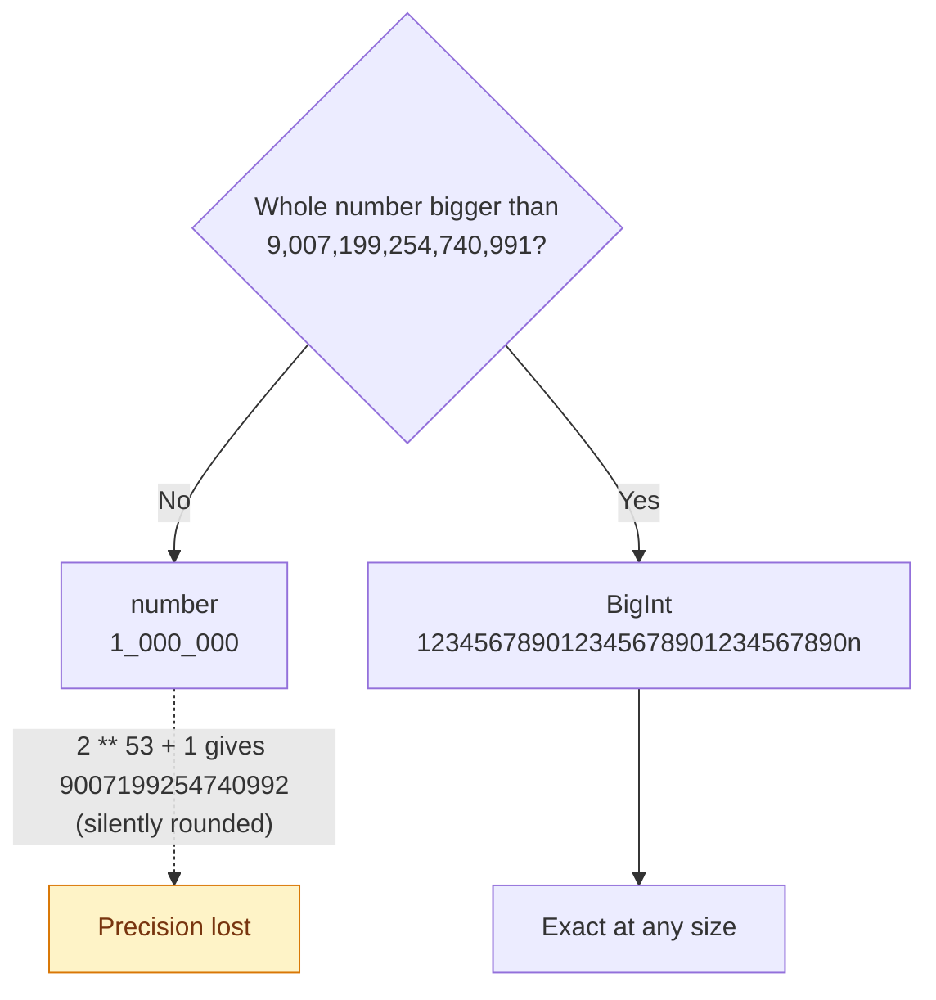

```js
// 03_chapter_JS_Literals/16_Numbers_PART2.js
let million = 1_000_000;      // same as 1000000
let binarySep = 0b1010_0001;
let hexSep = 0xFF_FF;

let big = 123456789012345678901234567890n;
let big2 = BigInt("123456789012345678901234567890");
let bigFromNum = BigInt(42);

console.log("BigInt literal:", big);          // 123456789012345678901234567890n
console.log("BigInt from string:", big2);     // 123456789012345678901234567890n
console.log("BigInt from number:", bigFromNum); // 42n
console.log("typeof BigInt:", typeof big);    // bigint
```

### 17: Special Numbers: Infinity and NaN

**Concept:** `Infinity`, `-Infinity` and `NaN` (Not a Number) are special values of type `number`. Dividing by zero gives `Infinity`; math with no numeric answer, like `0 / 0` or `"hello" * 2`, gives `NaN`.

**Why:** JavaScript never throws on bad arithmetic. It returns one of these values and keeps going, so a test can quietly compute `NaN` unless you check for it.

**Q&A: why use this?**
- **Q: When do I reach for it?** A: Whenever you convert page text to a number (`Number(priceText)`), check the result with `Number.isNaN()` before you assert on it.
- **Q: What does it replace?** A: Java's `ArithmeticException` on integer divide-by-zero. JavaScript has no arithmetic exceptions; you get `Infinity` or `NaN` back instead.
- **Q: What's the gotcha?** A: `NaN` is not equal to anything, itself included: `NaN === NaN` is `false`. Use `Number.isNaN(x)`. The older global `isNaN("hello")` returns `true` because it converts the string first.

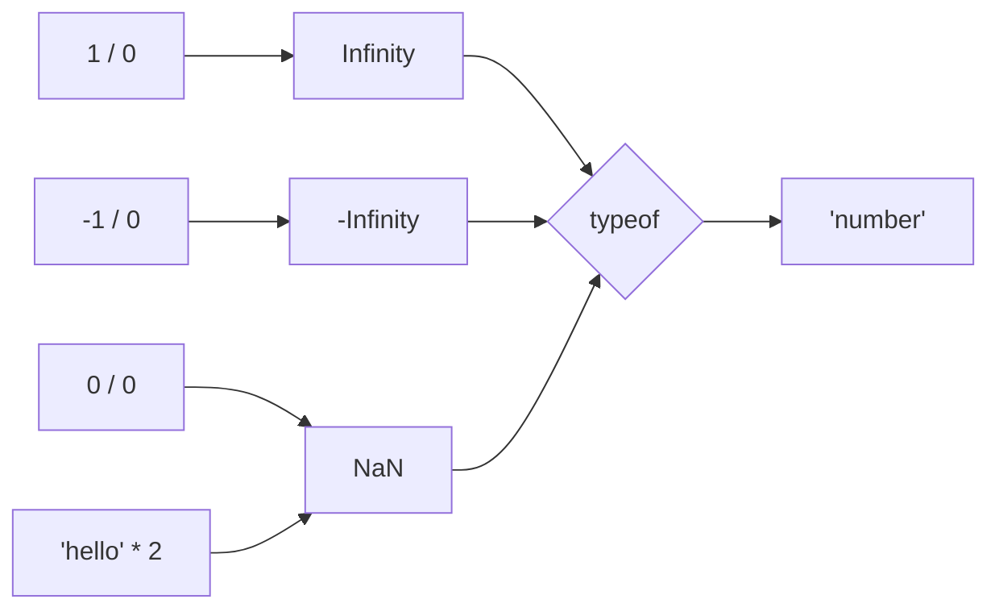

```js
// 03_chapter_JS_Literals/17_Special.js
console.log("Infinity:", Infinity);               // Infinity
console.log("1 / 0:", 1 / 0);                     // Infinity
console.log("-1 / 0:", -1 / 0);                   // -Infinity
console.log("typeof Infinity:", typeof Infinity); // "number"

console.log("NaN:", NaN);                         // NaN
console.log("0 / 0:", 0 / 0);                     // NaN
console.log("'hello' * 2:", "hello" * 2);         // NaN
console.log("typeof NaN:", typeof NaN);           // "number" (quirky!)
```

---

## Chapter 04: Operators

### 19: Expressions and Data Types

**Concept:** An expression combines values (operands) with operators to produce a new value. `let a = 10 + 3;` uses two operators: `+` computes `13`, then `=` stores it in `a`. Every value has one of eight types: seven primitives (`string`, `number`, `boolean`, `bigint`, `undefined`, `null`, `symbol`) plus `object`.

**Why:** Operators behave differently depending on the types of their operands, so the type list comes before the operator lessons.

**Q&A: why use this?**
- **Q: When do I reach for it?** A: Whenever an operator gives a surprising result, ask "what types are the operands?" first. `"5" + 1` is `"51"`, but `"5" - 1` is `4`.
- **Q: What does it replace?** A: Java's long list of numeric types (`byte`, `short`, `int`, `long`, `float`, `double`, `char`). JavaScript collapses them into `number` and `bigint` and has no `char`.
- **Q: What's the gotcha?** A: Arrays, `NaN` and `Infinity` are not types of their own. Arrays are objects (`typeof []` is `"object"`, so use `Array.isArray()`), and `NaN` and `Infinity` are values of type `number`.

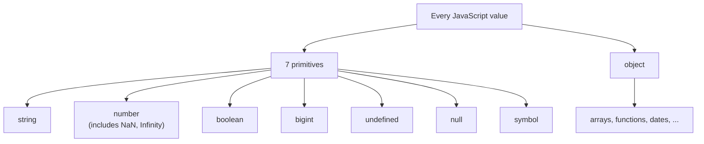

```js
// 04_chapter_JS_Operators/19_Arch.js (expanded)
let a = 10 + 3;     // 2 operators: + computes 13, = stores it
console.log(a);     // 13

console.log(typeof "pramod");     // string
console.log(typeof 42);           // number
console.log(typeof true);         // boolean
console.log(typeof 42n);          // bigint
console.log(typeof undefined);    // undefined
console.log(typeof null);         // object (null is still its own type)
console.log(typeof Symbol("id")); // symbol
console.log(typeof [1, 2, 3]);    // object (arrays are objects)
console.log(typeof NaN);          // number
```

### 20: Assignment Operators

**Concept:** `=` stores the value on its right in the variable on its left. A `let` variable can be reassigned, even to a value of a different type, and `x1 = x1 + 5` reads the old value, adds 5, and stores the result back.

**Why:** Counters, running totals and retry loops in tests all update a variable from its own previous value.

**Q&A: why use this?**
- **Q: When do I reach for it?** A: Every time you store or update a value. For updates, the compound forms say the same thing in less code: `x1 += 5` is `x1 = x1 + 5`.
- **Q: What does it replace?** A: The same `=` and compound operators as Java, minus the type check. JavaScript lets `x` go from `10` to `"PrrammodDutta"` without complaint; TypeScript brings that check back.
- **Q: What's the gotcha?** A: `=` assigns, `==` and `===` compare. `if (x = 5)` assigns 5 and is always true, a classic bug that JavaScript does not flag.

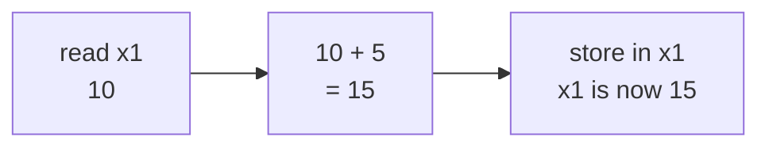

| Operator | Same as | Example (`x = 10`) | Result |
|:--------:|:--------|:-------------------|:------:|
| `=` | | `x = 5` | 5 |
| `+=` | `x = x + n` | `x += 5` | 15 |
| `-=` | `x = x - n` | `x -= 5` | 5 |
| `*=` | `x = x * n` | `x *= 2` | 20 |
| `/=` | `x = x / n` | `x /= 4` | 2.5 |
| `%=` | `x = x % n` | `x %= 3` | 1 |
| `**=` | `x = x ** n` | `x **= 2` | 100 |

```js
// 04_chapter_JS_Operators/20_Assigment_Op.js
let x = 10;
x = "PrrammodDutta";   // let allows a new value, even a new type
console.log(x);        // PrrammodDutta

let x1 = 10;
x1 = x1 + 5;           // read 10, add 5, store 15
console.log(x1);       // 15

x1 += 5;               // shorthand for x1 = x1 + 5
console.log(x1);       // 20
```

### 21: Arithmetic Operators

**Concept:** `+`, `-`, `*` and `/` do the usual math, `%` (modulus) gives the remainder after division, and `**` raises to a power. Division never truncates: `10 / 3` is `3.3333333333333335`.

**Why:** Tests compute expected values all the time (totals, page counts, even/odd rows), and `%` answers "is this even?" in one expression.

**Q&A: why use this?**
- **Q: When do I reach for it?** A: `%` for even/odd checks (`n % 2 === 0` means even), `**` for powers (`2 ** 3` is 8), and `/` with `Math.ceil` for page counts (`Math.ceil(25 / 10)` is 3 pages).
- **Q: What does it replace?** A: Java's integer division: in Java `10 / 3` is `3`, in JavaScript it is `3.3333333333333335`. Use `Math.floor()` or `Math.trunc()` to drop the decimals. `**` replaces `Math.pow()`.
- **Q: What's the gotcha?** A: `%` keeps the sign of the left side: `-7 % 2` is `-1`, so the odd check `n % 2 == 1` fails for negative numbers. Write `n % 2 !== 0` for odd.

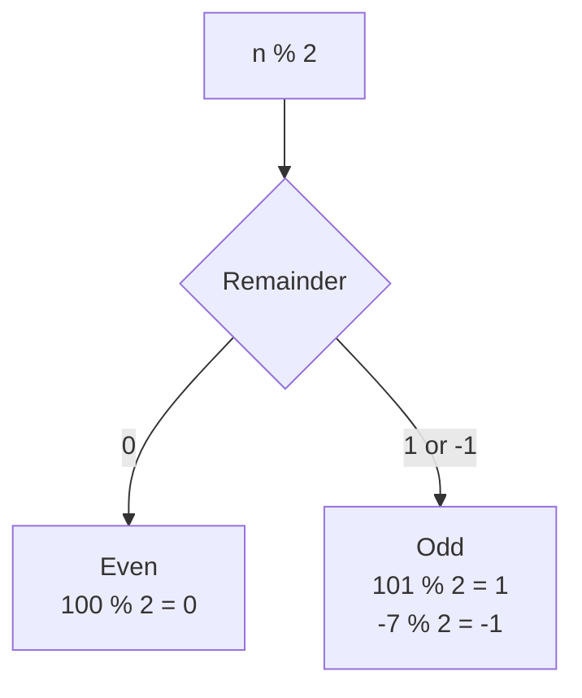

```js
// 04_chapter_JS_Operators/21_Arithematic_Op.js
let a = 10;
let b = 3;

console.log(a + b);   // 13
console.log(a - b);   // 7
console.log(a * b);   // 30
console.log(a / b);   // 3.3333333333333335

// Modulus -> % -> gives you the remainder
console.log(a % b);   // 1
console.log(13 % 7);  // 6
console.log(101 % 2); // 1  -> odd
console.log(100 % 2); // 0  -> even

// Exponential ** -> power, 2^3 = 8
console.log(2 ** 3);  // 8
console.log(a ** b);  // 1000 (10^3)
```

### 22: Comparison Operators (Loose vs Strict)

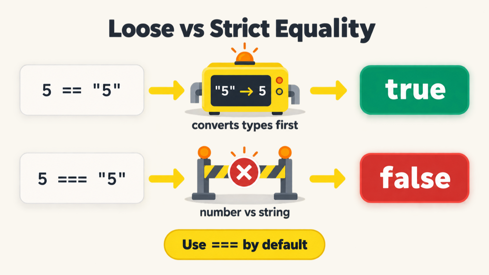

**Concept:** Comparison operators always return a boolean. `==` (loose) converts both sides to the same type before comparing; `===` (strict) compares both value and type with no conversion. `!=` and `!==` are their "not equal" versions, and `>`, `<`, `>=`, `<=` compare order.

**Why:** Assertions are comparisons, and loose equality can let a wrong value pass: `5 == "5"` is `true`.

**Q&A: why use this?**
- **Q: When do I reach for it?** A: Use `===` and `!==` by default. Playwright's `expect(x).toBe(y)` is strict as well (it uses `Object.is`), so `expect("5").toBe(5)` fails.
- **Q: What does it replace?** A: Java's `==` vs `.equals()` split. In JavaScript, `===` compares primitive values directly, so `"abc" === "abc"` is `true` with no `.equals()` call.
- **Q: What's the gotcha?** A: `>=` is not simply "`>` or `==`": `null >= 0` is `true` while `null == 0` is `false`, because the relational operators convert `null` to `0` and `==` does not.

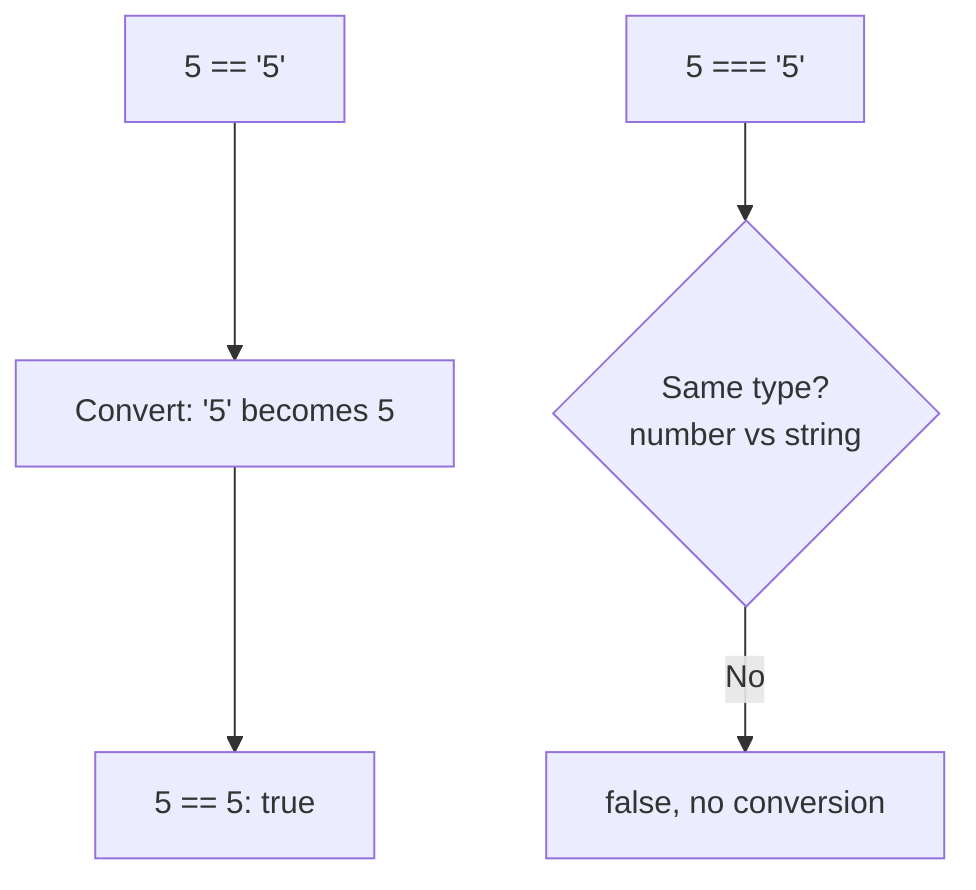

| Operator | Name | `5` vs `"5"` | Result |
|:--------:|:-----|:-------------|:------:|
| `==` | Loose equal | `5 == "5"` | `true` |
| `===` | Strict equal | `5 === "5"` | `false` |
| `!=` | Loose not equal | `5 != "5"` | `false` |
| `!==` | Strict not equal | `5 !== "5"` | `true` |

```js
// 04_chapter_JS_Operators/22_Comparsion_Op.js (excerpt)
console.log(3 > 4);      // false
console.log(3 < 4);      // true
console.log(4 >= 4);     // true

console.log(5 == "5");   // true:  loose, compares value only
console.log(5 === "5");  // false: strict, value + data type

console.log(5 != "5");   // false
console.log(5 !== "5");  // true
console.log(5 === 5);    // true
```

`26_Question.js` is a quick quiz on the same idea: `5 != "5"` is `false`, `5 !== "5"` is `true`. There is no `!===` operator; `5 !=== "5"` throws `SyntaxError: Unexpected token '='`.

### 23: Logical Operators

**Concept:** `&&` (AND) is true only when both sides are true, `||` (OR) is true when at least one side is true, and `!` (NOT) flips a boolean.

**Why:** Real conditions are rarely a single check: "logged in AND cart not empty", "on staging OR on dev".

**Q&A: why use this?**
- **Q: When do I reach for it?** A: Combining conditions in an `if`, and `||` for defaults: `const baseUrl = process.env.BASE_URL || "http://localhost:3000"`.
- **Q: What does it replace?** A: The same symbols as Java, but JavaScript returns one of the operands, not always a boolean: `"a" && "b"` is `"b"` and `null || "guest"` is `"guest"`. Both short-circuit: the right side only runs when it is needed.
- **Q: What's the gotcha?** A: `||` treats every falsy value (`0`, `""`, `null`, `undefined`, `NaN`, `false`) as missing, so `0 || 5` is `5`. When `0` or `""` is a valid value, use `??` instead: `0 ?? 5` is `0`.

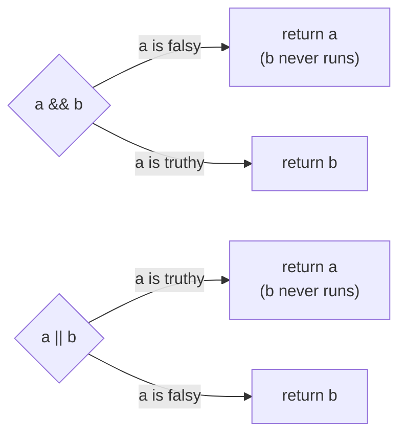

| `a` | `b` | `a && b` | `a \|\| b` | `!a` |
|:---:|:---:|:--------:|:----------:|:----:|
| `true` | `true` | `true` | `true` | `false` |
| `true` | `false` | `false` | `true` | `false` |
| `false` | `true` | `false` | `true` | `true` |
| `false` | `false` | `false` | `false` | `true` |

```js
// 04_chapter_JS_Operators/23_Logical_Op.js (plus short-circuit examples)
let a = true;
let b = false;

console.log(a && b);           // false
console.log(a || b);           // true
console.log(!a);               // false

console.log(null || "guest");  // guest (default value)
console.log(0 || 5);           // 5, because 0 is falsy
console.log(0 ?? 5);           // 0, ?? only replaces null/undefined
```

### 24: Confusing Comparisons

**Concept:** Because `==` converts types before comparing, it breaks rules you expect from math. `"" == 0` and `"0" == 0` are both `true`, yet `"" == "0"` is `false`, so equality is no longer transitive.

**Why:** These are the classic interview traps, and the same conversion can make a test pass when the page shows `""` where you expected `0`.

**Q&A: why use this?**
- **Q: When do I reach for it?** A: In interviews, and when reviewing code that uses `==`. The fix is always the same: switch to `===`.
- **Q: What does it replace?** A: Guessing. The rule: when one side is a number, `==` converts the other side to a number (`""` becomes `0`, `"0"` becomes `0`); two strings are compared as text, character by character.
- **Q: What's the gotcha?** A: The same rule creates more traps: `[] == false` is `true`, `null == 0` is `false` while `null >= 0` is `true`, and `NaN == NaN` is `false`.

```mermaid
flowchart TD
    E["empty string ''"] -->|"== 0: converted to number"| Z(("0"))
    S["string '0'"] -->|"== 0: converted to number"| Z
    E -.->|"'' == '0': both strings,<br/>compared as text"| F["false"]:::warn

    classDef warn fill:#fef3c7,stroke:#d97706,color:#78350f
```

```js
// 04_chapter_JS_Operators/24_Confusing_Comparsion.js
// Rule of thumb:
//   ==   → loose equality  (does type coercion, surprising)
//   ===  → strict equality (no coercion, what you usually want)

console.log("" == 0);    // true, "" coerced to Number → 0
console.log("0" == 0);   // true, "0" coerced to Number → 0
console.log("" == "0");  // false, both strings, compared as-is
// (transitivity broken) -> coerced

// === fixes it
console.log("" === 0);   // false
console.log("0" === 0);  // false
console.log("" === "0"); // false
```

### 27: String Concatenation and Template Literals

**Concept:** `+` joins two strings into one (`"Hello" + "World"` is `"HelloWorld"`) and `+=` appends to an existing string. Template literals use backticks and `${}` to drop values straight into text: `` `Response: ${responseTime}ms` ``.

**Why:** Test logs, error messages and URLs are built from pieces, and how you join them decides whether the output reads well or turns into `"Hello12"`.

**Q&A: why use this?**
- **Q: When do I reach for it?** A: Template literals for anything with a variable in it (`` `${baseUrl}/login` ``), `+=` to build a string step by step, and `console.log(a, b, c)` with commas for quick debugging, since it puts the spaces in for you.
- **Q: What does it replace?** A: Java's `String.format()` and long `"a" + b + "c"` chains. Template literals can also span several lines without `\n`.
- **Q: What's the gotcha?** A: `+` works left to right and switches to text the moment it meets a string: `1 + 2 + "Hello"` is `"3Hello"`, but `"Hello" + 1 + 2` is `"Hello12"`. A template literal avoids the surprise: `` `Hello ${1 + 2}` `` is `"Hello 3"`.

```mermaid
flowchart LR
    A["1 + 2 + 'Hello'"] --> A1["3 + 'Hello'"] --> A2["'3Hello'"]
    B["'Hello' + 1 + 2"] --> B1["'Hello1' + 2"] --> B2["'Hello12'"]
```

```js
// 04_chapter_JS_Operators/27_String.js (plus a template literal from 32_IQ.js)
let s = "Hi, ";
console.log(typeof s);                   // string
s += "Dev";                              // append to the same string
console.log(s);                          // Hi, Dev

console.log("HELLO", "Prrammod");        // HELLO Prrammod (commas add a space)
console.log("Hello" + "World");          // HelloWorld (+ adds nothing)
console.log(1, 2, 3, 4, "Hello", true);  // 1 2 3 4 Hello true

let sla = 1000;
console.log(`What is the SLA time ? - ${sla}`);  // What is the SLA time ? - 1000
```

### 28: Ternary Operator

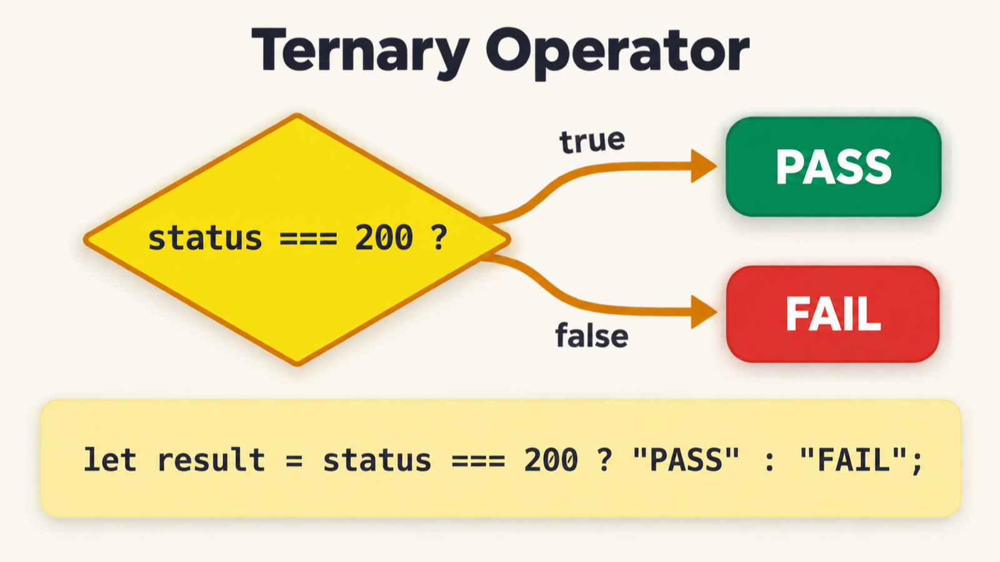

**Concept:** The ternary operator `condition ? valueIfTrue : valueIfFalse` is an `if/else` that produces a value. It is the only JavaScript operator that takes three operands.

**Why:** Tests constantly choose between two values (PASS or FAIL, headless or headed, prod or staging URL), and a ternary does it in one line you can assign straight to a variable.

**Q&A: why use this?**
- **Q: When do I reach for it?** A: When both branches produce a value and the condition is short: `actual === expected ? "✅ PASS" : "❌ FAIL"`. Use a full `if/else` when a branch has to do several things.
- **Q: What does it replace?** A: A five-line `if/else` whose only job is to set one variable. Java has the same `? :` operator.
- **Q: What's the gotcha?** A: Watch the boundary. `age > 18 ? "Yes" : "No"` answers "No" for an 18-year-old; if 18 should pass, write `age >= 18`. That is boundary value analysis, the same check you would run on a form field.

```mermaid
flowchart LR
    C{"age > 18 ?"} -->|true| Y["'Yes'"]
    C -->|false| N["'No'"]
    Y --> V["stored in can_I_go"]
    N --> V
```

```js
// 04_chapter_JS_Operators/28_Ternary_Op.js
let age = 17;
let can_I_go = age > 18 ? "Yes" : "No";
console.log(can_I_go);    // No

// 04_chapter_JS_Operators/29_T_Op.js
let actualStatusCode = 200;
let expectedStatusCode = 200;
let testResult = actualStatusCode === expectedStatusCode ? "✅ PASS" : "❌ FAIL";
console.log(testResult);  // ✅ PASS
```

### 30: Ternary in Test Code (Interview Practice)

**Concept:** Four short drills (`30_IQ.js` to `33_IQ.js`) that use a ternary the way real test frameworks do: a base URL per environment, headless vs headed browser, an SLA verdict, and one redundant pattern to avoid.

**Why:** Interviewers ask for exactly these one-liners, and they are the same lines you will write in a Playwright config.

**Q&A: why use this?**
- **Q: When do I reach for it?** A: Config-style decisions made once at the top of a file. The `playwright.config.ts` that `npm init playwright` generates does it too: `retries: process.env.CI ? 2 : 0`.
- **Q: What does it replace?** A: Hard-coding one environment and editing the file before every run.
- **Q: What's the gotcha?** A: `condition ? true : false` (`33_IQ.js`) is redundant: if `condition` is already a boolean, just write `condition`. If it might not be, use `Boolean(condition)`.

```mermaid
flowchart TD
    E{"environment === 'prod'"} -->|true| P["https://api.example.com"]
    E -->|false| S["https://staging-api.example.com"]
    C{"isCI"} -->|true| H["headless"]
    C -->|false| HD["headed"]
    R{"responseTime <= sla"} -->|true| W["Within SLA ✅"]
    R -->|false| B["SLA breached ❌"]
```

```js
// 04_chapter_JS_Operators/30_IQ.js
let environment = "staging";
let baseUrl = environment === "prod"
    ? "https://api.example.com"
    : "https://staging-api.example.com";
console.log(baseUrl);  // https://staging-api.example.com

// 31_IQ.js
let isCI = true;
let browserMode = isCI ? "headless" : "headed";
console.log("Launching browser in:", browserMode, "mode");  // Launching browser in: headless mode

// 32_IQ.js (adapted)
let responseTime = 850;  // ms
let sla = 1000;          // ms
let slaStatus = responseTime <= sla ? "Within SLA ✅" : "SLA breached ❌";
console.log(`Response: ${responseTime}ms, ${slaStatus}`);  // Response: 850ms, Within SLA ✅

// 33_IQ.js: this ternary adds nothing
let condition = true;
let isSKMale = condition ? true : false;  // same as: let isSKMale = condition;
console.log(isSKMale);                    // true
```

### 34: Nested Ternary

**Concept:** A ternary can sit inside another ternary to choose between more than two values. Chained flat (`a ? x : b ? y : z`), it reads like an `if / else if / else` ladder.

**Why:** Sorting a value into categories (HTTP status class, temperature band, age rules) is common in test reports and logs.

**Q&A: why use this?**
- **Q: When do I reach for it?** A: Three or four ordered bands, written one condition per line as in `35_IQ.js`. The first true condition wins, so order the checks from smallest to largest (or the reverse) and never mix the two.
- **Q: What does it replace?** A: An `if / else if / else` chain, or a `switch`, whose only job is to assign one variable.
- **Q: What's the gotcha?** A: Readability drops fast. A ternary nested in the middle, as in `34_Nested_Ternary.js`, is harder to follow than a flat chain, and past three branches most style guides (and ESLint's `no-nested-ternary` rule) prefer `if/else`.

```mermaid
flowchart TD
    S{"statusCode < 300"} -->|true| OK["Success"]
    S -->|false| R{"statusCode < 400"}
    R -->|true| RD["Redirect"]
    R -->|false| C{"statusCode < 500"}
    C -->|true| CE["Client Error"]
    C -->|false| SE["Server Error"]
```

```js
// 04_chapter_JS_Operators/34_Nested_Ternary.js
let age = 26;
let is_pramod_enjoy = (age > 18) ? (age > 25 ? "Goa & Drink" : "No Drink,ONly Goa") : "No Goa";
console.log(`Pramod can Enjoy ${is_pramod_enjoy}`);  // Pramod can Enjoy Goa & Drink

// 04_chapter_JS_Operators/35_IQ.js
let statusCode = 404;
let category =
    statusCode < 300 ? "Success" :
        statusCode < 400 ? "Redirect" :
            statusCode < 500 ? "Client Error" : "Server Error";
console.log(`Status ${statusCode}: ${category}`);   // Status 404: Client Error
```

`36_IQ.js` applies the same flat chain to temperature: `35` lands in the `"Hot"` band (`>= 30`).

### 37: The typeof Operator

**Concept:** `typeof` is an operator, not a function: it takes one operand and returns its type as a lowercase string such as `"string"` or `"number"`. Whole numbers and decimals both return `"number"`.

**Why:** When a value comes from outside your code (page text, JSON, environment variables), `typeof` is the one-word check that tells you what you actually received.

**Q&A: why use this?**
- **Q: When do I reach for it?** A: To guard input before using it: `if (typeof price === "number")`. The result is a string, so compare it with a string.
- **Q: What does it replace?** A: Java's `instanceof` and `getClass()`. JavaScript's `typeof` works on any value, and even on a variable that was never declared (`typeof notDeclared` is `"undefined"`, no error).
- **Q: What's the gotcha?** A: The classic interview twist: `typeof typeof 123` is `"string"`, because the inner `typeof` already returned the string `"number"`. And remember the two odd answers: `typeof null` is `"object"` and `typeof function () {}` is `"function"`.

```mermaid
flowchart LR
    V["123"] --> T1["typeof 123"] --> R1["'number'<br/>(a string)"] --> T2["typeof 'number'"] --> R2["'string'"]
```

| Value | `typeof` result |
|:------|:----------------|
| `"hello"` | `"string"` |
| `123`, `31.4`, `NaN` | `"number"` |
| `true` | `"boolean"` |
| `undefined` | `"undefined"` |
| `null` | `"object"` (historical bug) |
| `10n` | `"bigint"` |
| `Symbol()` | `"symbol"` |
| `function () {}` | `"function"` |
| `[]`, `{}` | `"object"` |

```js
// 04_chapter_JS_Operators/37_TypeOf.js (plus the commented cases)
console.log(typeof "hello");     // string
console.log(typeof 123);         // number
console.log(typeof 31.4);        // number
console.log(typeof true);        // boolean
console.log(typeof undefined);   // undefined
console.log(typeof null);        // object
console.log(typeof typeof 123);  // string
```

---

## Chapter 05: Increment, Decrement and Nullish

### 38: Pre vs Post Increment and Decrement

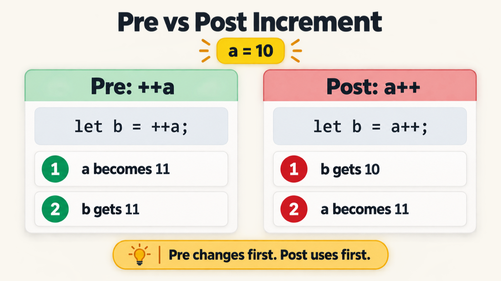

**Concept:** `++` adds 1 to a variable and `--` subtracts 1. Before the variable (`++a`, pre) it changes the value first and then hands back the new value; after the variable (`a++`, post) it hands back the old value and then changes it.

**Why:** Loop counters and retry counters use these every day, and pre vs post decides which value the surrounding expression actually sees.

**Q&A: why use this?**
- **Q: When do I reach for it?** A: Standalone counters like `i++` in a `for` loop or `retries++`, where pre vs post makes no difference because nothing reads the expression's value.
- **Q: What does it replace?** A: `a = a + 1` and `a += 1`. The operators and the pre/post rules are the same as in Java.
- **Q: What's the gotcha?** A: Only variables can change: `5++` is a `SyntaxError`, and `++` on a `const` throws `TypeError: Assignment to constant variable.` Also, `++` converts strings: `let s = "5"; s++` leaves `s` as the number `6`.

```mermaid
flowchart LR
    subgraph PRE["let b = ++a (pre)"]
        P1["a: 10 to 11"] --> P2["b gets 11"]
    end
    subgraph POST["let b = a++ (post)"]
        Q1["b gets 10"] --> Q2["a: 10 to 11"]
    end
```

| Code (start: `a = 10`) | `b` | `a` after |
|:-----------------------|:---:|:---------:|
| `let b = ++a;` | 11 | 11 |
| `let b = a++;` | 10 | 11 |
| `let b = --a;` | 9 | 9 |
| `let b = a--;` | 10 | 9 |

```js
// 05_chapter_JS_Incre_Decr_Op/38_ID_Op.js: pre-increment
let a = 10;
let b = ++a;          // a becomes 11, then b gets 11
console.log(b, a);    // 11 11

// 39_ID.js: post-increment (variables renamed so this runs as one file)
let c = 10;
let d = c++;          // d gets 10, then c becomes 11
console.log(d, c);    // 10 11

// 43_De.js and 44.js: the same rules with --
let e = 10;
console.log(--e, e);  // 9 9
let f = 10;
console.log(f--, f);  // 10 9
```

### 40: Increment Interview Questions

**Concept:** Three drills (`40_IQ.js` to `42_IQ.js`) that mix pre and post increment in one expression. Solve them by reading left to right and writing down the variable's value after every step.

**Why:** These are favourite interview questions precisely because guessing fails and tracing works.

**Q&A: why use this?**
- **Q: When do I reach for it?** A: In interviews. In real code, keep one `++` per statement so nobody has to trace it.
- **Q: What does it replace?** A: Guessing. Trace with two columns: the value each operand uses, and the variable after that step.
- **Q: What's the gotcha?** A: Each `++` updates the variable immediately, so operands further right see the new value. In `++a + a`, the second `a` is already 11.

```mermaid
flowchart LR
    S0["a = 10"] --> S1["++a<br/>uses 11, a = 11"] --> S2["a<br/>uses 11, a = 11"] --> S3["a++<br/>uses 11, a = 12"] --> R["11 + 11 + 11 = 33"]
```

| Expression | Values used | Result | Variable after |
|:-----------|:------------|:------:|:--------------:|
| `++a + a` (a = 10) | 11 + 11 | 22 | a = 11 |
| `++a + a + a++` (a = 10) | 11 + 11 + 11 | 33 | a = 12 |
| `i++ + ++i` (i = 1) | 1 + 3 | 4 | i = 3 |

```js
// 05_chapter_JS_Incre_Decr_Op/40_IQ.js
let a = 10;
console.log(++a + a);        // 22  (11 + 11)
console.log(a);              // 11

// 41_IQ.js (variable renamed so this runs as one file)
let b = 10;
console.log(++b + b + b++);  // 33  (11 + 11 + 11)
console.log(b);              // 12

// 42_IQ.js
let i = 1;
let result = i++ + ++i;      // i++ uses 1 (i is now 2), ++i makes i 3 and uses 3
console.log(result, i);      // 4 3
```

### 45: Nullish Coalescing (??)

**Concept:** `a ?? b` returns `a` unless `a` is `null` or `undefined`; in that case it returns the fallback `b`.

**Why:** API responses and config values are often missing, and `??` supplies a safe default without throwing away real values like `0` or `""`.

**Q&A: why use this?**
- **Q: When do I reach for it?** A: Defaults for data that may be absent: `let responsedata = api_response ?? "{}"`. Its sibling `??=` assigns only when the variable is null or undefined: `timeout ??= 30_000`.
- **Q: What does it replace?** A: `||` for defaults. `||` also replaces `0`, `""` and `false`; `??` only replaces `null` and `undefined`. So `0 || 5` is `5`, but `0 ?? 5` is `0`.
- **Q: What's the gotcha?** A: You cannot mix `??` with `||` or `&&` without parentheses: `a || b ?? c` is a `SyntaxError`. Write `(a || b) ?? c`.

```mermaid
flowchart TD
    V{"Is the left side null<br/>or undefined?"} -->|Yes| F["Return the fallback<br/>'NANDANI Milk'"]
    V -->|No| L["Return the left side<br/>(even 0, '' or false)"]
```

| `value` | `value ?? "x"` | `value \|\| "x"` |
|:--------|:--------------:|:----------------:|
| `null` | `"x"` | `"x"` |
| `undefined` | `"x"` | `"x"` |
| `0` | `0` | `"x"` |
| `""` | `""` | `"x"` |
| `false` | `false` | `"x"` |
| `"Pramod"` | `"Pramod"` | `"Pramod"` |

```js
// 05_chapter_JS_Incre_Decr_Op/45_Nullish.js (commented examples switched on)
let amul = null;
let val = amul ?? "NANDANI Milk";
console.log(val);            // NANDANI Milk

let api_response = null;
let responsedata = api_response ?? "{}";
console.log(responsedata);   // {}

let api_response1 = "Pramod";
let responsedata1 = api_response1 ?? "{}";
console.log(responsedata1);  // Pramod
```

---

## Chapter 06: if, else and else if

### 46: if and else

**Concept:** `if (condition) { ... } else { ... }` runs the first block when the condition is true and the `else` block otherwise. Exactly one of the two blocks runs.

**Why:** Tests branch all the time: skip a step on mobile, log in only when the session has expired, retry only after a failure.

**Q&A: why use this?**
- **Q: When do I reach for it?** A: Whenever a branch has to do something (one or more statements), not just produce a value. For a value-only choice, a ternary (lesson 28) is shorter.
- **Q: What does it replace?** A: Nothing new if you know Java: same syntax, same braces. One difference: the condition does not have to be a boolean. JavaScript converts it, so `if (0)` and `if ("")` take the `else` branch.
- **Q: What's the gotcha?** A: Boundaries again. With `age = 18`, `age > 18` goes to `else`. Decide whether the edge value belongs in the `if`, and use `>=` when it does.

```mermaid
flowchart TD
    C{"age > 18"} -->|true| G["Go Goa"]
    C -->|false| N["No Goa"]
    G --> E["continue with the rest of the program"]
    N --> E
```

```js
// 06_chatper_if_else_statement_Condition/46_IF.js (plus a falsy check)
let age = 16;
if (age > 18) {
    console.log("Go Goa");
} else {
    console.log("No Goa");   // runs: 16 > 18 is false
}

if ("") {
    console.log("never runs");
} else {
    console.log("an empty string is falsy");   // runs
}
```

### 47: Nested if

**Concept:** An `if` inside another `if` checks a second condition only after the first one has passed.

**Why:** Some rules only make sense in context: "over 26?" is only worth asking for someone who already passed "over 18?".

**Q&A: why use this?**
- **Q: When do I reach for it?** A: When the inner check depends on the outer one, for example "is the user logged in?" and then "do they have the admin role?". Two levels are fine.
- **Q: What does it replace?** A: One long condition such as `age > 18 && age > 26`, which cannot print the `Goa Check!` step that happens in between.
- **Q: What's the gotcha?** A: Deep nesting gets hard to read quickly. Past two levels, flatten it with an `else if` ladder (lesson 49) or early `return`s inside a function.

```mermaid
flowchart TD
    A{"age > 18"} -->|false| N["No Goa"]
    A -->|true| G["Goa Check!"] --> B{"age > 26"}
    B -->|true| D["Drink and Goa"]
    B -->|false| O["Only Goa, no Drink"]
```

```js
// 06_chatper_if_else_statement_Condition/47_IF_Else_Nested.js
let age = 27;
if (age > 18) {
    console.log("Goa Check!");
    if (age > 26) {
        console.log("Drink and Goa");
    } else {
        console.log("Only Goa, no Drink");
    }
} else {
    console.log("No Goa");
}
// Output: Goa Check!, Drink and Goa
```

### 48: Ternary vs if and else

**Concept:** `48_TO_IfElse.js` writes the same decision twice: once as a ternary that produces a value, and once as an `if/else` that runs several statements.

**Why:** Picking the right form keeps code short where it can be and readable where it has to be.

**Q&A: why use this?**
- **Q: When do I reach for it?** A: A ternary when you need a value (`let result = age > 21 ? "Drive" : "No Able to DRIve"`); `if/else` when a branch runs more than one statement (Drive, Drink, Go goa).
- **Q: What does it replace?** A: Neither replaces the other. A ternary is an expression (it has a value); `if/else` is a statement (it does things).
- **Q: What's the gotcha?** A: In the file, `result` is computed but never used. Reach for a ternary only when you use its value; for side effects such as `console.log`, `if/else` is clearer.

```mermaid
flowchart LR
    Q{"Do you need a value<br/>or an action?"} -->|"a value"| T["ternary<br/>cond ? a : b"]
    Q -->|"one or more actions"| I["if / else"]
```

| | Ternary | `if / else` |
|:--|:--:|:--:|
| Produces a value | ✅ | ❌ |
| Several statements per branch | ❌ | ✅ |
| Assigns straight to a variable | ✅ | ❌ (assign inside each branch) |
| Best for | Picking one of two values | Running one of two blocks |

```js
// 06_chatper_if_else_statement_Condition/48_TO_IfElse.js
let age = 20;
let result = age > 21 ? "Drive" : "No Able to DRIve";   // a value

if (age > 21) {                                          // actions
    console.log("Drive");
    console.log("Drink");
    console.log("Go goa");
} else {
    console.log("No Able to DRIve");
}
```

### 49: else if Ladder: Grade Calculator

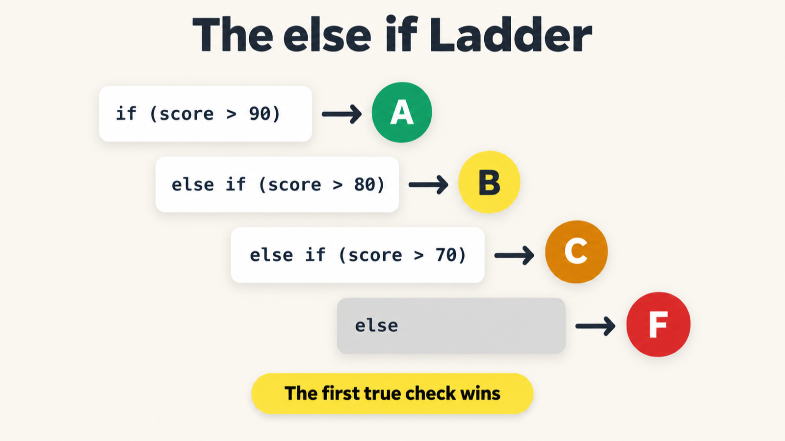

**Concept:** An `if / else if / else` chain checks its conditions from top to bottom and runs only the first block whose condition is true. The final `else` catches everything left over.

**Why:** Mapping a number into bands (grades, HTTP status classes, SLA levels) is a classic interview task and a common helper in test code.

**Q&A: why use this?**
- **Q: When do I reach for it?** A: More than two outcomes that depend on ranges. Validate the input first (`score > 100 || score < 0` prints "Invalid score") so the ladder only ever sees legal values.
- **Q: What does it replace?** A: A stack of separate `if`s, which could run several blocks for one score. With `else if`, once a band matches, the rest are skipped.
- **Q: What's the gotcha?** A: Boundaries. The spec says 50 is an E, and an earlier version of this file wrote `score > 50 && score <= 60`, which sent 50 to F. It now uses `score >= 50`. Testing the edges (0, 49, 50, 60, 61, 90, 91, 100) is exactly how you catch a bug like that. Also, because the ladder runs top-down, the `&& score <= 90` halves are redundant: if `score > 90` were true, the first branch would already have run.

```mermaid
flowchart TD
    V{"score > 100 or score < 0"} -->|true| INV["Invalid score"]
    V -->|false| A{"score > 90"}
    A -->|true| GA["A: Excellent"]
    A -->|false| B{"score > 80"}
    B -->|true| GB["B: Very Good"]
    B -->|false| C{"score > 70"}
    C -->|true| GC["C: Good"]
    C -->|false| D{"score > 60"}
    D -->|true| GD["D: Average"]
    D -->|false| E{"score >= 50"}
    E -->|true| GE["E: Needs Improvement"]
    E -->|false| F["F: Fail"]
```

| Score | Spec says | `49_Multiple_ifelse.js` prints |
|:-----:|:---------:|:-------------------------------|
| 101 | Invalid | Invalid score ✅ |
| 100 | A | Grade A - Excellent ✅ |
| 91 | A | Grade A - Excellent ✅ |
| 90 | B | Grade B - Very Good ✅ |
| 61 | D | Grade D - Average ✅ |
| 60 | E | Grade E - Needs Improvement ✅ |
| 50 | E | Grade E - Needs Improvement ✅ (was F before the `>= 50` fix) |
| 49 | F | Grade F - Fail ✅ |
| 0 | F | Grade F - Fail ✅ |

```js
// 06_chatper_if_else_statement_Condition/49_Multiple_ifelse.js (code part)
let score = 95;

if (score > 100 || score < 0) {
    console.log("Invalid score");
} else {
    if (score > 90) {
        console.log(" Grade A - Excellent");
    }
    else if (score > 80 && score <= 90) {
        console.log("Grade B - Very Good");
    }
    else if (score > 70 && score <= 80) {
        console.log("Grade C - Good");
    }
    else if (score > 60 && score <= 70) {
        console.log("Grade D - Average");
    }
    else if (score >= 50 && score <= 60) {  // >= so that 50 is an E, as the spec says
        console.log("Grade E - Needs Improvement");
    }
    else {
        console.log("Grade F - Fail");
    }
}
```

---

## Chapter 07: switch

### 50: switch Basics

**Concept:** `switch (value)` compares one value against a list of `case`s and jumps to the first match. `break` leaves the switch, and `default` runs when nothing matches.

**Why:** When one variable picks between many fixed options (day number, status code, browser name), a `switch` reads more cleanly than a long `else if` chain.

**Q&A: why use this?**
- **Q: When do I reach for it?** A: Many exact values of one variable. For ranges (`score > 90`), an `else if` ladder fits better (or `switch (true)`, lesson 56).
- **Q: What does it replace?** A: A chain like `if (day === 1) ... else if (day === 2) ...`. Java has the same `switch`, `case`, `break` and `default`.
- **Q: What's the gotcha?** A: All cases share one block scope, so `let a` inside `case 2` belongs to the whole switch. Declaring `let a` again in another case is `SyntaxError: Identifier 'a' has already been declared`; wrap each case body in `{ }` to give it its own scope.

```mermaid
flowchart TD
    S{"switch (day)"} -->|"case 1"| M["Monday"]
    S -->|"case 2"| T["Tue, then a + b = 40"]
    S -->|"case 3 to 7"| O["Wed ... Sun"]
    S -->|"no match"| D["default: No idea which day it is"]
    M --> BR["break: leave the switch"]
    T --> BR
    O --> BR
```

```js
// 07_chapter_switch/50_switch.js (excerpt)
let day = 2;
switch (day) {
    case 1:
        console.log("Monday");
        break;
    case 2:
        console.log('Tue');
        let a = 10;
        let b = 30;
        console.log(a + b);   // 40
        break;
    case 3:
        console.log('Wed');
        break;
    // ... cases 4 to 7
    default:
        console.log("No idea which day it is");
}
// Output: Tue, 40
```

### 51: Fall-Through (Missing break)

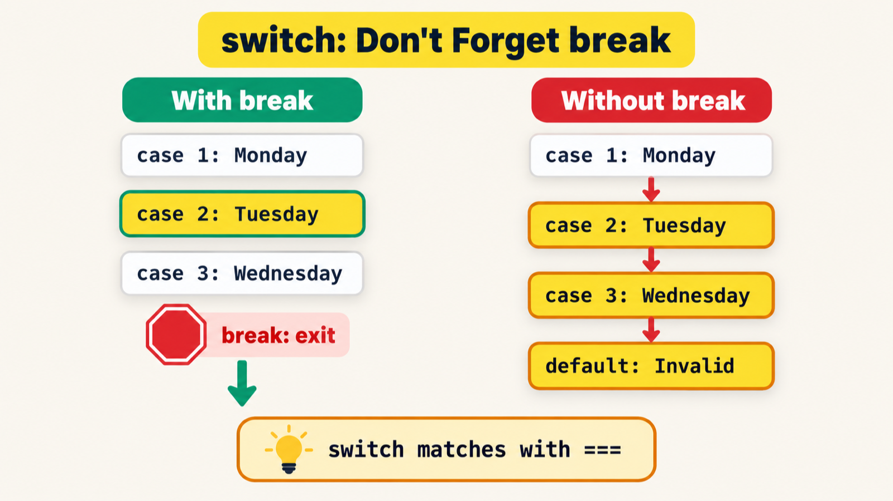

**Concept:** Without `break`, a matching `case` runs its code and then keeps going into every case below it, `default` included. This is called fall-through.

**Why:** It is the most common `switch` bug and a favourite interview question (`51_IQ.js`, `55_IQ.js`).

**Q&A: why use this?**
- **Q: When do I reach for it?** A: On purpose, only when several cases share code, and then the cases are stacked with no code between them (lesson 53). Everywhere else, end each case with `break` (or `return` inside a function).
- **Q: What does it replace?** A: Nothing; it is how `switch` works in JavaScript, Java and C. `52_IQ.js` is the fixed version with a `break` in every case, and its `day = 10` lands on `default`.
- **Q: What's the gotcha?** A: The cases below the match run even though their values do not match: with `day = 2` in `51_IQ.js`, Tuesday through Saturday and `default` all print. ESLint's `no-fallthrough` rule flags this.

```mermaid
flowchart TD
    M["case 2 matches"] --> T["Tuesday"] --> W["Wednesday"] --> TH["Thursday"] --> F["Friday"] --> SA["Saturday"] --> D["default: Invalid day value"]
    N["No break anywhere,<br/>so it keeps falling"] -.-> W
```

```js
// 07_chapter_switch/55_IQ.js
let fruit = "banana";
switch (fruit) {
    case "apple":
        console.log("Apple selected");
    case "banana":
        console.log("Banana selected");   // match: starts here
    case "cherry":
        console.log("Cherry selected");   // falls through
    case "date":
        console.log("Date selected");     // falls through
    default:
        console.log("Default reached");   // falls through
}
// Output: Banana selected, Cherry selected, Date selected, Default reached
```

### 53: Status Codes and Grouped Cases

**Concept:** A `switch` on a response code maps each code to an action (`53_API_Switch.js`), and stacking several `case` labels with no code between them makes them share one block (`54_Switch_Group.js`).

**Why:** API tests branch on status codes, and cross-browser tests often treat a whole family of browsers the same way.

**Q&A: why use this?**
- **Q: When do I reach for it?** A: Grouped cases when several values need identical handling: Chrome, Edge, Brave and Opera are all Chromium, so one block covers them.
- **Q: What does it replace?** A: `if (browser === "Chrome" || browser === "Edge" || browser === "Brave" || browser === "Opera")`.
- **Q: What's the gotcha?** A: Matching is exact and case-sensitive: `"chrome"` does not match `case "Chrome"` and drops to `default`. Normalise first, for example `switch (browser.toLowerCase())` with lowercase cases.

```mermaid
flowchart LR
    C["Chrome"] --> CH["Chromium Project!"]
    E["Edge"] --> CH
    B["Brave"] --> CH
    O["Opera"] --> CH
    FF["Firefox"] --> MZ["Mozilla Project!"]
    SF["Safari"] --> AP["Apple browser"]
    X["anything else"] --> DF["default: manual testing needed"]
```

```js
// 07_chapter_switch/53_API_Switch.js
let responseCode = 404;
switch (responseCode) {
    case 200:
        console.log("200 Ok");
        break;
    case 404:
        console.log("404 Not found!");        // runs
        break;
    default:
        console.log("Not status code match");
}

// 07_chapter_switch/54_Switch_Group.js (adapted)
let browser = "Brave";
switch (browser) {
    case "Chrome":
    case "Edge":
    case "Brave":
    case "Opera":
        console.log("Chromium Project!");     // runs: Brave is in the group
        break;
    case "Firefox":
        console.log("Mozilla Project!");
        break;
    default:
        console.log("Unknown browser: manual testing needed");
}
```

### 56: switch (true) for Ranges

**Concept:** `switch (true)` compares `true` against each `case` expression, so the first case whose condition is true runs. It turns `switch` into a range checker.

**Why:** It lets you write band logic (score levels, response-time tiers) in `switch` style when a team prefers that shape.

**Q&A: why use this?**
- **Q: When do I reach for it?** A: Ordered ranges of one variable, as in `56_IQ.js`. Order the cases from highest to lowest so each case needs only a lower bound.
- **Q: What does it replace?** A: An `else if` ladder (lesson 49). Both work; many style guides prefer the ladder because `switch (true)` surprises readers.
- **Q: What's the gotcha?** A: Each case must evaluate to exactly `true`. A truthy value such as `1` or `"yes"` will not match, because `switch` compares with `===`.

```mermaid
flowchart TD
    S["switch (true), testScore = 85"] --> A{"testScore >= 95"}
    A -->|false| B{"testScore >= 85"}
    B -->|true| E["Excellent: Above expectations"]
    A -->|true| O["Outstanding: Top performer"]
    B -->|false| G["... >= 70, >= 50, default"]
```

```js
// 07_chapter_switch/56_IQ.js (adapted)
let testScore = 85;
switch (true) {
    case (testScore >= 95):
        console.log("Outstanding: Top performer");
        break;
    case (testScore >= 85):
        console.log("Excellent: Above expectations");   // runs
        break;
    case (testScore >= 70):
        console.log("Good: Meets expectations");
        break;
    case (testScore >= 50):
        console.log("Needs Improvement");
        break;
    default:
        console.log("Unsatisfactory: Requires training");
}
```

### 57: switch Gotchas: Duplicate Cases, let and Strict Matching

**Concept:** Two interview drills. `57_IQ.js` has two `case 10:` labels, and only the first one can ever run. `58.IQ.js` shows that `switch` matches with `===`, so `0` does not match `case false`.

**Why:** Both run without any error, so only knowing the rule (or a linter) catches them.

**Q&A: why use this?**
- **Q: When do I reach for it?** A: In interviews and code review: look for repeated case values, and for cases whose type differs from the switched value (`"1"` vs `1`).
- **Q: What does it replace?** A: The `==` intuition. `0 == false` is `true`, but `switch` uses `===`, so `case false` is skipped and `case 0` matches.
- **Q: What's the gotcha?** A: `57_IQ.js` names its variables `b1` and `b2` for a reason: all cases share one scope, so `let b` in both cases would be a `SyntaxError`. ESLint's `no-duplicate-case` rule catches the duplicate label.

```mermaid
flowchart LR
    S["switch (0)"] --> C1{"0 === false ?"}
    C1 -->|No| C2{"0 === 0 ?"}
    C2 -->|Yes| R["0 matched"]
```

```js
// 07_chapter_switch/57_IQ.js
let x = 10;
switch (x) {
    case 10:
        let b1 = 1;
        console.log(b1);          // 1: the first matching case wins
        break;
    case 10:                      // duplicate: never reached
        let b2 = 2;
        console.log(b2);
        break;
    default:
        console.log("d");
}

// 07_chapter_switch/58.IQ.js
let status = 0;
console.log(typeof status);       // number
switch (status) {                 // === : value and type must both match
    case false:
        console.log("false matched");
        break;
    case 0:
        console.log("0 matched");     // runs
        break;
}
```

---

## Chapter 08: User Input

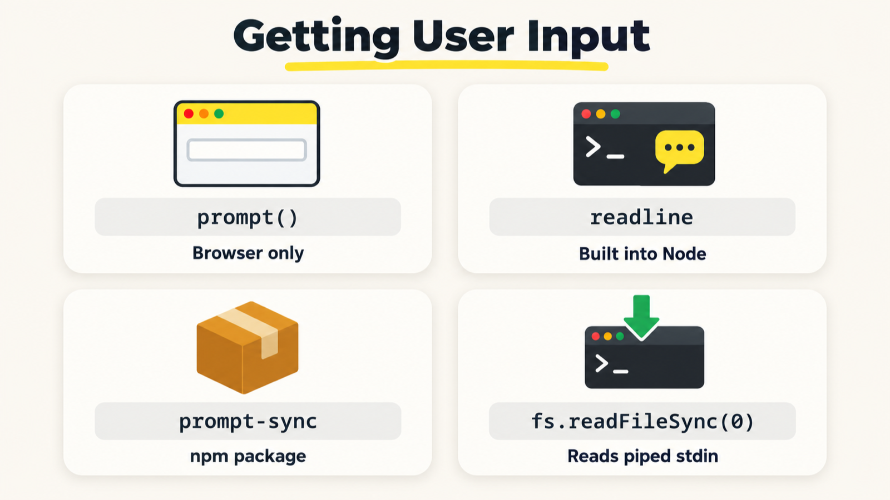

| Method | Where it works | Waits on that line? | Install | Lesson |
|:-------|:---------------|:-------------------:|:--------|:------:|
| `prompt()` | Browser only | Yes | None | 59 |
| `readline` | Node | No (callback) | None, built in | 60 |
| `prompt-sync` | Node, interactive terminal | Yes | `npm install` | 61 |
| `fs.readFileSync(0)` | Node, piped or typed stdin | Yes | None | 62 |

### 59: prompt() in the Browser

**Concept:** `prompt("Enter a number:")` opens a browser dialog and returns what the user typed as a string, or `null` if they press Cancel. `Number()` converts it before the math.

**Why:** It is the quickest way to get input while learning in the browser console.

**Q&A: why use this?**
- **Q: When do I reach for it?** A: In a browser's DevTools console or a `<script>` on a page: paste the file's code into the Console tab to try it.
- **Q: What does it replace?** A: Java's `Scanner(System.in)`, but only in browsers. In Node, `node 08_chapter_UserInput/59_UI.js` fails with `ReferenceError: prompt is not defined`.
- **Q: What's the gotcha?** A: The answer is always a string or `null`. Pressing Cancel gives `null`, `Number(null)` is `0`, and the file prints "0 is Even". Typing `abc` gives `NaN`, and since `NaN % 2 === 0` is `false`, it prints "NaN is Odd".

```mermaid
sequenceDiagram
    participant Code as 59_UI.js
    participant Browser
    participant User
    Code->>Browser: prompt("Enter a number:")
    Browser->>User: show dialog
    User->>Browser: types 7, clicks OK
    Browser-->>Code: "7" (a string)
    Code->>Code: Number("7") is 7, 7 % 2 is 1
    Code->>Browser: console.log("7 is Odd")
```

```js
// 08_chapter_UserInput/59_UI.js (run in a browser console, not in Node)
let num = prompt("Enter a number:");
num = Number(num);  // convert string to number

if (num % 2 === 0) {
    console.log(num + " is Even");
} else {
    console.log(num + " is Odd");
}
```

### 60: readline in Node

**Concept:** Node's built-in `readline` module asks a question in the terminal and hands the answer to a callback function. `rl.close()` ends the input so the program can exit.

**Why:** It needs no install and works wherever Node runs, so it is the standard way to read input in Node scripts.

**Q&A: why use this?**
- **Q: When do I reach for it?** A: Node scripts that ask a question, such as a test-data generator that asks how many users to create.
- **Q: What does it replace?** A: The browser's `prompt()`, which does not exist in Node.
- **Q: What's the gotcha?** A: It is asynchronous: code written after `rl.question(...)` runs before the user answers. Put everything that needs the answer inside the callback, and call `rl.close()`, or the program sits waiting for more input.

```mermaid
sequenceDiagram
    participant Script as 60_Node_UI.js
    participant Terminal
    Script->>Terminal: "Enter a number: "
    Note over Script: code after rl.question keeps running
    Terminal-->>Script: callback("7") after Enter
    Script->>Terminal: "7 is Odd"
    Script->>Script: rl.close(), program exits
```

```js
// 08_chapter_UserInput/60_Node_UI.js
const readline = require('readline');

const rl = readline.createInterface({
    input: process.stdin,
    output: process.stdout
});

rl.question("Enter a number: ", (input) => {
    let num = Number(input);

    if (num % 2 === 0) {
        console.log(num + " is Even");
    } else {
        console.log(num + " is Odd");
    }

    rl.close();
});
```

```bash
$ echo 7 | node 08_chapter_UserInput/60_Node_UI.js
Enter a number: 7 is Odd
```

### 61: prompt-sync

**Concept:** `prompt-sync` is a small npm package that gives Node a synchronous, browser-style `prompt()`: the program waits on that line until the user presses Enter.

**Why:** Synchronous input reads top to bottom like the browser version, which is easier for beginners than `readline` callbacks.

**Q&A: why use this?**
- **Q: When do I reach for it?** A: Interactive practice scripts in your own terminal. Run `npm install` once (the repo's `package.json` lists `prompt-sync`), then `node 08_chapter_UserInput/61_Prompt_sync.js`.
- **Q: What does it replace?** A: `readline` callbacks in simple scripts, and the browser-only `prompt()`.
- **Q: What's the gotcha?** A: It reads the keyboard straight from the terminal, so it fails when there is no terminal: piping input (`echo 42 | node 61_Prompt_sync.js`) or running it in CI throws `Error: ENXIO: no such device or address, open '/dev/tty'`.

```mermaid
flowchart LR
    A["npm install<br/>(prompt-sync)"] --> B["require('prompt-sync')()"]
    B --> C["prompt('Enter a number')<br/>waits for Enter"]
    C --> D["Number(...)"]
    D --> E["console.log(num)"]
```

```js
// 08_chapter_UserInput/61_Prompt_sync.js (needs npm install, run in a terminal)
const prompt = require("prompt-sync")();
let num = Number(prompt("Enter a number"));
console.log(num);
```

### 62: Reading Piped Input with fs.readFileSync

**Concept:** `require('fs').readFileSync(0, 'utf8')` reads everything from standard input (file descriptor `0`) in one go and returns it as a single string.

**Why:** It is the simplest way to accept piped input such as `echo 15 | node file.js`, and it is how many online coding judges feed test input to JavaScript solutions.

**Q&A: why use this?**
- **Q: When do I reach for it?** A: Scripts that receive input from a pipe or a file: `echo 15 | node 08_chapter_UserInput/62_FS_readFile.js` or `node 08_chapter_UserInput/62_FS_readFile.js < input.txt`.
- **Q: What does it replace?** A: Line-by-line `readline` when you simply want all of the input at once.
- **Q: What's the gotcha?** A: It reads until the end of the input, so when you type by hand nothing happens after Enter: press `Ctrl+D` (macOS and Linux) to finish. The string also keeps its trailing newline, so `data === "15"` is `false` until you call `data.trim()`.

```mermaid
flowchart LR
    P["echo 15"] -->|"pipe into stdin (fd 0)"| R["readFileSync(0, 'utf8')"]
    R --> S["'15' plus a newline"]
    S --> O["console.log: Hi 15"]
```

```js
// 08_chapter_UserInput/62_FS_readFile.js
console.log("Enter the number!");
const data = require('fs').readFileSync(0, 'utf8');   // 0 = standard input
console.log("Hi", data);

// In the terminal: type 15, press Enter, then press Ctrl+D
```

```bash
$ echo 15 | node 08_chapter_UserInput/62_FS_readFile.js
Enter the number!
Hi 15
```

---

## Chapter 09: for Loop

### 63: Why Loops: the for Loop

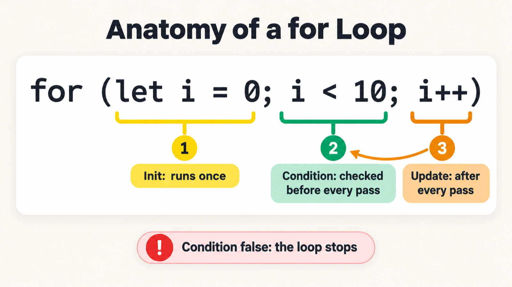

**Concept:** A loop repeats a block of code. A `for` loop packs its three parts into one line: the init (`let i = 0`, runs once), the condition (`i < 10`, checked before every pass) and the update (`i++`, runs after every pass). The lesson calls this ICU.

**Why:** Writing `console.log(1)` to `console.log(10)` by hand (`63_Loop.js`) does not scale; a loop does the same work in three lines for 10 values or 10,000.

**Q&A: why use this?**
- **Q: When do I reach for it?** A: When you know how many times to repeat: 10 rows, 3 retries, 5 form fields. In tests, checking each row of a table is the classic case.
- **Q: What does it replace?** A: Copy-pasted lines. The syntax matches Java's `for (int i = 0; i < 10; i++)`, with `let` instead of `int`.
- **Q: What's the gotcha?** A: `i++` or `++i` in the update makes no difference (`64_For_loop.js` uses `++i`), because nothing reads the update's value. What matters is the condition: `i < 10` starting at 0 runs 10 times, printing 0 to 9.

```mermaid
flowchart TD
    I["Init: let i = 0 (runs once)"] --> C{"i < 10 ?"}
    C -->|true| B["Body: console.log(i)"]
    B --> U["Update: ++i"]
    U --> C
    C -->|false| E["Loop ends"]
```

```js
// 09_chapter_Loops/63_Loop.js: the slow way
console.log(1);
console.log(2);
console.log(3);
// ... one line per number, all the way to 10

// 09_chapter_Loops/64_For_loop.js: the loop way
// ICU: INIT let i = 0, CONDITION i < 10, UPDATE ++i
for (let i = 0; i < 10; ++i) {
    console.log(i);   // 0 1 2 ... 9
}
```

### 66: Loop Boundaries, Zero Runs and Infinite Loops

**Concept:** Interview drills on the loop header (`65_Foor_Loop.js` to `68_IQ.js`): the counter can have any valid name, `<=` includes the end value, a condition that is false at the start runs the body zero times, and a missing condition never stops.

**Why:** Off-by-one and never-ending loops are the most common loop bugs, and in test code they show up as wrong counts or hanging runs.

**Q&A: why use this?**
- **Q: When do I reach for it?** A: Every time you write a loop header: check the first value, the last value and the count. `for (let somya = 1; somya <= 10; somya++)` runs 10 times, 1 to 10.
- **Q: What does it replace?** A: Guessing the count. The rule: start at 0 with `< n`, or start at 1 with `<= n`; both run n times.
- **Q: What's the gotcha?** A: `for (let pramod = 0; pramod > 1; pramod++)` never runs, because `0 > 1` is already false. `for (let pramod = 0; ; pramod++)` has no condition, so it never stops, which is why `68_IQ.js` is commented out. Press `Ctrl+C` to kill a runaway loop.

```mermaid
flowchart TD
    Q{"Is the condition true<br/>for the first value?"} -->|No| Z["0 runs (67_iq.js)"]
    Q -->|Yes| C{"Does the update move<br/>the counter toward false?"}
    C -->|Yes| N["Stops after n runs"]
    C -->|"No, or no condition"| INF["Infinite loop (68_IQ.js)"]
```

| Header | Counter values | Runs |
|:-------|:---------------|:----:|
| `for (let i = 0; i < 10; i++)` | 0 to 9 | 10 |
| `for (let i = 1; i <= 10; i++)` | 1 to 10 | 10 |
| `for (let i = 0; i <= 10; i++)` | 0 to 10 | 11 |
| `for (let i = 0; i > 1; i++)` | none | 0 |
| `for (let i = 0; ; i++)` | 0, 1, 2, ... forever | ∞ |

```js
// 09_chapter_Loops/66_iq.JS
for (let somya = 1; somya <= 10; somya++) {
    console.log(somya);   // 1 2 3 ... 10
}

// 67_iq.js (switched on): _1 is a valid name; 0 to 10 with <= is 11 runs
for (let _1 = 0; _1 <= 10; _1++) {
    console.log(_1);      // 0 1 2 ... 10
}

// 67_iq.js (switched on): 0 > 1 is false at the start, so the body never runs
for (let pramod = 0; pramod > 1; pramod++) {
    console.log(pramod);  // never printed
}

// 68_IQ.js: no condition, never stops. Leave this one commented out.
// for (let pramod = 0; ; pramod++) {
//     console.log(pramod);
// }
```

### 69: if Inside a Loop

**Concept:** A loop body can hold any code, including an `if/else`, so every pass can make its own decision based on the counter.

**Why:** Tests often loop over items and treat some of them differently: skip disabled rows, flag values over a limit.

**Q&A: why use this?**
- **Q: When do I reach for it?** A: When the action depends on the item or the counter: "for each year from 0 to 17, a gift only after 15".
- **Q: What does it replace?** A: Two separate loops (one per case), or hand-written special cases.
- **Q: What's the gotcha?** A: Count the outcomes before you trust the output. With `somya < 18` and `somya > 15`, only 16 and 17 pass, so the gift line prints 2 times and the other line 16 times. If 15 should count, write `somya >= 15`.

```mermaid
flowchart TD
    L["for somya = 0 to 17"] --> C{"somya > 15"}
    C -->|"true (16, 17)"| G["Gift from papa, iphone this year"]
    C -->|"false (0 to 15)"| N["No Gift, iphone only barbie doll"]
    G --> NEXT["next somya"]
    N --> NEXT
    NEXT --> L
```

```js
// 09_chapter_Loops/69_IQ.js
for (let somya = 0; somya < 18; ++somya) {
    if (somya > 15) {
        console.log("Gift from papa, iphone this year")   // somya = 16, 17
    } else {
        console.log("No Gift, iphone only barbie doll")   // somya = 0 to 15
    }
}
// Output: "No Gift ..." 16 times, then "Gift from papa ..." 2 times
```

---

## Chapter 10: while Loop

### 70: while Loop

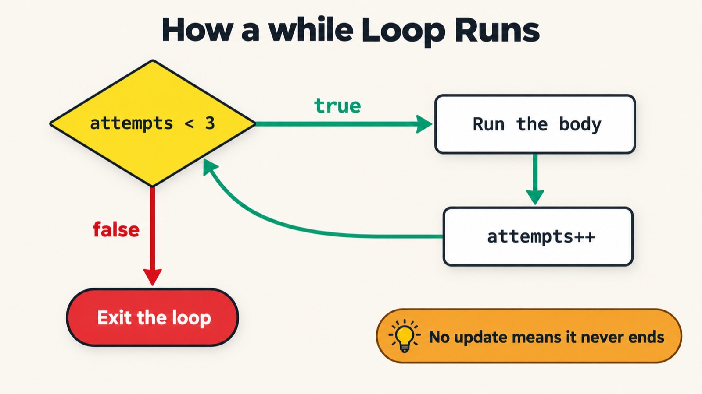

**Concept:** `while (condition) { ... }` repeats its body as long as the condition is true. The same ICU parts are there, just spread out: the init goes before the loop, the condition in the header, the update inside the body.

**Why:** When you repeat until something changes (retry until success, read until the input ends), a `while` says "keep going while this is true" directly.

**Q&A: why use this?**
- **Q: When do I reach for it?** A: Repeat-until-done logic, like the retry counter in `71_IQ.js` (`while (attempts < 3)`). Playwright's auto-waiting runs this kind of retry loop for you, which is why you rarely hand-write one in tests.
- **Q: What does it replace?** A: A `for` loop; each can do what the other does (`70.js` shows the same count both ways). Java's `while` is identical.
- **Q: What's the gotcha?** A: Forget the update (`i++`) and the condition never turns false: an infinite loop. In a `for` the update sits in the header where you see it; in a `while` it hides at the bottom of the body.

```mermaid
flowchart TD
    I["let i = 0 (init, before the loop)"] --> C{"i < 10 ?"}
    C -->|true| B["console.log(i)"]
    B --> U["i++ (update, inside the body)"]
    U --> C
    C -->|false| E["Exit"]
```

| | `for` | `while` |
|:--|:--|:--|
| Init | In the header | Before the loop |
| Update | In the header | Inside the body |
| Best when | You know the count | You repeat until something changes |

```js
// 10_chapter_Loops_WHILE/70.js
let i = 0;            // Init
while (i < 10) {      // Condition
    console.log(i);   // 0 1 2 ... 9
    i++;              // Update
}

// 10_chapter_Loops_WHILE/71_IQ.js: a retry counter
let attempts = 0;
while (attempts < 3) {
    console.log("Attempt", attempts);   // Attempt 0, Attempt 1, Attempt 2
    attempts++;
}
```

`72.js` counts the same way from 1 to 15 (`while (modi <= 15)`).

### 73: while (true) and break

**Concept:** `while (true)` would run forever on its own; a `break` inside the body is what ends it. Use it when the exit check fits better in the middle of the body than in the header.

**Why:** "Keep going until X happens" (a matching row, a successful response, an age limit) often reads more naturally as a `break` than as a header condition.

**Q&A: why use this?**
- **Q: When do I reach for it?** A: When the stop condition is only known after some work inside the body. Always make sure at least one path reaches the `break`.
- **Q: What does it replace?** A: A header condition: `73_break.IQ.js` does the same as `while (age <= 10) { console.log(age); age++; }`.
- **Q: What's the gotcha?** A: `break` only leaves the innermost loop (or `switch`) it sits in. And if the variable never reaches the exit value (say `age--` instead of `age++`), it really does run forever.

```mermaid
flowchart TD
    W["while (true)"] --> C{"age > 10 ?"}
    C -->|true| BR["break: leave the loop"]
    C -->|false| P["console.log(age)"]
    P --> U["age++"]
    U --> W
```

```js
// 10_chapter_Loops_WHILE/73_break.IQ.js
let age = 7;
while (true) {
    if (age > 10) {
        break;              // the only way out
    } else {
        console.log(age);   // 7 8 9 10
    }
    age++;
}
```

---

## Chapter 11: do...while and Nested Loops

### 74: do...while

**Concept:** `do { ... } while (condition);` runs the body first and checks the condition afterwards, so the body always runs at least once.

**Why:** Some work has to happen before you can decide whether to repeat it: try the action, then check whether a retry is needed.

**Q&A: why use this?**
- **Q: When do I reach for it?** A: "Try first, then decide": a retry loop like `74.js`, or a menu that must show at least once before asking whether to show it again.
- **Q: What does it replace?** A: A `while` loop with a copy of its body pasted above it. Java's `do...while` works the same way.
- **Q: What's the gotcha?** A: The condition sits at the bottom, after the body, so read the last line before guessing the count. `retry < 3` with `retry` starting at 0 gives three runs (0, 1, 2), and the body runs once even when the condition is false from the start (lesson 75).

```mermaid
flowchart TD
    S["retry = 0"] --> B["Body: Executing the code....<br/>Retrying..... retry"]
    B --> U["retry++"]
    U --> C{"retry < 3 ?"}
    C -->|true| B
    C -->|false| E["Exit"]
```

```js
// 11_chapter_Loops_DoWhile/74.js
let retry = 0;

do {
    console.log("Executing the code....");
    console.log("Retrying.....", retry);   // 0, then 1, then 2
    retry++;
} while (retry < 3);
```

### 75: while vs do...while

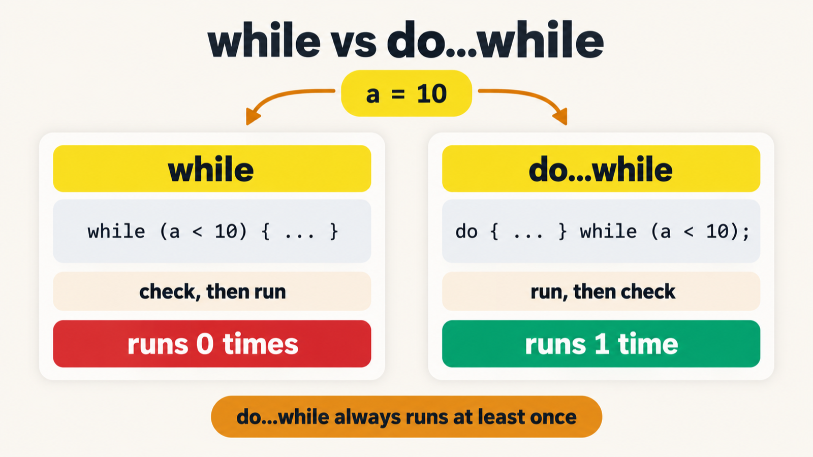

**Concept:** Same start value (`a = 10`), same condition (`a < 10`): a `while` checks first and runs zero times, while a `do...while` runs once and then checks. `77_IQ.js` shows the same zero-run rule for a `for` loop.

**Why:** "How many times does this print?" with a condition that is false from the start is a classic interview question.

**Q&A: why use this?**
- **Q: When do I reach for it?** A: `while` or `for` when zero runs is a valid outcome (an empty list); `do...while` only when the body must run at least once.
- **Q: What does it replace?** A: Memorising outputs. The rule: `for` and `while` check at the top, `do...while` checks at the bottom.
- **Q: What's the gotcha?** A: In `77_IQ.js`, `for (let i = 5; i < 5; i++)` never runs, so `count` stays `0`. Rewrite it as a `do...while` and `count` would be `1`.

```mermaid
flowchart LR
    subgraph W["while"]
        W1{"a < 10 ?<br/>10 < 10 is false"} --> W2["exit: 0 runs"]
    end
    subgraph D["do...while"]
        D1["run the body: prints 10"] --> D2{"a < 10 ?<br/>11 < 10 is false"} --> D3["exit: 1 run"]
    end
```

| Loop | Checks the condition | Start `a = 10`, condition `a < 10` |
|:-----|:---------------------|:-----------------------------------|
| `for` | Before each pass | 0 runs |
| `while` | Before each pass | 0 runs |
| `do...while` | After each pass | 1 run (prints 10) |

```js
// 11_chapter_Loops_DoWhile/75_IQ.js (with the while version switched on)
let a = 10;
while (a < 10) {          // checked first: false, so the body never runs
    console.log(a);
    a++;
}

let b = 10;
do {
    console.log(b);       // runs once: prints 10
    b++;
} while (b < 10);         // checked after: 11 < 10 is false, stop

// 11_chapter_Loops_DoWhile/77_IQ.js
let count = 0;
for (let i = 5; i < 5; i++) {
    count++;
}
console.log(count);       // 0
```

### 76: Nested Loops

**Concept:** A loop inside a loop: for every pass of the outer loop, the inner loop runs all the way through. Two loops of 3 give 3 x 3 = 9 runs of the inner body.

**Why:** Grids and tables have two dimensions: rows and columns, every browser on every screen size, every user on every role.

**Q&A: why use this?**
- **Q: When do I reach for it?** A: Walking the rows and cells of a table, or building a test matrix such as 3 browsers x 3 screen sizes.
- **Q: What does it replace?** A: Writing every combination out by hand.
- **Q: What's the gotcha?** A: The work multiplies: 100 x 100 is 10,000 runs, so watch the size of both loops. Give the counters different names (`i` outside, `j` inside); an inner `let i` would hide the outer one inside the inner body.

```mermaid
flowchart TD
    O["outer loop: i = 0, 1, 2"] --> IN["inner loop: j = 0, 1, 2"]
    IN --> P["console.log(i, j)"]
    P -->|"next j"| IN
    IN -->|"inner done: next i"| O
    O -->|"outer done"| E["9 lines printed"]
```

| | `j = 0` | `j = 1` | `j = 2` |
|:--|:--:|:--:|:--:|
| **`i = 0`** | `0 0` | `0 1` | `0 2` |
| **`i = 1`** | `1 0` | `1 1` | `1 2` |
| **`i = 2`** | `2 0` | `2 1` | `2 2` |

```js
// 11_chapter_Loops_DoWhile/76_Nested.js
for (let i = 0; i < 3; i++) {
    for (let j = 0; j < 3; j++) {
        console.log(i, j);   // 0 0, 0 1, 0 2, 1 0, ... 2 2
    }
}
```

---

## Chapter 12: Arrays

### 78: Arrays: Index, length and at()

**Concept:** An array is an ordered list of values in square brackets: `["chrome", "firefox", "webkit"]`. Items are numbered from 0, `length` says how many there are, and `at(-1)` counts from the end.

**Why:** Test data is full of lists (browsers to run on, rows in a table, expected error messages), and an array holds a whole list in one variable.

**Q&A: why use this?**
- **Q: When do I reach for it?** A: Any group of related values. `["chrome", "firefox", "webkit"]` is exactly the set of browsers Playwright runs tests on.
- **Q: What does it replace?** A: Separate variables (`browser1`, `browser2`, ...) and Java arrays. Unlike Java, a JavaScript array has no fixed size and can mix types: `[1, "hello", true, null]` in `81_Array.js`.
- **Q: What's the gotcha?** A: Brackets do not count from the end: `browsers[-1]` is `undefined`, not the last item; use `browsers.at(-1)`. Reading past the end (`arr[4]` on a 4-item array) also gives `undefined`, with no error. And `typeof []` is `"object"`, so check with `Array.isArray()`.

```mermaid
flowchart LR
    subgraph ARR["browsers, length 3"]
        A0["[0] chrome<br/>at(-3)"] --- A1["[1] firefox<br/>at(-2)"] --- A2["[2] webkit<br/>at(-1)"]
    end
```

```js
// 12_chapters_Arrays/78_Array.js
const browsers = ["chrome", "firefox", "webkit"];
console.log(browsers[0]);          // chrome
console.log(browsers.at(-1));      // webkit  (negative index)
console.log(browsers.length);      // 3

// 79_Arrays.js and 80_Arrays.js
console.log(typeof []);            // object
console.log(browsers[-1]);         // undefined: brackets don't count from the end
let arr = [10, 20, 30, 40];
console.log(arr[4]);               // undefined: index 4 is past the end
```

### 82: Creating Arrays

**Concept:** The literal `[...]` is the everyday way to make an array. `new Array(...)`, `Array.of(...)` and `Array.from(...)` exist for special cases.

**Why:** You will meet all four in other people's code, and one of them has a trap.

**Q&A: why use this?**
- **Q: When do I reach for it?** A: `[]` almost always. `Array.from("hello")` splits a string (or anything iterable) into an array, and `Array.from({ length: 3 }, (_, i) => i)` builds `[0, 1, 2]`.
- **Q: What does it replace?** A: Java's `new String[3]` and `Arrays.asList(...)`.
- **Q: What's the gotcha?** A: `new Array(3)` does not make `[3]`. A single number means "length", so you get three empty slots (`[ <3 empty items> ]`). With several numbers, `new Array(1, 2, 3)` does make `[1, 2, 3]`. `Array.of(3)` always means `[3]`.

```mermaid
flowchart TD
    Q{"What are you starting from?"} -->|"values you already know"| L["[1, 2, 3]<br/>(literal)"]
    Q -->|"a string or other iterable"| F["Array.from('hello')"]
    Q -->|"one number, as a value"| O["Array.of(3)"]
    Q -->|"a number of empty slots"| N["new Array(3)"]:::warn

    classDef warn fill:#fef3c7,stroke:#d97706,color:#78350f
```

| Code | Result |
|:-----|:-------|
| `["Chrome", "Firefox", "Safari"]` | `["Chrome", "Firefox", "Safari"]` |
| `new Array(3)` | `[ <3 empty items> ]`, length 3 |
| `new Array(1, 2, 3)` | `[1, 2, 3]` |
| `Array.of(3)` | `[3]` |
| `Array.of(10, 20, 30, 40, 50)` | `[10, 20, 30, 40, 50]` |
| `Array.from("hello")` | `["h", "e", "l", "l", "o"]` |

```js
// 12_chapters_Arrays/82_Create.js (with console.log added)
let browsers = ["Chrome", "Firefox", "Safari"];

let scores = new Array(3);          // [ <3 empty items> ]
scores[0] = "1";
console.log(scores);                // [ '1', <2 empty items> ]

let scores2 = new Array(1, 2, 3);   // [1, 2, 3]
let test = Array.of(10, 20, 30, 40, 50);
console.log(test.length);           // 5

let chars = Array.from("hello");
console.log(chars);                 // [ 'h', 'e', 'l', 'l', 'o' ]
```

### 83: Accessing and Modifying

**Concept:** Read an item with `arr[i]` (or `arr.at(i)`), and change it by assigning to the same index: `statuses[1] = "blocked"`.

**Why:** Updating one entry in a list, such as a test status or a cell value, is everyday work.

**Q&A: why use this?**
- **Q: When do I reach for it?** A: When you know the position. `at(-1)` and `at(-2)` read from the end without working out `length - 1`.
- **Q: What does it replace?** A: `statuses[statuses.length - 1]` for the last item.
- **Q: What's the gotcha?** A: `const` does not freeze an array. With `const statuses = [...]`, `statuses[1] = "blocked"` works; only reassigning (`statuses = []`) throws. And `at(-4)` on a 3-item array is `undefined`, not an error.

```mermaid
flowchart LR
    B["['pass', 'fail', 'skip']"] -->|"statuses[1] = 'blocked'"| A["['pass', 'blocked', 'skip']"]
    A --> L["length is still 3"]
```

```js
// 12_chapters_Arrays/83_Access_Modify.js
let statuses = ["pass", "fail", "skip"];

console.log(statuses[0]);        // pass
console.log(statuses[2]);        // skip

console.log(statuses.at(-1));    // skip
console.log(statuses.at(-2));    // fail
console.log(statuses.at(-4));    // undefined

// Modify
statuses[1] = "blocked";
console.log(statuses);           // [ 'pass', 'blocked', 'skip' ]
console.log(statuses.length);    // 3
```

### 84: Adding and Removing Items

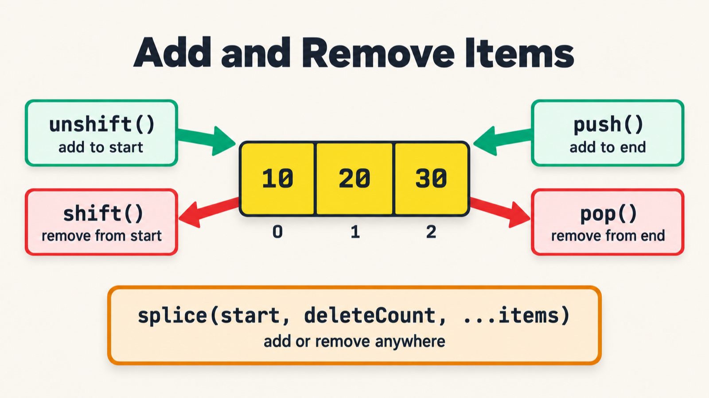

**Concept:** `push` and `pop` add and remove at the end, `unshift` and `shift` add and remove at the start, and `splice(start, deleteCount, ...items)` removes and/or inserts anywhere. All five change the original array.

**Why:** Test data changes while a test runs: queue up pages to visit, drop a browser that is not supported, insert an extra step.

**Q&A: why use this?**
- **Q: When do I reach for it?** A: `push` and `pop` for most list building, `shift` to take the next item from a queue, `splice` for anything in the middle.
- **Q: What does it replace?** A: Java's `ArrayList` methods `add(item)`, `remove(index)` and `add(index, item)`.
- **Q: What's the gotcha?** A: Watch the return values. `push` and `unshift` return the new length, not the array; `pop` and `shift` return the removed item (`85_ARRAY.js` keeps `browser.shift()` as `removed`); `splice` returns an array of what it removed. All of them change the array in place.

```mermaid
flowchart LR
    A["[1, 2, 3, 5, 6]"] -->|"splice(2, 1)<br/>remove 1 at index 2"| B["[1, 2, 5, 6]"]
    B -->|"splice(2, 0, 99)<br/>insert at index 2"| C["[1, 2, 99, 5, 6]"]
    C -->|"splice(1, 2, 10, 20)<br/>replace 2 from index 1"| D["[1, 10, 20, 5, 6]"]
```

| Method | Where | Returns | On `[1, 2, 3]` |
|:-------|:------|:--------|:---------------|
| `push(4)` | End, add | New length (`4`) | `[1, 2, 3, 4]` |
| `pop()` | End, remove | Removed item (`3`) | `[1, 2]` |
| `unshift(0)` | Start, add | New length (`4`) | `[0, 1, 2, 3]` |
| `shift()` | Start, remove | Removed item (`1`) | `[2, 3]` |
| `splice(1, 1)` | Anywhere | Removed items (`[2]`) | `[1, 3]` |
| `splice(1, 0, 99)` | Anywhere | `[]` | `[1, 99, 2, 3]` |

```js
// 12_chapters_Arrays/84_Adding_Remove.js (excerpt)
let arr = [1, 2, 3];

arr.push(4);              // add to END              [1, 2, 3, 4]
arr.pop();                // remove from END         [1, 2, 3]
arr.push(5, 6);           //                         [1, 2, 3, 5, 6]
arr.unshift(0);           // add to BEGINNING        [0, 1, 2, 3, 5, 6]
arr.shift();              // remove from BEGINNING   [1, 2, 3, 5, 6]

arr.splice(2, 1);         // remove 1 item at index 2       [1, 2, 5, 6]
arr.splice(2, 0, 99);     // insert 99 at index 2           [1, 2, 99, 5, 6]
arr.splice(1, 2, 10, 20); // replace 2 items from index 1   [1, 10, 20, 5, 6]
console.log(arr);         // [ 1, 10, 20, 5, 6 ]
```

`85_ARRAY.js` combines these: it pops and shifts a browser list, then loops over what is left and flags `"opera"`.

### 86: Searching: indexOf, includes and find

**Concept:** `indexOf` and `lastIndexOf` return the position of a value (or `-1`), and `includes` answers yes or no. `find` and `findIndex` search with a rule instead of an exact value: `n => n > 20` is a short arrow function that takes an item and returns `true` or `false`.

**Why:** Assertions often ask "is this value in the list?" or "which row matches?", and these methods answer without a hand-written loop.

**Q&A: why use this?**
- **Q: When do I reach for it?** A: `includes` for yes/no checks (`results.includes("error")`), `indexOf` when you need the position, `find` when the match is a rule (`n > 20`) rather than a fixed value. `findLast` and `findLastIndex` search from the end.
- **Q: What does it replace?** A: A `for` loop with a flag variable and a `break`.
- **Q: What's the gotcha?** A: Each method says "not found" differently: `indexOf` and `findIndex` return `-1`, `find` returns `undefined`. So never write `if (results.indexOf("fail"))`: a match at position 0 is falsy and a miss (`-1`) is truthy. Also, `indexOf` cannot find `NaN`, but `includes` can.

```mermaid
flowchart TD
    Q{"What do you need?"} -->|"yes or no"| I["includes(value)"]
    Q -->|"position of a value"| X["indexOf / lastIndexOf"]
    Q -->|"first item matching a rule"| F["find / findIndex"]
    Q -->|"last item matching a rule"| FL["findLast / findLastIndex"]
```

| Method | Looks for | Found | Not found |
|:-------|:----------|:------|:----------|
| `indexOf(v)` | Exact value, from the start | First index | `-1` |
| `lastIndexOf(v)` | Exact value, from the end | Last index | `-1` |
| `includes(v)` | Exact value | `true` | `false` |
| `find(fn)` | First item where `fn` is true | The item | `undefined` |
| `findIndex(fn)` | First item where `fn` is true | Its index | `-1` |
| `findLast(fn)`, `findLastIndex(fn)` | Same, from the end | Item, index | `undefined`, `-1` |

```js
// 12_chapters_Arrays/86_Searching.js (with console.log added)
let results = ["pass", "fail", "pass", "error", "fail"];
console.log(results.indexOf("fail"));       // 1
console.log(results.indexOf("skip"));       // -1
console.log(results.lastIndexOf("fail"));   // 4 (searches from the end)
console.log(results.includes("error"));     // true

// 12_chapters_Arrays/87_Find.js
let nums = [10, 25, 30, 45];
console.log(nums.find(temp => temp > 20));      // 25
console.log(nums.findIndex(n => n > 20));       // 1
console.log(nums.findLast(n => n > 20));        // 45
console.log(nums.findLastIndex(n => n > 20));   // 3
```

### 88: Iterating Over an Array

**Concept:** Five ways to walk through an array: a classic `for` loop with an index, `for...of` for the values, `forEach` with a callback, `for...of` over `entries()` for index and value together, and `for...in`, which gives the indexes.

**Why:** Checking every row, every link or every result is the most common thing a test does with a list.

**Q&A: why use this?**
- **Q: When do I reach for it?** A: `for...of` by default (cleanest for values); the classic `for` when you need the index or want to skip around; `entries()` when you want both.
- **Q: What does it replace?** A: Java's enhanced `for (String t : tests)`, which is JavaScript's `for...of`.
- **Q: What's the gotcha?** A: `for...in` gives the index as a string (`"0"`, `"1"`), not the value, and is meant for objects; use `for...of` for arrays. And `forEach` cannot be stopped with `break` and does not wait for `await`, which matters in Playwright tests: use `for...of` with `await` inside.

```mermaid
flowchart LR
    A["tests = ['login', 'checkout', 'search']"] --> F1["for...of<br/>'login', 'checkout', 'search'"]
    A --> F2["for...in<br/>'0', '1', '2' (strings)"]
    A --> F3["entries()<br/>[0, 'login'], [1, 'checkout'], ..."]
```

| Loop | Gives you | `break` works? |
|:-----|:----------|:--------------:|
| `for (let i = 0; i < a.length; i++)` | Index (then `a[i]`) | ✅ |
| `for (const v of a)` | Value | ✅ |
| `a.forEach((v, i) => ...)` | Value and index | ❌ |
| `for (const [i, v] of a.entries())` | Index and value | ✅ |
| `for (const i in a)` | Index, as a string | ✅ (avoid for arrays) |

```js
// 12_chapters_Arrays/88_Iterate.js (excerpt)
let tests = ["login", "checkout", "search"];

for (let i = 0; i < tests.length; i++) {
    console.log(i, tests[i]);            // 0 login, 1 checkout, 2 search
}

for (let test of tests) {
    console.log(test);                   // login, checkout, search
}

tests.forEach((test, index) => {
    console.log(`${index}: ${test}`);    // 0: login, 1: checkout, 2: search
});

for (let [i, test] of tests.entries()) {
    console.log(i, test);                // 0 login, 1 checkout, 2 search
}

let students = ["methis", "senthil", "ajay", "rahul"];
for (let student in students) {
    console.log(student, " -> ", students[student]);   // 0 -> methis, ...
}
```

### 89: Transforming: map and filter

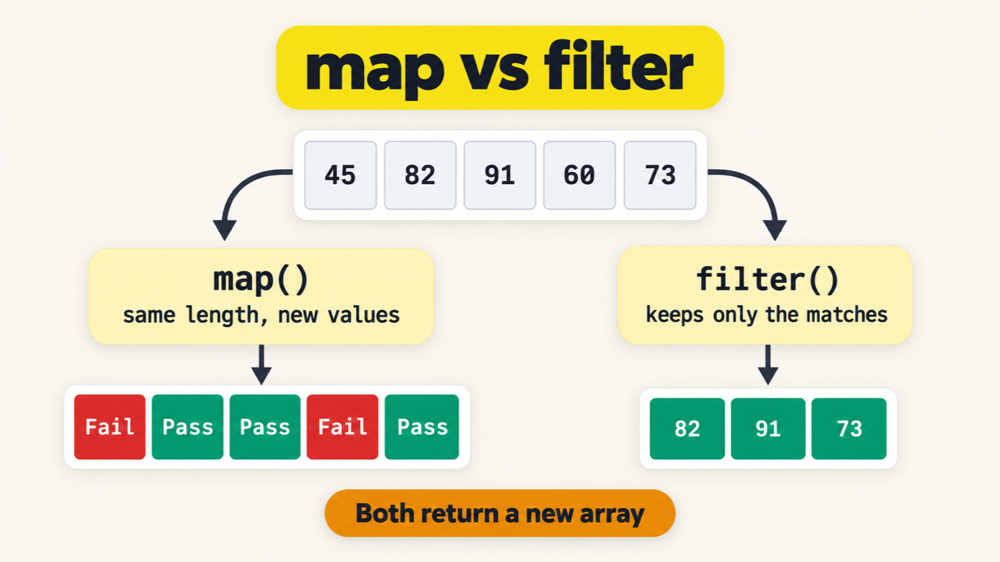

**Concept:** `map` builds a new array by transforming every item; `filter` builds a new array that keeps only the items that pass a test. Neither changes the original array.

**Why:** Turning raw data into what you assert on (scores into Pass/Fail, all rows into the failing ones) becomes a one-liner instead of a loop.

**Q&A: why use this?**
- **Q: When do I reach for it?** A: `map` when you need one output per input (labels, prices with tax, the text of every row); `filter` when you need a subset (failed tests, visible items).
- **Q: What does it replace?** A: A `for` loop that pushes into a new array, and Java's `stream().map(...)` and `stream().filter(...)`.
- **Q: What's the gotcha?** A: Keep the rules in sync. `89_Arrays_Transform.js` uses `> 70` in `map` but `>= 70` in `filter`, so a score of exactly 70 would be labelled "Fail" by one and counted as passing by the other.

```mermaid
flowchart LR
    S["scores<br/>[45, 82, 91, 60, 73]"] -->|"map(i => i > 70 ? 'Pass' : 'Fail')"| G["['Fail', 'Pass', 'Pass', 'Fail', 'Pass']"]
    S -->|"filter(s => s >= 70)"| P["[82, 91, 73]"]
```

| | `map` | `filter` |
|:--|:--|:--|
| Output length | Same as the input | Same or shorter |
| Output items | New values | Original items that passed |
| Callback returns | The new value | `true` (keep) or `false` (drop) |

```js
// 12_chapters_Arrays/89_Arrays_Transform.js (plus a check on the original)
let scores = [45, 82, 91, 60, 73];

let grades = scores.map(i => i > 70 ? "Pass" : "Fail");
console.log(grades);    // [ 'Fail', 'Pass', 'Pass', 'Fail', 'Pass' ]

let passing = scores.filter(s => s >= 70);
console.log(passing);   // [ 82, 91, 73 ]

console.log(scores);    // [ 45, 82, 91, 60, 73 ] (unchanged)
```

### 90: Sorting: Text Order vs Number Order

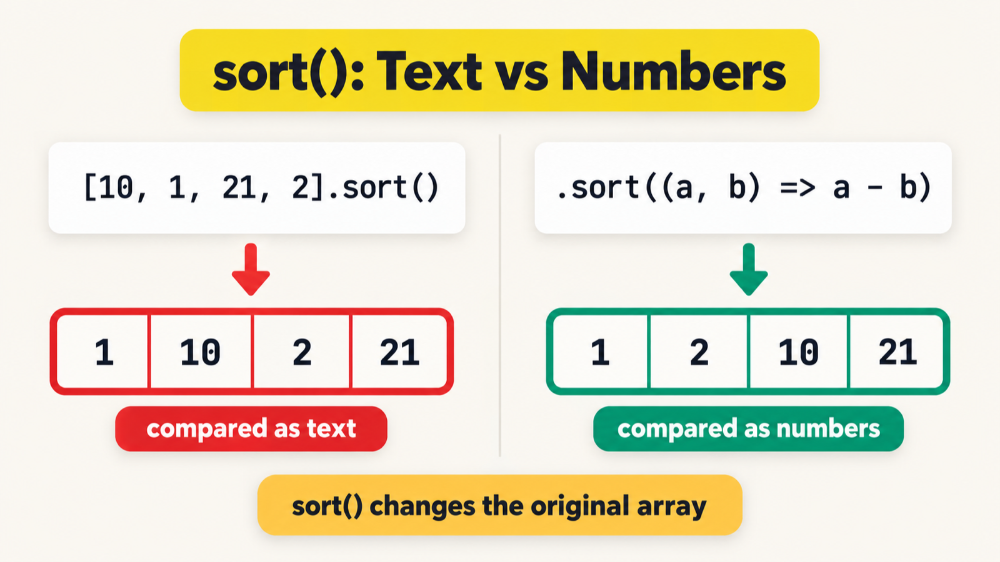

**Concept:** `sort()` puts an array in order and changes the original array. With no arguments it compares items as text, in lexicographic (dictionary) order, even when they are numbers; pass a compare function to sort numbers or to use your own rule.

**Why:** "Is this column sorted?" is a common test, and the default sort gives the wrong answer for numbers.

**Q&A: why use this?**
- **Q: When do I reach for it?** A: `sort()` alone for plain lowercase words; `(a, b) => a - b` for numbers smallest first; `(a, b) => b - a` for largest first; `(a, b) => a.localeCompare(b)` for text that should ignore case the way people expect.
- **Q: What does it replace?** A: Java's `Collections.sort()`, which sorts numbers as numbers by default. JavaScript's default does not.
- **Q: What's the gotcha?** A: `[10, 1, 21, 2].sort()` gives `[1, 10, 2, 21]`: as text, `"10"` comes before `"2"`. It also changes the array in place and returns that same array; use `toSorted()` (Node 20+) when you need to keep the original.

```mermaid
flowchart TD
    Q{"Compare function passed?"} -->|No| T["Turn every item into a string,<br/>compare character codes"]
    T --> R1["[1, 10, 2, 21]"]
    Q -->|"Yes: (a, b) => a - b"| N["Negative: a first<br/>Positive: b first<br/>0: keep the order"]
    N --> R2["[1, 2, 10, 21]"]
```

| Compare function | `[10, 1, 21, 2]` becomes |
|:-----------------|:-------------------------|
| None | `[1, 10, 2, 21]` |
| `(a, b) => a - b` | `[1, 2, 10, 21]` |
| `(a, b) => b - a` | `[21, 10, 2, 1]` |

```js
// 12_chapters_Arrays/90_Array_Sorting.js
let fruits = ["banana", "apple", "cherry"];
fruits.sort();
console.log(fruits);              // [ 'apple', 'banana', 'cherry' ]

// 12_chapters_Arrays/91_Array_Sorting.js
let nums = [10, 1, 21, 2];
nums.sort();
console.log(nums);                // [ 1, 10, 2, 21 ]  compared as text
console.log([11, -11].sort());    // [ -11, 11 ]  "-" (code 45) comes before "1" (code 49)

// 12_chapters_Arrays/92_Array_Normal_Sorting.js
nums.sort((a, b) => a - b);
console.log(nums);                // [ 1, 2, 10, 21 ]  ascending
nums.sort((a, b) => b - a);
console.log(nums);                // [ 21, 10, 2, 1 ]  descending

let names = ["banana", "Apple", "cherry"];
console.log(names.sort((a, b) => a.localeCompare(b)));   // [ 'Apple', 'banana', 'cherry' ]
```

`91_Array_Sorting.js` calls the default "Natural Sorting". Natural sorting usually means the number-aware order people expect (`file2` before `file10`); the default `sort()` is plain lexicographic order. [91_Lexicographic_Explain.md](12_chapters_Arrays/91_Lexicographic_Explain.md) walks through it character by character.

### 93: slice: Copy Part of an Array

**Concept:** `slice(start, end)` returns a new array with the items from `start` up to, but not including, `end`. Leave out `end` to go to the last item; negative numbers count from the end. The original array is not changed.

**Why:** Taking the first N results, the last few log lines or one page of rows is everyday test work, and `slice` does it without touching the source data.

**Q&A: why use this?**
- **Q: When do I reach for it?** A: `arr.slice(0, 3)` for the first three items, `arr.slice(-2)` for the last two, `arr.slice()` for a copy of the whole array.
- **Q: What does it replace?** A: A `for` loop that pushes a range of items, and Java's `Arrays.copyOfRange(arr, from, to)`.
- **Q: What's the gotcha?** A: `slice` (copies, original untouched) and `splice` (lesson 84, changes the original) are easy to mix up. And the start has to land before the end: `arr.slice(-3, -5)` is `slice(2, 0)`, which returns `[]`. [93_Slice_Explain.md](12_chapters_Arrays/93_Slice_Explain.md) walks through that one.

```mermaid
flowchart LR
    A["arr.slice(-3, -5)<br/>arr has 5 items"] --> B["-3 becomes 5 + (-3) = 2<br/>-5 becomes 5 + (-5) = 0"]
    B --> C["slice(2, 0)<br/>start is after end"]
    C --> D["[ ] empty array"]
```

| Call on `[1, 2, 3, 4, 5]` | Same as | Result |
|:--------------------------|:--------|:-------|
| `arr.slice(1, 3)` | | `[2, 3]` |
| `arr.slice(2)` | `slice(2, 5)` | `[3, 4, 5]` |
| `arr.slice(-2)` | `slice(3)` | `[4, 5]` |
| `arr.slice(-3)` | `slice(2)` | `[3, 4, 5]` |
| `arr.slice(0)` | Whole array | `[1, 2, 3, 4, 5]` |
| `arr.slice(-3, -5)` | `slice(2, 0)` | `[]` |

```js
// 12_chapters_Arrays/93_Array_Slicing.js (commented examples switched on)
let arr = [1, 2, 3, 4, 5];

console.log(arr.slice(1, 3));    // [ 2, 3 ]  index 1 up to (not including) 3
console.log(arr.slice(2));       // [ 3, 4, 5 ]  from index 2 to the end
console.log(arr.slice(-2));      // [ 4, 5 ]  the last two
console.log(arr.slice(-3));      // [ 3, 4, 5 ]
console.log(arr.slice(0));       // [ 1, 2, 3, 4, 5 ]  a full copy
console.log(arr.slice(-5));      // [ 1, 2, 3, 4, 5 ]
console.log(arr.slice(-3, -5));  // []  start (2) is after end (0)
console.log(arr);                // [ 1, 2, 3, 4, 5 ]  unchanged
```

### 94: Combining Arrays: concat and Spread

**Concept:** `a.concat(b)` returns a new array with the items of `a` followed by the items of `b`. The spread operator `...` does the same inside an array literal: `[...a, ...b]`.

**Why:** Test data often arrives in pieces (default users plus extra users, smoke tests plus regression tests) that you need as one list.

**Q&A: why use this?**
- **Q: When do I reach for it?** A: Spread is the modern default because it can also slot items in between: `[...a, 99, ...b]`. `concat` reads well at the end of a method chain.
- **Q: What does it replace?** A: Looping over `b` and pushing each item into `a`, which also changes `a`. In Java, `list.addAll(other)`.
- **Q: What's the gotcha?** A: Neither one changes `a` or `b`, so `a.concat(b);` on its own line does nothing useful unless you store the result. And `concat` unpacks array arguments one level only: `[1].concat([2], [3, [4]])` is `[1, 2, 3, [4]]`.

```mermaid
flowchart LR
    A["a = [1, 2]"] --> C["a.concat(b)<br/>or [...a, ...b]"]
    B["b = [3, 4]"] --> C
    C --> R["[1, 2, 3, 4]<br/>a new array"]
    A -.->|"unchanged"| A2["a is still [1, 2]"]
```

```js
// 12_chapters_Arrays/94_Array_Concat.js (plus two extra checks)
let a = [1, 2];
let b = [3, 4];
let c = a.concat(b);
console.log(c);                 // [ 1, 2, 3, 4 ]

// spread (modern way)
let d = [...a, ...b];
console.log(d);                 // [ 1, 2, 3, 4 ]

console.log([...a, 99, ...b]);  // [ 1, 2, 99, 3, 4 ]
console.log(a);                 // [ 1, 2 ]  unchanged
```

### 95: Array.isArray

**Concept:** `Array.isArray(value)` returns `true` only for real arrays. It is the reliable check, because `typeof` answers `"object"` for arrays, plain objects and `null` alike.

**Why:** Data from an API or a page can be a list, a single value or `null`, and code that loops over it needs to know which one it got.

**Q&A: why use this?**
- **Q: When do I reach for it?** A: Before looping over data you did not create, such as a JSON field that is sometimes a list and sometimes a single item.
- **Q: What does it replace?** A: `typeof value === "object"`, which cannot tell an array from an object or `null`. In Java you would use `instanceof`.
- **Q: What's the gotcha?** A: Array-like values are not arrays. A string, an object with a `length` (`{ length: 0 }`) or the `NodeList` that `document.querySelectorAll()` returns in a browser all give `false`. Convert them with `Array.from()` (lesson 82) when you need array methods.

```mermaid
flowchart TD
    V["some value"] --> T{"typeof value"}
    T -->|"'object'"| AMB["could be an array,<br/>an object or null"]
    V --> I{"Array.isArray(value)"}
    I -->|true| ARR["definitely an array"]
    I -->|false| NOT["not an array"]
```

| Value | `typeof` | `Array.isArray` |
|:------|:---------|:---------------:|
| `[1, 2, 3]` | `"object"` | `true` |
| `{ a: 1 }` | `"object"` | `false` |
| `null` | `"object"` | `false` |
| `"a"` | `"string"` | `false` |

```js
// 12_chapters_Arrays/95_ARRAY_Check.js (plus typeof for comparison)
let result = Array.isArray([1, 2, 3]);
let result1 = Array.isArray("a");
console.log(result);              // true
console.log(result1);             // false

console.log(typeof [1, 2, 3]);    // object
console.log(typeof { a: 1 });     // object: typeof can't tell them apart
```

### 96: every and some

**Concept:** `every(fn)` returns `true` only if every item passes the test; `some(fn)` returns `true` if at least one item passes. Both stop as soon as the answer is known.

**Why:** They turn "did all the tests pass?" and "did any test fail?" into one readable line.

**Q&A: why use this?**
- **Q: When do I reach for it?** A: `every` for "all must pass" checks (`scores.every(s => s >= 70)`), `some` for "any match" checks (`scores.some(s => s < 70)`).
- **Q: What does it replace?** A: A loop with a boolean flag and a `break`. Think of them as the `&&` and `||` of arrays (lesson 23).
- **Q: What's the gotcha?** A: Empty arrays: `[].every(...)` is `true` (nothing failed) and `[].some(...)` is `false` (nothing matched). So an assertion like `results.every(r => r === "pass")` passes when `results` is empty; check the length too.

```mermaid
flowchart LR
    subgraph EV["every(i => i >= 70): all must pass"]
        E1["[80, 90, 85]: true"]
        E2["[80, 60, 85]: false, 60 fails"]
    end
    subgraph SO["some(s => s < 70): one is enough"]
        S1["[80, 60, 85]: true, 60 matches"]
        S2["[80, 90, 85]: false"]
    end
```

| | `every` | `some` |
|:--|:--|:--|
| Returns `true` when | All items pass | At least one item passes |
| Stops early on | The first fail | The first pass |
| Empty array | `true` | `false` |

```js
// 12_chapters_Arrays/96_Array_Transform.js (commented examples switched on)
// every: ALL must pass
console.log([80, 90, 85].every(i => i >= 70));   // true
console.log([80, 60, 85].every(i => i >= 70));   // false (60 fails)

// some: AT LEAST ONE must pass
console.log([80, 60, 85].some(s => s < 70));     // true (60 matches)
console.log([80, 90, 85].some(s => s < 70));     // false

// empty arrays
console.log([].every(s => s >= 70));             // true
console.log([].some(s => s < 70));               // false
```

### 97: Copy vs Reference

![Copy vs reference: let ref = original gives one array two names, so a change through one shows in both; let copy = [...original] makes a second array, so changes stay separate; nested arrays need structuredClone()](assets/images/ch12-copy-vs-reference.png)

**Concept:** `let b = a` does not copy an array; it gives the same array a second name, so a change made through either name shows up in both. `[...a]` and `a.slice()` make a new array (a shallow copy), and `structuredClone(a)` makes a deep copy that duplicates nested arrays too.

**Why:** Tests that share setup data break in confusing ways when one test changes an array that another test is still using.

**Q&A: why use this?**
- **Q: When do I reach for it?** A: Copy before you change data you did not create: `const expected = [...defaults]; expected.push("extra");`.
- **Q: What does it replace?** A: Nothing new if you know Java: assigning an array there also copies only the reference, and `Arrays.copyOf` makes the copy.
- **Q: What's the gotcha?** A: In `97_Array_Copy.js`, `let deep_copy_array = original` is labelled "Deep copy", but it is no copy at all, which is why `original` gets the `91` too. Spread and `slice()` are shallow: a nested array inside is still shared. Use `structuredClone()` for a real deep copy.

```mermaid
flowchart LR
    subgraph REF["let ref = original"]
        O1["original"] --> ARR1["[1, 2, 3]"]
        R1["ref"] --> ARR1
    end
    subgraph CP["let copy = [...original]"]
        O2["original"] --> ARR2["[1, 2, 3]"]
        C2["copy"] --> ARR3["[1, 2, 3], a new array"]
    end
```

| Code | New array? | Nested arrays |
|:-----|:----------:|:--------------|
| `let b = a` | ❌ Same array | Shared |
| `let b = [...a]` | ✅ | Shared (shallow copy) |
| `let b = a.slice()` | ✅ | Shared (shallow copy) |
| `let b = structuredClone(a)` | ✅ | Copied (deep copy) |

```js
// 12_chapters_Arrays/97_Array_Copy.js (adapted, plus a nested example)
let original = [1, 2, 3];
let copy1 = [...original];      // new array
let copy2 = original.slice();   // new array
copy2.push(92);
copy1.push(93);
console.log(original);          // [ 1, 2, 3 ]  untouched
console.log(copy1);             // [ 1, 2, 3, 93 ]
console.log(copy2);             // [ 1, 2, 3, 92 ]

let same = original;            // NOT a copy: a second name for the same array
same.push(91);
console.log(original);          // [ 1, 2, 3, 91 ]  changed too

let nested = [[1], 2];
let shallow = [...nested];
let deep = structuredClone(nested);
shallow[0].push(99);
console.log(nested);            // [ [ 1, 99 ], 2 ]  the inner array was shared
console.log(deep);              // [ [ 1 ], 2 ]      the deep copy is unaffected
```

### 98: Destructuring

**Concept:** Array destructuring unpacks items into variables by position: `let [first, second, third] = [10, 20, 30]`. A `...rest` element collects whatever is left, and an empty slot (`[, , thirdOnly]`) skips an item.

**Why:** Functions and APIs often hand back small arrays (a pair, a row), and destructuring names the parts in one line.

**Q&A: why use this?**
- **Q: When do I reach for it?** A: Splitting a short array into named values, taking the first item and the rest (`let [head, ...tail] = list`), or ignoring items you do not need.
- **Q: What does it replace?** A: `let first = arr[0]; let second = arr[1]; ...`. Java has no equivalent.
- **Q: What's the gotcha?** A: Missing items become `undefined` unless you give a default (`let [x = 5] = []` gives `5`), and the rest element must come last: `let [...rest, last] = arr` is `SyntaxError: Rest element must be last element`.

```mermaid
flowchart LR
    A["[10, 20, 30, 40, 50]"] --> A1["a = 10"]
    A --> B1["b = 20"]
    A --> R1["rest = [30, 40, 50]"]
```

```js
// 12_chapters_Arrays/98_Array_Destructing.js
let [first, second, third] = [10, 20, 30];
console.log(first, second, third);   // 10 20 30

// 12_chapters_Arrays/99.js
let [a, b, ...rest] = [10, 20, 30, 40, 50];
console.log(a);          // 10
console.log(b);          // 20
console.log(rest);       // [ 30, 40, 50 ]

let [, , thirdOnly] = [10, 20, 30];
console.log(thirdOnly);  // 30

let [x = 5, y = 6] = [1];
console.log(x, y);       // 1 6  (y falls back to its default)
```

### 100: Swapping Two Variables

**Concept:** `[p, q] = [q, p]` swaps two variables in one line: the right side builds a temporary array of the current values, and destructuring writes them back in the opposite order.

**Why:** Swaps show up in sorting algorithms and interview questions, and the classic version needs a third, temporary variable.

**Q&A: why use this?**
- **Q: When do I reach for it?** A: Whenever two values need to trade places, including two items in an array: `[arr[0], arr[1]] = [arr[1], arr[0]]`.
- **Q: What does it replace?** A: The three-step swap with a temporary variable, `let temp = p; p = q; q = temp;`, which is also how Java does it.
- **Q: What's the gotcha?** A: Mind the semicolon on the line before. Without it, `let p = 1, q = 2` followed by `[p, q] = [q, p]` on the next line is read as one statement and throws `ReferenceError: Cannot access 'q' before initialization`. `100_Swap.js` has the semicolon, so it works.

```mermaid
flowchart LR
    S["p = 1, q = 2"] --> R["right side: [q, p]<br/>builds [2, 1]"]
    R --> L["left side: [p, q] = [2, 1]<br/>p = 2, q = 1"]
```

```js
// 12_chapters_Arrays/100_Swap.js (plus the old way and an array swap)
let p = 1, q = 2;
[p, q] = [q, p];
console.log(p, q);   // 2 1

// the old way, with a temporary variable
let x = 1, y = 2;
let temp = x;
x = y;
y = temp;
console.log(x, y);   // 2 1

// swapping two items in an array
let arr = ["a", "b"];
[arr[0], arr[1]] = [arr[1], arr[0]];
console.log(arr);    // [ 'b', 'a' ]
```

---

## Chapter 13: Functions

### 101: Defining and Calling a Function

**Concept:** A function is a named block of code you write once and run whenever you call it. `function greet() { ... }` defines it; `greet()` calls it.

**Why:** Test code repeats the same steps (open the browser, log in, check a status) again and again, and a function lets you write each step once and reuse it.

**Q&A: why use this?**
- **Q: When do I reach for it?** A: As soon as you copy-paste the same lines a second time. In Playwright, helpers like `login(page)` are plain functions.
- **Q: What does it replace?** A: Java methods, minus the class: a JavaScript function can live on its own at the top of a file, with no `public static void`.
- **Q: What's the gotcha?** A: The parentheses are what run it. `greet()` calls the function; `greet` without `()` is only a reference to it, so nothing happens (the same trap as `fruits.sort` without `()`).

```mermaid
sequenceDiagram
    participant Script as 101_Fn.js
    participant greet
    Script->>greet: greet()
    greet->>greet: console.log("Hi")
    greet-->>Script: done, carry on with the next line
```

```js
// 13_chapter_Functions/101_Fn.js (plus one line without the parentheses)
// Fn definition
function greet() {
    console.log("Hi");
}

// Fn calling
greet();   // Hi
greet;     // no () so nothing runs: this is only a reference
```

### 102: The Four Types of Functions

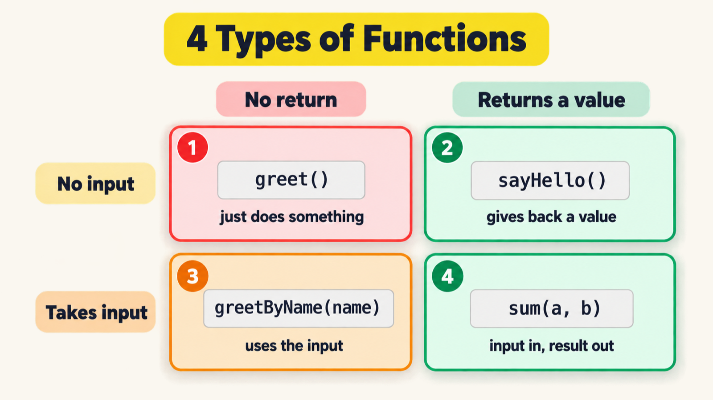

**Concept:** Functions come in four shapes, depending on two questions: does it take input (parameters), and does it give back a value (`return`)? Lessons 102 to 105 show one of each.

**Why:** Knowing which shape you need decides how you call the function and whether you store its result.

**Q&A: why use this?**
- **Q: When do I reach for it?** A: Type 1 (`openBrowser()`) for actions, Type 2 (`sayHello()`) for fixed values, Type 3 (`greetByName(name)`) for actions on some input, Type 4 (`sumOfTwoNumbers(a, b)`) for calculations you want to store or assert on.
- **Q: What does it replace?** A: Java's `void` methods (types 1 and 3) and methods with a return type (types 2 and 4). JavaScript does not declare a return type; a function without `return` gives back `undefined`.
- **Q: What's the gotcha?** A: Storing the result of a function that does not return gives `undefined`: `let msg = greet()` in `102_Type1_Fn.js` prints `undefined`. Missing arguments are `undefined` too, so `sumOfTwoNumbers(4)` returns `NaN` (4 + undefined); give a default (`function sum(a, b = 0)`) when an argument is optional.

```mermaid
flowchart TD
    Q1{"Takes input?"} -->|No| Q2{"Returns a value?"}
    Q1 -->|Yes| Q3{"Returns a value?"}
    Q2 -->|No| T1["Type 1: greet()"]
    Q2 -->|Yes| T2["Type 2: sayHello()"]
    Q3 -->|No| T3["Type 3: greetByName(name)"]
    Q3 -->|Yes| T4["Type 4: sumOfTwoNumbers(a, b)"]
```

| Type | Input | Returns | Lesson | Example |
|:----:|:-----:|:--------|:-------|:--------|
| 1 | No | No (`undefined`) | `102_Type1_Fn.js` | `greet()`, `openBrowser()` |
| 2 | No | Yes | `103_Type2_Fn.js` | `sayHello()` gives `"Hello"` |
| 3 | Yes | No (`undefined`) | `104_Type3_Fn.js` | `greetByName("Pramod")` |
| 4 | Yes | Yes | `105_Type4_Fn.js` | `sumOfTwoNumbers(4, 5)` gives `9` |

```js
// Type 1: 13_chapter_Functions/102_Type1_Fn.js
function openBrowser() {
    console.log("Open Browser");
}
openBrowser();                     // Open Browser
console.log(openBrowser());        // Open Browser, then undefined

// Type 2: 103_Type2_Fn.js
function sayHello() {
    return "Hello";
}
console.log(sayHello());           // Hello

// Type 3: 104_Type3_Fn.js
function greetByName(name) {
    console.log("Hi", name);
}
greetByName("Pramod");             // Hi Pramod

// Type 4: 105_Type4_Fn.js
function sumOfTwoNumbers(a, b) {
    return a + b;
}
let c = sumOfTwoNumbers(4, 5);
console.log(c);                    // 9
console.log(sumOfTwoNumbers(4));   // NaN: b is undefined
```

### 106: Declarations, Expressions and Arrow Functions

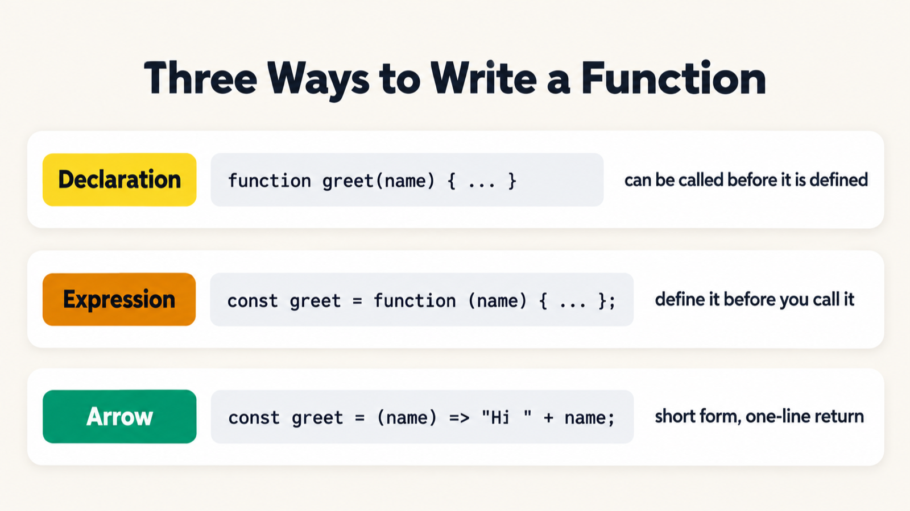

**Concept:** The same function can be written three ways: a declaration (`function greet(name) { ... }`), a function expression stored in a variable (`const greet1 = function (name) { ... }`), or an arrow function (`const greet2 = (name) => ...`). A one-line arrow function returns its expression automatically.

**Why:** Modern code, and almost every Playwright test (`test('...', async ({ page }) => { ... })`), uses arrow functions, so you need to read all three forms.

**Q&A: why use this?**
- **Q: When do I reach for it?** A: Declarations for named helpers at the top of a file; arrow functions for short callbacks (`scores.map(s => s * 2)`) and test bodies. Add `{ }` and an explicit `return` once the body needs more than one line (`110_Arrow_Multiple.js`).
- **Q: What does it replace?** A: Java lambdas (`(a) -> a * 2`) are the closest match to arrow functions. `108_Fn_Arrow.js` gives the recipe: drop `function`, drop `return` and the braces, and add `=>`.
- **Q: What's the gotcha?** A: Only declarations are hoisted. `greet()` works above `function greet()`, but calling `greet1()` above `const greet1 = function ...` throws `ReferenceError: Cannot access 'greet1' before initialization`. And a one-line arrow that returns an object needs parentheses: `() => ({ a: 1 })`; without them, `() => { a: 1 }` returns `undefined`.

```mermaid
flowchart LR
    D["Declaration<br/>function greet(name) { return ... }"] -->|"store it in a variable"| E["Expression<br/>const greet1 = function (name) { ... }"]
    E -->|"drop function, return and { }, add =>"| A["Arrow<br/>const greet2 = (name) => ..."]
```

| | Declaration | Expression | Arrow |
|:--|:--|:--|:--|
| Syntax | `function greet(name) { }` | `const greet = function (name) { }` | `const greet = (name) => ...` |
| Callable above its line (hoisted) | ✅ | ❌ | ❌ |
| One-line automatic return | ❌ | ❌ | ✅ |
| Typical use | Named helpers | Functions stored or passed around | Callbacks and test bodies |

```js
// 13_chapter_Functions/106_Template_Literal.js: a declaration
function greet(name) {
    return `Hello, ${name}`;
}

// 107_Fn_Exp.js: an anonymous function stored in a variable
const greet1 = function (name) {
    return `Hello, ${name}`;
};

// 108_Fn_Arrow.js and 109_Arrow.js: an arrow function, one-line automatic return
const greet2 = (name) => `Hello, ${name}`;

console.log(greet("Alice"), "|", greet1("Amit"), "|", greet2("Meeti"));   // Hello, Alice | Hello, Amit | Hello, Meeti

// 110_Arrow_Multiple.js: several lines need { } and return
const getResult = (score) => {
    if (score > 70) return "Pass";
    return "fail";
};
console.log(getResult(78), getResult(43));   // Pass fail

// 110_Fn.js: the same function both ways
function doubleMe(a) { return a * 2; }
const doubleMeA = (a) => a * 2;
console.log(doubleMe(2), doubleMeA(2));      // 4 4
```

### 112: One Check, Three Syntaxes

**Concept:** `112_Fn_REAL.js` writes one realistic test helper, a status-code check, three times: as a declaration, a function expression and an arrow function. All three behave the same when called.

**Why:** API tests check response codes constantly, and a small helper keeps that check in one place.

**Q&A: why use this?**
- **Q: When do I reach for it?** A: For any check you repeat across tests: status codes, response times, required fields. Pick one syntax per codebase and stay consistent.
- **Q: What does it replace?** A: Copying `if (status >= 200 && ...)` into every test.
- **Q: What's the gotcha?** A: The range is off by one. `status <= 300` treats 300 as fine, but 300 is a redirect: success (2xx) is 200 to 299, so write `status < 300`, as `115_Fn_Return.js` does. Also, the helper only logs; returning `true` or `false` would let a test assert on it.

```mermaid
flowchart LR
    S["status"] --> C{"status >= 200<br/>and status < 300"}
    C -->|true| OK["Request is fine!"]
    C -->|false| N["not a success"]
```

```js
// 13_chapter_Functions/112_Fn_REAL.js (the arrow version, plus a version a test can assert on)
const validateStatusCode_Arrow = (status) => {
    if (status >= 200 && status <= 300) {   // note: 300 is a redirect, not a success
        console.log("Request is fine!");
    }
};
validateStatusCode_Arrow(200);   // Request is fine!
validateStatusCode_Arrow(300);   // Request is fine!  (it should not be)

// returns true or false instead of logging
const isSuccess = (status) => status >= 200 && status < 300;
console.log(isSuccess(200), isSuccess(300), isSuccess(404));   // true false false
```

### 113: IIFE: Run a Function Immediately

**Concept:** An IIFE (Immediately Invoked Function Expression) is a function wrapped in parentheses and called straight away: `(() => { ... })();`. It runs once, right where it is written, and needs no name.

**Why:** It runs one-time setup code in its own private scope, so its variables do not leak into the rest of the file.

**Q&A: why use this?**
- **Q: When do I reach for it?** A: One-off setup blocks, and running async code in a plain Node script: `(async () => { await ... })();` is a common way to drive Playwright from a script outside the test runner.
- **Q: What does it replace?** A: Defining a named function only to call it once (`function name1() { ... } name1();`, the commented code in `113_Fn_IIFE.js`).
- **Q: What's the gotcha?** A: Put a semicolon at the end of the line before it. `let x = 1` followed by `(() => { ... })()` on the next line is read as `1(...)` and throws `TypeError: 1 is not a function`.

```mermaid
flowchart LR
    A["(() => { ... })<br/>wrap the function"] -->|"now it is an expression"| B["();<br/>call it straight away"]
    B --> C["runs once:<br/>Setup complete"]
```

```js
// 13_chapter_Functions/113_Fn_IIFE.js (commented examples switched on)
function name1() {
    console.log("Hi");
}
name1();                          // the normal way: define, then call

(function () {
    console.log("Anonymous Fn");
})();                             // an IIFE written with function

(() => {
    console.log("Setup complete");
})();                             // an IIFE written with an arrow
```

### 114: Rest Parameters and Spread Arguments

**Concept:** `...` means two opposite things. In a function definition, `...codes` is a rest parameter that collects any number of arguments into one array. In a call, `add(...num)` spreads an array out into separate arguments.

**Why:** Test helpers often take "any number of" things (status codes, tags, users), and spreading lets you pass an array you already have.

**Q&A: why use this?**
- **Q: When do I reach for it?** A: Rest when the caller may pass 1, 3 or 10 values (`hasError(...codes)`); spread when your data is already in an array but the function wants separate arguments.
- **Q: What does it replace?** A: Java varargs (`int... codes`) for rest; for spread, writing `add(num[0], num[1], num[2])` by hand.
- **Q: What's the gotcha?** A: Extra spread values are silently ignored: `add(...[1, 2, 3, 5])` uses only the first three and returns `6`. A rest parameter must come last (`function h(...a, b)` is a `SyntaxError`). And in the file, `hasError(...responseCodes)` computes `true` but never prints or stores it.

```mermaid
flowchart LR
    subgraph SP["spread, in a call"]
        A["num = [1, 2, 3]"] -->|"add(...num)"| B["add(1, 2, 3)"]
    end
    subgraph RE["rest, in a definition"]
        C["hasError(200, 201, 404)"] -->|"...codes"| D["codes = [200, 201, 404]"]
    end
```

```js
// 13_chapter_Functions/114_Spread_As_Argument_Fn.js (commented example switched on)
function add(a, b, c) {
    return a + b + c;
}
let num = [1, 2, 3, 5];
console.log(add(...num));                 // 6: spread fills a, b, c and the 5 is ignored

function hasError(...codes) {             // rest: every argument lands in one array
    return codes.some(c => c >= 400);
}
let responseCodes = [200, 201, 404];
console.log(hasError(...responseCodes));  // true (404)
console.log(hasError(200, 201));          // false
```

### 115: return

**Concept:** `return` ends the function and hands a value back to the caller. A function can have several `return`s on different paths (`115_Fn_Return.js`); a function with no `return` hands back `undefined` (`116_Return_Fn.js`).

**Why:** Returning a value, instead of only logging it, is what lets a test store, compare and assert on the result.

**Q&A: why use this?**
- **Q: When do I reach for it?** A: Whenever the caller needs the answer: `expect(getStatus(404)).toBe("client error")`. An early `return` also replaces deep `else` nesting.
- **Q: What does it replace?** A: Java's `return`, without declaring a return type.
- **Q: What's the gotcha?** A: Keep the value on the same line as `return`. A `return` followed by a line break returns `undefined`, because JavaScript inserts a semicolon right after `return`. And code after a `return` never runs.

```mermaid
flowchart TD
    C["getStatus(code)"] --> A{"200 to 299?"}
    A -->|yes| R1["return 'Success'"]
    A -->|no| B{"400 to 499?"}
    B -->|yes| R2["return 'client error'"]
    B -->|no| D{"500 or more?"}
    D -->|yes| R3["return 'server error'"]
    D -->|no| R4["return 'unknown'"]
```

```js
// 13_chapter_Functions/115_Fn_Return.js (plus one extra call)
function getStatus(code) {
    if (code >= 200 && code < 300) {
        return "Success";
    } else if (code >= 400 && code < 500) {
        return "client error";
    } else if (code >= 500) {
        return "server error";
    } else {
        return "unknown";
    }
}
console.log(getStatus(200));   // Success
console.log(getStatus(404));   // client error
console.log(getStatus(500));   // server error
console.log(getStatus(302));   // unknown

// 116_Return_Fn.js: no return statement
function logTest(name) {
    console.log(`Running: ${name}`);
}
console.log(logTest("open Browser!!"));   // Running: open Browser!!, then undefined
```

---

## Chapter 14: var, let, const: Scope, Hoisting and TDZ

### 117: var Is Function-Scoped

**Concept:** A `var` belongs to the whole function it is declared in (or to the whole file, outside any function). Blocks such as `if` and `for` do not create a new `var`, so `var a` inside an `if` overwrites the function's `a` (`118_var_let_const.js`).

**Why:** This is the main reason modern code avoids `var`: values change in places you did not expect.

**Q&A: why use this?**
- **Q: When do I reach for it?** A: Only when reading older code. `117.js` shows that all three keywords look the same for a simple value; the difference is scope.
- **Q: What does it replace?** A: Nothing in new code: `let` and `const` replaced `var` in ES6 (2015).
- **Q: What's the gotcha?** A: `var` is hoisted: it exists from the top of its function with the value `undefined`, so `console.log(v); var v = 1;` prints `undefined` instead of throwing an error. And a `for (var i = 0; ...)` counter is still there after the loop ends (`i` is 3).

```mermaid
flowchart TD
    G["file: var a = 10"] --> F["printHello(): var a = 20<br/>a new a, only inside the function"]
    F --> I["if block: var a = 30<br/>the SAME a as the function's"]
    I --> AF["after the if: a is 30"]
    G --> OUT["outside the function: a is still 10"]
```

```js
// 14_chapter_Var_Let_Const_Hoisting_TDZ/118_var_let_const.js (plus a final check)
var a = 10;
console.log(a);          // 10
function printHello() {
    console.log("Hello TheTestingAcademy");
    var a = 20;          // a new a, scoped to this function
    console.log(a);      // 20
    if (true) {
        var a = 30;      // NOT a new a: overwrites the function's a
        console.log(a);  // 30
    }
    console.log(a);      // 30: the if block leaked
}
printHello();
console.log(a);          // 10: the file-level a was never touched
```

### 119: let Is Block-Scoped

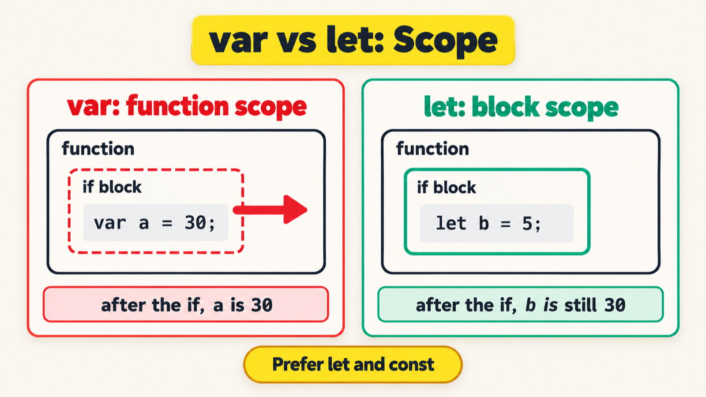

**Concept:** A `let` belongs to the nearest `{ }` block. Declaring `let b` again inside an inner block creates a separate variable that shadows the outer one, and the outer value is back once the block ends.

**Why:** Block scope keeps each variable where it is used, so a change inside an `if` or a loop cannot leak out and break the code below it.

**Q&A: why use this?**
- **Q: When do I reach for it?** A: For every variable that gets reassigned (counters, running totals, retry attempts). Use `const` for the rest.
- **Q: What does it replace?** A: `var`. It matches how local variables work in Java blocks.
- **Q: What's the gotcha?** A: A `let` cannot be used before its line. From the start of the block until the declaration runs, it is in the temporal dead zone (TDZ), so `console.log(t); let t = 1;` throws `ReferenceError: Cannot access 't' before initialization`. Declaring the same name twice in the same block is a `SyntaxError`.

```mermaid
flowchart TD
    G["file: let b = 20"] --> F["printHello(): let b = 30"]
    F --> I["if block: let b = 5<br/>a separate b"]
    I --> AF["after the if: b is 30 again"]
```

| | `var` | `let` | `const` |
|:--|:--:|:--:|:--:|
| Scope | Function | Block | Block |
| Used before its line | `undefined` (hoisted) | `ReferenceError` (TDZ) | `ReferenceError` (TDZ) |
| Declared twice in the same scope | Allowed | `SyntaxError` | `SyntaxError` |
| Reassigned | ✅ | ✅ | ❌ `TypeError` |

```js
// 14_chapter_Var_Let_Const_Hoisting_TDZ/119_let.js
let b = 20;                    // Global scope
console.log(b);                // 20

function printHello() {
    console.log("Hello TheTestingAcademy!");
    let b = 30;                // Local scope
    console.log(b);            // 30
    if (true) {
        let b = 5;             // a separate b, only inside this block
        console.log(b);        // 5
    }
    console.log("let ->", b);  // let -> 30
}

printHello();
```

### 120: const

**Concept:** `const` declares a variable that cannot be reassigned, and it must get its value on the same line. `pi = 3.14159` after `const pi = 3.14` throws `TypeError: Assignment to constant variable.`

**Why:** Values that should never change (URLs, timeouts, expected titles) are safer as `const`, because an accidental reassignment fails loudly instead of silently changing a test.

**Q&A: why use this?**
- **Q: When do I reach for it?** A: By default, for anything you do not plan to reassign: `const BASE_URL = "https://..."`, `const page = await browser.newPage()`.
- **Q: What does it replace?** A: Java's `final`.
- **Q: What's the gotcha?** A: `const` freezes the variable, not the value: `const o = { n: 1 }; o.n = 2;` works, and so does `push` on a `const` array. And `const p;` with no value is `SyntaxError: Missing initializer in const declaration`.

```mermaid
flowchart LR
    C["const pi = 3.14"] --> R{"pi = 3.14159"}
    R -->|"reassign"| E["TypeError: Assignment<br/>to constant variable."]
    C --> M{"change inside an<br/>object or array"}
    M -->|"o.n = 2, arr.push(4)"| OK["allowed"]
```

```js
// 14_chapter_Var_Let_Const_Hoisting_TDZ/120_Const.js (plus two checks)
const pi = 3.14;
console.log(pi);           // 3.14
// pi = 3.14159;           TypeError: Assignment to constant variable.

const config = { timeout: 30000 };
config.timeout = 60000;    // allowed: the object itself can change
console.log(config);       // { timeout: 60000 }

const browsers = ["chrome"];
browsers.push("firefox");  // allowed: the array itself can change
console.log(browsers);     // [ 'chrome', 'firefox' ]
```

### 121: Hoisting: var vs let

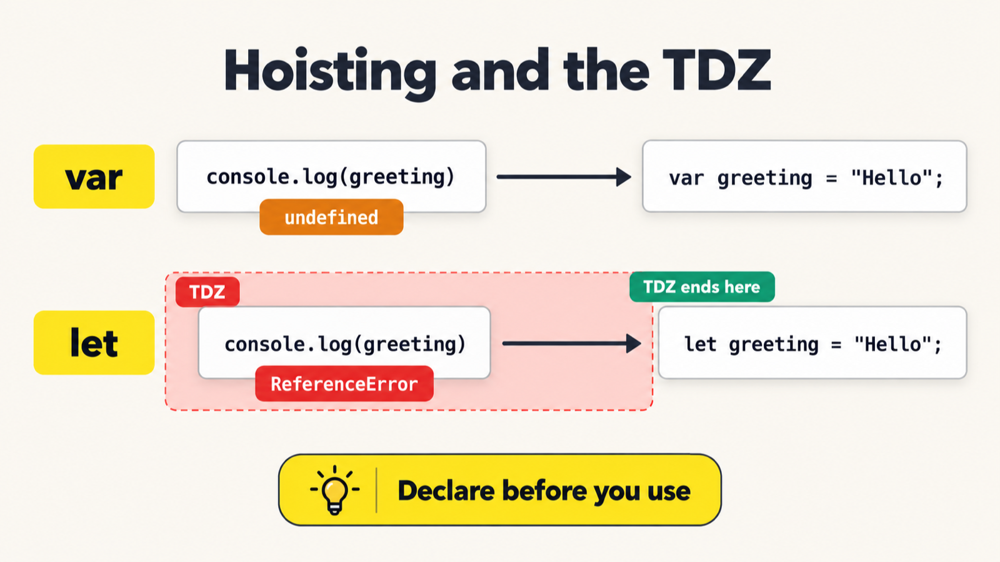

**Concept:** Before a scope runs, JavaScript sets up every variable declared in it; that is hoisting. A `var` is set to `undefined` straight away, so using it early prints `undefined`. A `let` or `const` is created but left without a value until its line runs, so using it early throws an error.

**Why:** Hoisting explains two confusing outputs: `undefined` where you expected a value, and a `ReferenceError` for a variable that clearly exists a few lines further down.

**Q&A: why use this?**
- **Q: When do I reach for it?** A: When reading older `var`-based code, and when debugging an unexpected `undefined`. Only the declaration moves up, not the assignment: `121_Var_Hoisting.js` prints `undefined`, then `Hello`.
- **Q: What does it replace?** A: The idea that code runs strictly top to bottom with nothing prepared in advance. Java has no hoisting: using a local variable before its declaration is a compile error.
- **Q: What's the gotcha?** A: Function declarations are hoisted whole (lesson 106), so you can call them early. A `var` inside a function is hoisted only to the top of that function: `123_Fn_Hoisting.js` prints `undefined`, then `200`.

```mermaid
flowchart TD
    S["The scope starts"] --> V["var greeting<br/>created and set to undefined"]
    S --> L["let greeting<br/>created, but no value yet (TDZ)"]
    V --> V1["console.log(greeting)<br/>prints undefined"]
    L --> L1["console.log(greeting)<br/>throws ReferenceError"]
    V1 --> V2["greeting = 'Hello'"]
```

```js
// 14_chapter_Var_Let_Const_Hoisting_TDZ/121_Var_Hoisting.js
console.log(greeting);     // undefined: var greeting was hoisted
var greeting = "Hello";
console.log(greeting);     // Hello

// Behind the scenes:
// var greeting;            <-- hoisted with undefined
// console.log(greeting);   <-- undefined
// greeting = "Hello";      <-- the assignment stays where it is

// 123_Fn_Hoisting.js: the same thing inside a function
function getUserStatus() {
    console.log(status_code);   // undefined
    var status_code = "200";
    console.log(status_code);   // 200
}
getUserStatus();

// 122_Let_Hoisting.js: with let, only this order works
let greeting2 = "Hello";        // renamed so this runs as one file
console.log(greeting2);         // Hello
// console.log(x); let x = 1;   ReferenceError: Cannot access 'x' before initialization
```

### 124: var in a Block, and Redeclaring var

**Concept:** Two more `var` surprises. A `var` inside an `if` block is the same variable as the one outside, so it overwrites it (`124_Let_TDZ.js`). And `var` lets you declare the same name again with no error (`126_Var.js`).

**Why:** In a long file, a second `var` that reuses a name silently replaces the first value, which is exactly the kind of bug that is hard to track down.

**Q&A: why use this?**
- **Q: When do I reach for it?** A: When reading older code: check whether a `var` declared inside a block also exists outside it.
- **Q: What does it replace?** A: Nothing; `let` and `const` fix both problems. They are block-scoped, and they refuse a second declaration in the same scope (`SyntaxError: Identifier ... has already been declared`).
- **Q: What's the gotcha?** A: Despite its name, `124_Let_TDZ.js` uses `var`, not `let`. Change the inner `var a` to `let a` and the first `console.log(a)` inside the block throws `ReferenceError: Cannot access 'a' before initialization`, because the block's own `a` is in its TDZ (lesson 125).

```mermaid
flowchart LR
    subgraph V["var a = 'temp' inside the if"]
        V1["outer a = 'Pramod'"] --> V2["if block: var a = 'temp'<br/>overwrites the same a"]
        V2 --> V3["after the block:<br/>a is 'temp'"]
    end
    subgraph L["let a = 'temp' inside the if"]
        L1["outer a = 'Pramod'"] --> L2["if block: console.log(a)<br/>ReferenceError (TDZ)"]
    end
```

```js
// 14_chapter_Var_Let_Const_Hoisting_TDZ/124_Let_TDZ.js (plus a check after the block)
var a = "Pramod";
// ... 10,000 lines of code ...
if (true) {
    console.log(a);   // Pramod
    var a = "temp";   // the SAME a: overwrites the outer value
    console.log(a);   // temp
}
console.log(a);       // temp: the change leaked out of the block

// 14_chapter_Var_Let_Const_Hoisting_TDZ/126_Var.js
var testName = "Login Test";
var testName = "Signup Test";    // No error! Re-declaration allowed with var
var testName = "Search Test";    // Still no error!
console.log(testName);           // Search Test
```

### 125: The Temporal Dead Zone (TDZ)

**Concept:** The temporal dead zone is the stretch from the start of a block to the line where a `let` or `const` is declared. The variable already exists there but has no value yet, so any use of it throws `ReferenceError: Cannot access 'a' before initialization`.

**Why:** The error is deliberate: it catches "used before declared" bugs that `var` would hide behind a silent `undefined`.

**Q&A: why use this?**
- **Q: When do I reach for it?** A: Whenever you see that exact error message: move the declaration above the first use.
- **Q: What does it replace?** A: `var`'s silent `undefined`. The notes in `125_let_tds.js` put it side by side: before its line, a `var` is `undefined` and a `let` has no value at all.
- **Q: What's the gotcha?** A: `typeof` is not safe in the TDZ. For a name that was never declared, `typeof missingName` is `"undefined"` with no error (`127_TDZ_TypeOf.js`), but `typeof t` above `let t = 1` in the same block throws the same `ReferenceError`.

```mermaid
flowchart TD
    E["Enter the block"] --> C["a is created with no value<br/>the TDZ starts"]
    C --> U["console.log(a)<br/>ReferenceError"]:::err
    C --> D["let a = 10<br/>the TDZ ends, a is 10"]
    D --> OK["console.log(a)<br/>prints 10"]

    classDef err fill:#fee2e2,stroke:#dc2626,color:#7f1d1d
```

| Used before its declaration line | `var x` | `let x` / `const x` | `x` never declared |
|:---------------------------------|:--------|:--------------------|:-------------------|
| `console.log(x)` | `undefined` | `ReferenceError` (TDZ) | `ReferenceError: x is not defined` |
| `typeof x` | `"undefined"` | `ReferenceError` (TDZ) | `"undefined"` |

```js
// 14_chapter_Var_Let_Const_Hoisting_TDZ/125_let_tds.js (wrapped in try/catch so the file keeps running)
{
    try {
        console.log(a);           // a exists, but it is in the TDZ
    } catch (e) {
        console.log(e.message);   // Cannot access 'a' before initialization
    }
    let a = 10;
    console.log(a);               // 10: the TDZ is over
}

// 14_chapter_Var_Let_Const_Hoisting_TDZ/127_TDZ_TypeOf.js (with console.log added)
console.log(typeof missingName);  // undefined: never declared, so no error

{
    try {
        typeof t;                 // t is declared below, so it is in the TDZ
    } catch (e) {
        console.log(e.message);   // Cannot access 't' before initialization
    }
    let t = 1;
}
```

---

## Chapter 15: Closures

### 128: Closures

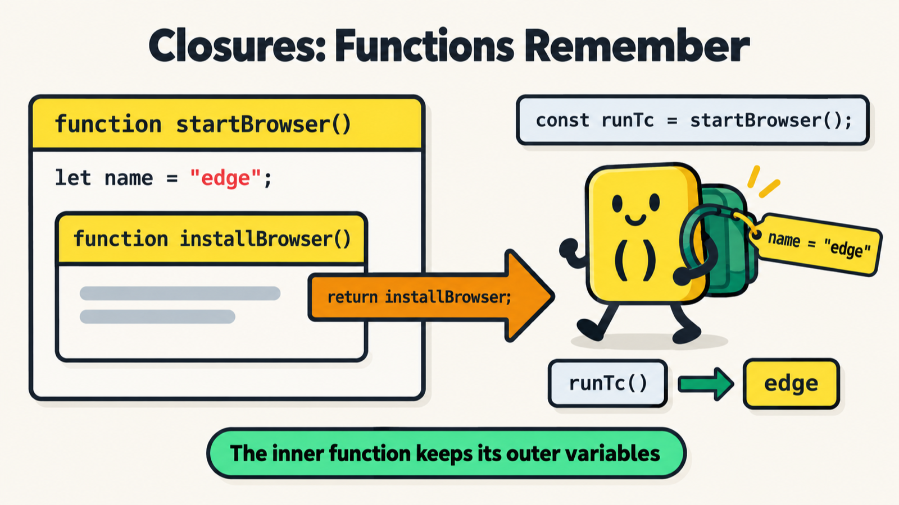

**Concept:** A closure is a function that remembers the variables from the place where it was created. `startBrowser()` returns `installBrowser`, and that inner function can still read `name` after `startBrowser()` has finished.

**Why:** Closures let a function carry its own private data (a counter, a config value, a base URL) without global variables.

**Q&A: why use this?**
- **Q: When do I reach for it?** A: Function factories and private state: `makeCounter()` returns a function that counts up, and a helper like `createApiClient(baseUrl)` can return functions that all remember the same `baseUrl`.
- **Q: What does it replace?** A: Global variables shared by several functions. In Java you would write a small class with a private field and a method.
- **Q: What's the gotcha?** A: Each call to the outer function creates a fresh, separate set of variables, so two counters made by `makeCounter()` count independently. And the inner function sees the variable's current value, not a snapshot from the moment it was created.

```mermaid
sequenceDiagram
    participant Caller as 128_Closure.js
    participant SB as startBrowser()
    participant IB as installBrowser
    Caller->>SB: startBrowser()
    SB->>SB: let name = "edge"
    SB-->>Caller: return installBrowser (it remembers name)
    Note over SB: startBrowser has finished
    Caller->>IB: runTc()
    IB-->>Caller: console.log(name) prints edge
```

```js
// 15_chapter_Functions_Closure/128_Closure.js (plus a counter example)
function startBrowser() {
    let name = "edge";

    function installBrowser() {
        console.log(name);   // reads name from startBrowser
    }

    return installBrowser;
}

const runTc = startBrowser();   // startBrowser has finished...
runTc();                        // ...but this still prints: edge

// a closure with private state
function makeCounter() {
    let count = 0;
    return () => ++count;
}
const c1 = makeCounter();
const c2 = makeCounter();
console.log(c1(), c1(), c1(), c2());   // 1 2 3 1
```

---

## Chapter 16: Strings

### 129: Creating Strings and Converting to a String

**Concept:** A string is text in single quotes, double quotes or backticks. Backticks make a template literal, which can hold `${expressions}` and span several lines; `String(value)` turns any value into a string.

**Why:** URLs, test names, log messages and expected page text are all strings, and most assertions compare strings.

**Q&A: why use this?**
- **Q: When do I reach for it?** A: Single or double quotes for fixed text (pick one style and stay with it); backticks whenever a value goes inside (`` `Test completed in ${320}ms` ``) or the text spans several lines, like a small report.
- **Q: What does it replace?** A: Java's `"text" + value` and `String.valueOf(value)`; Java needs text blocks (`"""`) for multi-line strings.
- **Q: What's the gotcha?** A: `String([1, 2])` is `"1,2"`, without brackets (the comment in `129_String.js` says `"[1,2]"`). And `String(null)` is `"null"`, but `null.toString()` throws a `TypeError`, so prefer `String(value)` when the value might be `null`.

```mermaid
flowchart LR
    T["text"] --> A["single or double quotes<br/>fixed text"]
    T --> B["backticks<br/>values inside, line breaks allowed"]
    V["any value"] -->|"String(value)"| S["a string<br/>String(200) is '200'"]
```

| Code | Result |
|:-----|:-------|
| `String(200)` | `"200"` |
| `String(true)` | `"true"` |
| `String(null)` | `"null"` |
| `String(undefined)` | `"undefined"` |
| `String([1, 2])` | `"1,2"` |

```js
// 16_chapter_String/129_String.js (with console.log added)
let url = "https://app.vwo.com";
let status = 'pass';
let message = `Test completed in ${320}ms`;
console.log(message);          // Test completed in 320ms

let name1 = "Alice";
let msg = `Hello, ${name1}! 2 + 2 = ${2 + 2}`;
console.log(msg);              // Hello, Alice! 2 + 2 = 4

let report = `
  Test: Login
  Status: Pass
  Duration: 320ms
`;
console.log(report);           // the three indented lines, with a blank line before and after

console.log(String(200));      // 200
console.log(String(true));     // true
console.log(String(null));     // null
console.log(String([1, 2]));   // 1,2  (no brackets)
```

### 130: length, Index, at() and charAt()

![Strings: index, length and at(). In let str = "Hello", H e l l o sit at indexes 0 to 4 and -5 to -1; str.length is 5, str[0] is "H", str.at(-1) is "o"; strings can't be changed in place](assets/images/ch16-string-index.png)

**Concept:** A string works like a read-only array of characters: `length` counts them, `str[0]` reads the first one (indexes start at 0), `at(-1)` reads from the end, and `charAt(i)` and `charCodeAt(i)` give the character and its character code.

**Why:** Checking the first letter, the last character or the length of a field's value is common in form-validation tests.

**Q&A: why use this?**
- **Q: When do I reach for it?** A: `length` for field limits ("at most 10 characters"), `str.at(-1)` for the last character, `charCodeAt` when comparing characters by code. Lesson 91's lexicographic sort uses these codes: `"H"` is 72, `"A"` is 65, `"a"` is 97.
- **Q: What does it replace?** A: Java's `str.length()` (a method there, a property here) and `str.charAt(i)`.
- **Q: What's the gotcha?** A: Strings cannot be changed in place: `str[0] = "J"` is silently ignored, and methods like `toUpperCase()` return a new string. Out of range, `"abc"[5]` is `undefined` while `"abc".charAt(5)` is an empty string `""`. And `\n` counts as one character in `length`.

```mermaid
flowchart LR
    subgraph STR["str = 'Hello', length 5"]
        C0["[0] H<br/>at(-5)"] --- C1["[1] e<br/>at(-4)"] --- C2["[2] l<br/>at(-3)"] --- C3["[3] l<br/>at(-2)"] --- C4["[4] o<br/>at(-1)"]
    end
```

| On `"Hello, World!"` | Result |
|:---------------------|:-------|
| `str.length` | `13` |
| `str[0]` | `"H"` |
| `str[7]` | `"W"` |
| `str.at(-1)` | `"!"` |
| `str.at(-6)` | `"W"` |
| `str.charAt(0)` | `"H"` |
| `str.charCodeAt(0)` | `72` |

```js
// 16_chapter_String/130_String_Fn.js (with console.log added)
let str = "Hello, World!";
console.log(str.length);          // 13 (counts from 1)
console.log(str[0]);              // H  (indexes start at 0)
console.log(str[7]);              // W
console.log(str.at(-1));          // !
console.log(str.at(-6));          // W
console.log(str.charAt(0));       // H
console.log(str.charCodeAt(0));   // 72

let s = "Hello";
s[0] = "J";                       // ignored: strings can't be changed in place
console.log(s);                   // Hello
console.log(s.toUpperCase(), s);  // HELLO Hello  (a new string; s is unchanged)
```

### 131: Searching Inside a String

**Concept:** `includes` answers "is this text anywhere in the string?", `startsWith` and `endsWith` check the two ends, and `indexOf` and `lastIndexOf` give the position of the first and last match, or `-1`.

**Why:** URL and text checks are everywhere in UI tests: is this the staging URL, does the message start with "Error", does the link end in `.pdf`?

**Q&A: why use this?**
- **Q: When do I reach for it?** A: `url.includes("staging")` to check the environment, `url.startsWith("https")` for secure links, `fileName.endsWith(".pdf")` for downloads, and `indexOf` when you need a position to cut the string at. Playwright assertions such as `toHaveURL()` and `toContainText()` run the same kind of check against the page.
- **Q: What does it replace?** A: Java's `contains`, `startsWith`, `endsWith` and `indexOf`; only `contains` has a different name (`includes`).
- **Q: What's the gotcha?** A: Every one of them is case-sensitive: `url.includes("STAGING")` is `false`, so lowercase first (`url.toLowerCase().includes("staging")`). And as with arrays, never use `indexOf` as a yes/no test: a match at position 0 is falsy and a miss (`-1`) is truthy; use `includes`.

```mermaid
flowchart TD
    Q{"What do you need?"} -->|"yes or no, anywhere"| I["includes(text)"]
    Q -->|"check the start or the end"| SE["startsWith / endsWith"]
    Q -->|"the position"| X["indexOf / lastIndexOf<br/>-1 when missing"]
```

| On `"https://staging.vwo.com/api/login?retry=true"` | Result |
|:----------------------------------------------------|:-------|
| `url.includes("staging")` | `true` |
| `url.includes("production")` | `false` |
| `url.startsWith("https")` | `true` |
| `url.startsWith("http://")` | `false` |
| `url.endsWith("true")` | `true` |
| `url.indexOf("a")` | `10` |
| `url.lastIndexOf("a")` | `24` |
| `url.indexOf("nothere")` | `-1` |

```js
// 16_chapter_String/131_String_Search.js (with console.log added)
let url = "https://staging.vwo.com/api/login?retry=true";

console.log(url.includes("staging"));       // true
console.log(url.includes("production"));    // false

console.log(url.startsWith("https"));       // true
console.log(url.startsWith("http://"));     // false
console.log(url.endsWith("true"));          // true

console.log(url.indexOf("a"));              // 10
console.log(url.lastIndexOf("a"));          // 24
console.log(url.indexOf("nothere"));        // -1

console.log(url.includes("STAGING"));                 // false: case-sensitive
console.log(url.toLowerCase().includes("staging"));   // true
```

---

## Chapter 17: Objects

### 132: Objects: Keys, Values, Dot and Bracket

![Anatomy of an object: in let user = { name: "Pramod", address: { city: "Delhi" }, printName() {...} }, name is a key, "Pramod" its value, address a nested object and printName a method; user.name and user["name"] give "Pramod", user.address.city gives "Delhi"; keys are case-sensitive](assets/images/ch17-object-anatomy.png)

**Concept:** An object groups related values under names: `{ status: "pass" }` has the key `status` and the value `"pass"`. You read a value with dot notation (`a.status`) or bracket notation (`a["status"]`).

**Why:** Test data rarely comes as single values: a user, a config or an API response is a bundle of named fields, and an object keeps those fields together.

**Q&A: why use this?**
- **Q: When do I reach for it?** A: Dot notation by default. Brackets when the key is stored in a variable (`user[key]`) or is not a valid identifier (`o["first-name"]`).
- **Q: What does it replace?** A: A pile of loose variables (`userName`, `userEmail`, ...). It is close to a Java `Map<String, Object>`, or a class with fields, without writing a class.
- **Q: What's the gotcha?** A: Keys are case-sensitive: `status` and `Status` are two different keys (`132_Objects.js`). A missing key gives `undefined`, not an error. And `a.key` looks for a key literally named "key"; to use the variable `key`, write `a[key]`.

```mermaid
flowchart LR
    O["a22 = { status: 'pass', Status: 'fail' }"] -->|"a22.status"| P["'pass'"]
    O -->|"a22['Status']"| F["'fail'"]
    O -->|"a22.missing"| U["undefined"]
```

```js
// 17_Objects_JS/132_Objects.js (plus two extra lookups)
let a = { status: "pass" };
console.log(a.status);        // pass  (dot)
console.log(a["status"]);     // pass  (bracket)

// keys are case sensitive
let a22 = { status: "pass", Status: "fail" };
console.log(a22["status"]);   // pass
console.log(a22["Status"]);   // fail

let key = "status";
console.log(a[key]);          // pass       (brackets use the variable)
console.log(a.key);           // undefined  (dot looks for a key named "key")
```

### 133: Value vs Reference

**Concept:** Copying a primitive (number, string, boolean) copies the value itself, so the two variables are independent. Copying an object copies only the reference (its address), so both variables point to the same object (`133_Object_Copy.js`, `138_Call_By_Ref_By_Value.js`).

**Why:** This is behind many flaky tests: one test "just tweaks" a shared object, and every later test sees the tweak.

**Q&A: why use this?**
- **Q: When do I reach for it?** A: Every time you assign or pass an object: assume both names share it unless you made a copy (lesson 139).
- **Q: What does it replace?** A: Nothing new if you know Java: primitives are copied by value, objects are shared by reference.
- **Q: What's the gotcha?** A: `const` does not protect you: `const b = a; b.status = "fail"` still changes `a`. And two objects that look the same are not equal: `{ status: "pass" } === { status: "pass" }` is `false`, because `===` compares references, not contents. There is a picture-by-picture ELI5 page for this in [00_learning/object_reference_copy_eli5.html](00_learning/object_reference_copy_eli5.html) (open it locally in a browser).

```mermaid
flowchart LR
    subgraph PRIM["primitive: let b = a"]
        PA["a = 10"]
        PB["b = 99<br/>its own copy"]
    end
    subgraph OBJ["object: let obj2 = obj1"]
        O1["obj1"] --> BOX["{ val: 99 }<br/>one shared object"]
        O2["obj2"] --> BOX
    end
```

```js
// 17_Objects_JS/138_Call_By_Ref_By_Value.js
// Primitives: the value is copied
let a = 10;
let b = a;
b = 99;
console.log(a);          // 10  (unchanged)
console.log(b);          // 99

// Objects: the reference is copied, so both point to the same object
let obj1 = { val: 10 };
let obj2 = obj1;
obj2.val = 99;
console.log(obj1.val);   // 99  (changed through obj2)

// 17_Objects_JS/133_Object_Copy.js (renamed to t1, t2 so this runs as one file)
let t1 = { status: "pass" };
let t2 = t1;             // copy the reference
t2.status = "fail";
console.log(t1.status);  // fail
```

### 134: Nested Objects and Methods

**Concept:** A value inside an object can itself be an object or an array (`address`, `skills`, `education` in `134.js`), or a function, which is then called a method. Inside a method, `this` means "the object the method was called on".

**Why:** Real API responses and test-data fixtures are deeply nested, so you need to read paths like `user.address.coordinates.latitude`.

**Q&A: why use this?**
- **Q: When do I reach for it?** A: Modelling test data that mirrors an API response; a method such as `getFullAddress()` keeps formatting logic next to the data it formats.
- **Q: What does it replace?** A: A Java class with fields and methods, written as one literal with no `class` keyword.
- **Q: What's the gotcha?** A: A missing level in the middle throws: `user.address.city` is a `TypeError` when `address` is missing. Optional chaining (`user.address?.city`) gives `undefined` instead. And `this` depends on how the method is called: after `const f = person.printName;`, calling `f()` no longer has `person` as `this`, so it does not return `"Pramod"`.

```mermaid
flowchart TD
    U["user"] --> N["fullName: 'Pramod Dutta'"]
    U --> A["address"]
    A --> C["city: 'Bengaluru'"]
    A --> CO["coordinates"]
    CO --> LAT["latitude: 12.9716"]
    U --> S["skills: ['JavaScript', 'Playwright', ...]"]
    U --> M["getIntroduction()<br/>reads this.fullName"]
```

```js
// 17_Objects_JS/134.js (a small excerpt of the synthetic test-data fixture)
const user = {
    fullName: "Pramod Dutta",
    address: {
        city: "Bengaluru",
        coordinates: { latitude: 12.9716, longitude: 77.5946 },
    },
    skills: ["JavaScript", "Playwright", "API Testing"],
    employment: { jobTitle: "Senior QA Architect" },

    getIntroduction() {
        return `Hi, I am ${this.fullName}, a ${this.employment.jobTitle} from ${this.address.city}.`;
    },
};

console.log(user.address.coordinates.latitude);  // 12.9716
console.log(user.skills[1]);                     // Playwright
console.log(user.getIntroduction());             // Hi, I am Pramod Dutta, a Senior QA Architect from Bengaluru.
console.log(user.phone?.home);                   // undefined (no error, thanks to ?.)

// 17_Objects_JS/135.js
const person = {
    name: "Pramod",
    printName() { return this.name; },
};
console.log(person.printName());                 // Pramod
```

### 136: Adding, Changing and Deleting Properties

**Concept:** Objects can grow and shrink after they are created: assign to a new key to add it (`user.city = "NYC"`), assign to an existing key to change it, and use `delete` to remove a key completely.

**Why:** Test setup often builds a config step by step (`137_Config.js`) or tweaks one field of a base payload before sending it.

**Q&A: why use this?**
- **Q: When do I reach for it?** A: Building config objects, and creating variations of a request body: copy the base object first (lesson 139), then change one field.
- **Q: What does it replace?** A: Java's `map.put(key, value)` and `map.remove(key)`. With a Java class, you could not add a new field at runtime.
- **Q: What's the gotcha?** A: Assigning the same key twice keeps only the last value (`timeout` ends up `5000`), and a typo in a key silently creates a new property instead of failing. `delete` removes the key entirely, while `config.browser = undefined` keeps the key with no value (`"browser" in config` is still `true`).

```mermaid
flowchart LR
    E["config = {}"] -->|"config.browser = 'Chrome'"| A1["{ browser: 'Chrome' }"]
    A1 -->|"timeout = 3000,<br/>then timeout = 5000"| A2["{ browser: 'Chrome',<br/>timeout: 5000 }"]
    A2 -->|"delete config.browser"| A3["{ timeout: 5000 }"]
```

```js
// 17_Objects_JS/136_Normal.js
const user = { name: "John", age: 30, email: "john@example.com" };

console.log(user.name);      // John
console.log(user["age"]);    // 30

user.city = "NYC";           // add a new key
user.age = 31;               // change an existing key
console.log(user);           // { name: 'John', age: 31, email: 'john@example.com', city: 'NYC' }

// 17_Objects_JS/137_Config.js
let config = {};
config.browser = "Chrome";
config.timeout = 3000;
config.timeout = 5000;       // the latest value wins
console.log(config);         // { browser: 'Chrome', timeout: 5000 }
delete config.browser;
console.log(config);         // { timeout: 5000 }
```

### 139: Shallow Copy vs Deep Copy

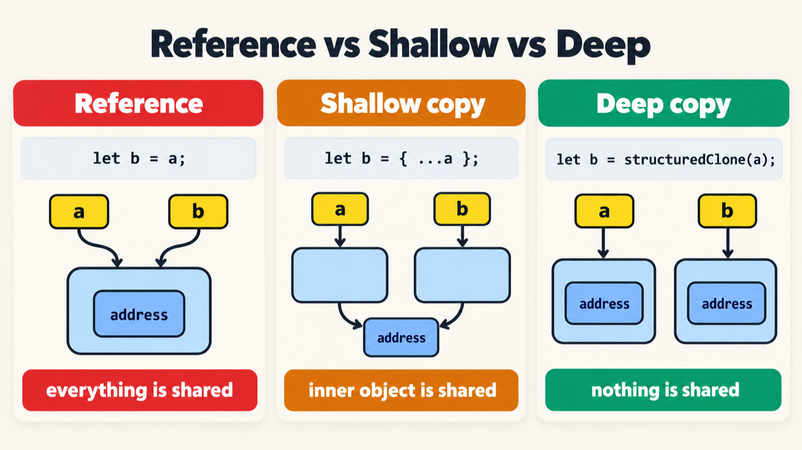

**Concept:** `{ ...obj }` makes a shallow copy: a new outer object, but any nested objects inside are still shared. `structuredClone(obj)` makes a deep copy: every level is new, so nothing is shared.

**Why:** Copying test data before changing it keeps tests independent, but a shallow copy is not enough once the data has nested objects.

**Q&A: why use this?**
- **Q: When do I reach for it?** A: Spread for flat objects (no objects or arrays inside); `structuredClone` for anything nested, which covers most API payloads and fixtures.
- **Q: What does it replace?** A: `let b = a`, which copies nothing at all (lesson 133). In Java terms: a shallow `clone()` vs a hand-written deep copy.
- **Q: What's the gotcha?** A: A shallow copy looks safe at first: changing `copy1.name` leaves the original alone, but changing `copy1.address.city` changes the original too. And `structuredClone` cannot copy functions: an object with a method, such as `getIntroduction()` in `134.js`, makes it throw a `DataCloneError`.

```mermaid
flowchart LR
    subgraph R["let b = a"]
        RA["a"] --> RO["object"]
        RB["b"] --> RO
    end
    subgraph S["let b = { ...a }"]
        SA["a"] --> SO1["object"]
        SB["b"] --> SO2["new object"]
        SO1 --> SAD["address<br/>(shared)"]
        SO2 --> SAD
    end
    subgraph D["let b = structuredClone(a)"]
        DA["a"] --> DO1["object"] --> DAD1["address"]
        DB["b"] --> DO2["new object"] --> DAD2["new address"]
    end
```

| Copy with | Change `copy.name` | Change `copy.address.city` |
|:----------|:-------------------|:---------------------------|
| `let b = a` | Original changes ❌ | Original changes ❌ |
| `let b = { ...a }` | Original safe ✅ | Original changes ❌ |
| `let b = structuredClone(a)` | Original safe ✅ | Original safe ✅ |

```js
// 17_Objects_JS/139_Shallow_Copy_Deep_Copy.js
// 1. Call by reference: one object, two names
let a = { status: "pass" };
let b = a;
b.status = "fail";
console.log(a.status);            // fail   (a changed too!)

// 2. Shallow copy (...spread): new object, but the inner object is shared
let user1 = { name: "Pramod", address: { city: "Delhi" } };
let copy1 = { ...user1 };
copy1.name = "Amit";
copy1.address.city = "Mumbai";
console.log(user1.name);          // Pramod  (safe)
console.log(user1.address.city);  // Mumbai  (changed!)

// 3. Deep copy (structuredClone): everything is new
let user2 = { name: "Pramod", address: { city: "Delhi" } };
let copy2 = structuredClone(user2);
copy2.name = "Amit";
copy2.address.city = "Mumbai";
console.log(user2.name);          // Pramod  (safe)
console.log(user2.address.city);  // Delhi   (safe)
```

---

## Chapter 18: Multi-Dimensional Arrays and Patterns

### 140: 2D Arrays: Rows and Columns

![2D arrays: grid[row][col]. In a 3 x 3 grid of 10 to 90, grid[1][2] is 60; grid.length is 3 rows and grid[0].length is 3 columns; row first, then column](assets/images/ch18-2d-grid.png)

**Concept:** A 2D array is an array whose items are arrays, and each inner array is one row. `grid[1][2]` means "row 1, then column 2". A plain list such as `["pass", "fail", "pass"]` (`140_MDArrays.js`) is a 1D array.

**Why:** Tables are everywhere in testing (data-driven test cases, the rows and cells of a page table, a CSV file), and a 2D array holds a whole table in one variable.

**Q&A: why use this?**
- **Q: When do I reach for it?** A: Data-driven tests with one row per test case, or the rows and cells you read out of an HTML table.
- **Q: What does it replace?** A: Java's `int[][] grid`. Unlike Java, rows can have different lengths ("jagged" arrays) and mix types.
- **Q: What's the gotcha?** A: A row that doesn't exist throws: `grid[7][7]` is `TypeError: Cannot read properties of undefined (reading '7')`, while a missing column only gives `undefined` (`grid[0][7]`). And `new Array(3).fill([])` puts the same inner array in every row; build separate rows with `Array.from({ length: 3 }, () => [])`.

```mermaid
flowchart LR
    G["grid"] --> R0["row 0: [10, 20, 30]"]
    G --> R1["row 1: [40, 50, 60]"]
    G --> R2["row 2: [70, 80, 90]"]
    R1 -->|"column [2]"| C["60"]
```

```js
// 18_Multi_Dimensions_Array/141_2D.js (plus two extra lookups)
let grid = [
    [10, 20, 30],
    [40, 50, 60],
    [70, 80, 90]
];

console.log(grid[0][0]);        // 10
console.log(grid[1][2]);        // 60: row 1, column 2
console.log(grid[0][7]);        // undefined: column 7 doesn't exist
// console.log(grid[7][7]);     TypeError: row 7 doesn't exist

grid[0][0] = 99;
console.log(grid);              // [ [ 99, 20, 30 ], [ 40, 50, 60 ], [ 70, 80, 90 ] ]

console.log(grid.length);       // 3 rows
console.log(grid[0].length);    // 3 columns
```

### 142: Looping Over a 2D Array

**Concept:** Two nested loops walk a 2D array: the outer loop picks a row (`i`), the inner loop visits each cell in that row (`j`), and `testMatrix[i][j]` is the current cell.

**Why:** Printing, checking or summing every cell of a table needs this pattern, for example a test matrix of test name, status and response code.

**Q&A: why use this?**
- **Q: When do I reach for it?** A: Whenever you need every cell: printing a results table, checking every cell of a UI table, or searching for a value.
- **Q: What does it replace?** A: Writing `testMatrix[0][0]`, `testMatrix[0][1]`, ... by hand. Java's nested `for` over an `int[][]` works the same way.
- **Q: What's the gotcha?** A: Use `testMatrix[i].length` as the inner limit rather than the first row's length, so rows of different lengths still work. And `process.stdout.write` keeps the cells on one line, while `console.log("")` ends the row: the same trick the star patterns use.

```mermaid
flowchart TD
    I["outer loop: i = 0, 1, 2<br/>(rows)"] --> J["inner loop: j = 0, 1, 2<br/>(cells in row i)"]
    J --> W["write testMatrix[i][j] + ' '"]
    W -->|"next j"| J
    J -->|"row done"| NL["console.log('') ends the line"]
    NL -->|"next i"| I
```

```js
// 18_Multi_Dimensions_Array/142_REAL_Exmaple.js (plus a for...of version)
let testMatrix = [
    ["login", "pass", 200],
    ["checkout", "fail", 404],
    ["search", "pass", 180]
];

for (let i = 0; i < testMatrix.length; i++) {
    for (let j = 0; j < testMatrix[i].length; j++) {
        process.stdout.write(testMatrix[i][j] + " ");
    }
    console.log("");
}
// login pass 200
// checkout fail 404
// search pass 180

// the same table with for...of and join
for (const row of testMatrix) {
    console.log(row.join(" "));
}
```

### 143: Row Totals with map and reduce

**Concept:** `scores.map(row => row.reduce((a, b) => a + b))` turns each row into one number: `map` visits every row, and `reduce` adds up the cells inside that row.

**Why:** Totals and averages per row (marks per student, failures per suite, time per test run) become a one-liner instead of two nested loops.

**Q&A: why use this?**
- **Q: When do I reach for it?** A: Any per-row summary: `map` gives one result per row, and `reduce` folds a row's cells into a single value.
- **Q: What does it replace?** A: Nested `for` loops with a running-total variable; in Java, `Arrays.stream(row).sum()`.
- **Q: What's the gotcha?** A: Without a starting value, `reduce` throws on an empty row: `TypeError: Reduce of empty array with no initial value`. Pass `0` as the second argument: `row.reduce((a, b) => a + b, 0)`.

```mermaid
flowchart LR
    R0["[85, 90, 78]"] -->|"reduce: a + b"| T0["253"]
    R1["[60, 45, 70]"] -->|"reduce: a + b"| T1["175"]
    R2["[95, 88, 92]"] -->|"reduce: a + b"| T2["275"]
    T0 --> M["map collects<br/>[253, 175, 275]"]
    T1 --> M
    T2 --> M
```

```js
// 18_Multi_Dimensions_Array/143_array_Fn.js (plus a safer version)
let scores = [
    [85, 90, 78],   // student 0
    [60, 45, 70],   // student 1
    [95, 88, 92]    // student 2
];

let rowsSum = scores.map(row => row.reduce((a, b) => a + b));
console.log(rowsSum);                     // [ 253, 175, 275 ]

// safer: start at 0, so an empty row gives 0 instead of an error
let safe = [[], [1, 2]].map(row => row.reduce((a, b) => a + b, 0));
console.log(safe);                        // [ 0, 3 ]
```

### 144: Right and Left Triangle Patterns

**Concept:** A star pattern is a pair of nested loops: the outer loop picks the row and the inner loop prints that row's stars. In `144_Right_Hand_Pattern.js` row `i` gets `i + 1` stars (1, 2, 3); in `145_Left_Hand_Triablge_Pattern.js` the outer loop counts down, so the rows get 3, 2, 1 stars.

**Why:** Pattern printing is the classic interview drill for nested loops: if you can predict the stars, you understand how the two loops work together.

**Q&A: why use this?**
- **Q: When do I reach for it?** A: Interview practice. Work out "how many stars on row `i`?" first, then turn that answer into the inner loop's condition.
- **Q: What does it replace?** A: Hard-coding every line. With `"*".repeat(k)` you can even drop the inner loop: `console.log("*".repeat(i + 1))`.
- **Q: What's the gotcha?** A: The start values change the conditions: 144 counts `i` from 0 and `j` from 0 with `j <= i`, while 145 counts `i` from 3 down to 1 and `j` from 1. Check the comments against the real output, too: 144's comment draws `* *` with spaces but the code prints `**`, and 145's comment draws 5 rows while `n = 3` prints 3.

```mermaid
flowchart LR
    subgraph RT["144: i = 0, 1, 2"]
        A1["i = 0: *"] --> A2["i = 1: **"] --> A3["i = 2: ***"]
    end
    subgraph LT["145: i = 3, 2, 1"]
        B1["i = 3: ***"] --> B2["i = 2: **"] --> B3["i = 1: *"]
    end
```

| File | Outer loop | Inner loop | Output with `n = 3` |
|:-----|:-----------|:-----------|:--------------------|
| `144_Right_Hand_Pattern.js` | `i = 0; i < n; i++` | `j = 0; j <= i` | `*`, `**`, `***` |
| `145_Left_Hand_Triablge_Pattern.js` | `i = n; i >= 1; i--` | `j = 1; j <= i` | `***`, `**`, `*` |

```js
// 18_Multi_Dimensions_Array/144_Right_Hand_Pattern.js
let n = 3;
for (let i = 0; i < n; i++) {
    for (let j = 0; j <= i; j++) {
        process.stdout.write("*");
    }
    console.log("");
}
// *
// **
// ***

// 18_Multi_Dimensions_Array/145_Left_Hand_Triablge_Pattern.js
for (let i = n; i >= 1; i--) {
    for (let j = 1; j <= i; j++) {
        process.stdout.write("*");
    }
    console.log("");
}
// ***
// **
// *
```

### 146: Pyramid Pattern

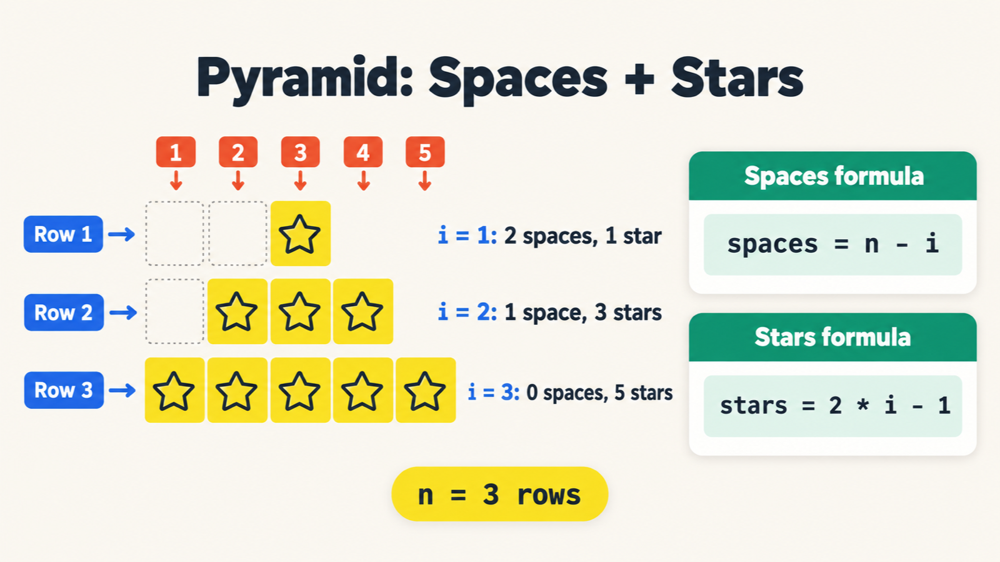

**Concept:** A centered pyramid needs two inner loops per row: first `n - i` spaces to push the stars to the right, then `2 * i - 1` stars. `146_Pyamid_Pattern.js` builds each row as a string and prints it once.

**Why:** It adds a second rule per row (spaces and stars), which makes it the usual next step after simple triangles in interviews.

**Q&A: why use this?**
- **Q: When do I reach for it?** A: Interview drills. The same "work out the count for each row" thinking applies to any loop that formats output.
- **Q: What does it replace?** A: The two inner loops can be replaced by `" ".repeat(n - i) + "*".repeat(2 * i - 1)`.
- **Q: What's the gotcha?** A: Building the row as a string and calling `console.log(row)` once also works in a browser console, while `process.stdout.write` exists only in Node.

```mermaid
flowchart LR
    I["row i"] --> S["n - i spaces"]
    S --> T["2 * i - 1 stars"]
    T --> P["console.log(row)"]
```

| Row `i` | Spaces (`n - i`) | Stars (`2 * i - 1`) | Printed |
|:-------:|:----------------:|:-------------------:|:--------|
| 1 | 2 | 1 | `  *` |
| 2 | 1 | 3 | ` ***` |
| 3 | 0 | 5 | `*****` |

```js
// 18_Multi_Dimensions_Array/146_Pyamid_Pattern.js (plus a repeat() version)
let n = 3;

for (let i = 1; i <= n; i++) {
    let row = "";
    for (let j = 1; j <= n - i; j++) {
        row += " ";              // spaces push the stars to the right
    }
    for (let j = 1; j <= 2 * i - 1; j++) {
        row = row + "*";         // 1, 3, then 5 stars
    }
    console.log(row);
}
//   *
//  ***
// *****

// the same pyramid with repeat()
for (let i = 1; i <= n; i++) {
    console.log(" ".repeat(n - i) + "*".repeat(2 * i - 1));
}
```

---

## Chapter 19: Callbacks

### 147: What Is a Callback?

**Concept:** A callback is a function you pass to another function, so that function can call it later. In `placeOrder("Burger", () => { ... })`, the arrow function is the callback, and `placeOrder` runs it when the order is done.

**Why:** It lets a function leave "what happens next" up to the caller, and every Playwright test you write is a callback: `test("...", async ({ page }) => { ... })`.

**Q&A: why use this?**
- **Q: When do I reach for it?** A: Array methods (`forEach`, `map`, `filter`), `setTimeout`, and the test body in Playwright. `148_More_CB.js` builds its own small `test()` to show the idea.
- **Q: What does it replace?** A: Hard-coding the next step inside the function. In Java you would pass a lambda or an anonymous class. All three forms in `147_Callback.js` (named, anonymous, arrow) behave the same.
- **Q: What's the gotcha?** A: Pass the function, don't call it: `placeOrder("Burger", done())` runs `done` straight away and passes its result, so `callback()` then throws a `TypeError`. Names must match exactly too: `148_More_CB.js` declares `callMeWhenDone` but calls `callMewhenDone`, which throws a `ReferenceError`. And `147_Callback.js` stops at `test(...)` with `ReferenceError: test is not defined`, because `test` only exists inside the Playwright runner.

```mermaid
sequenceDiagram
    participant You as Your code
    participant PO as placeOrder
    participant CB as callback
    You->>PO: placeOrder("Burger", callback)
    PO->>PO: Order Placed Burger
    PO->>CB: callback()
    CB-->>PO: finished
    PO-->>You: finished
```

```js
// 19_Callback/147_Callback.js (the three ways, without the test() line that only works in Playwright)
function placeOrder(item, callback) {
    console.log("Order Placed", item);
    callback();
}

// 1. A named function
function completeOrderPrint() {
    console.log("Normal Fn");
}
placeOrder("Burger", completeOrderPrint);

// 2. An anonymous function
placeOrder("Burger", function () {
    console.log("Order is ready!, pick it up!");
});

// 3. An arrow function
placeOrder("Burger", () => {
    console.log("Arrow Fn, I am also a function without a name!");
});

// 19_Callback/153_Callbacl_Return.js: a callback can return a value
function calculate(a, b, operation) {
    return operation(a, b);
}
console.log(calculate(10, 5, function (x, y) { return x + y; }));   // 15
```

### 149: Sync vs Async Callbacks

**Concept:** A sync callback runs right away, before the next line: `forEach` finishes all its items first. An async callback runs later: `setTimeout` schedules it, and the rest of the file keeps going.

**Why:** This explains the classic surprise in `150_CB_Async.js`: "Test 3" prints before "Test 2".

**Q&A: why use this?**
- **Q: When do I reach for it?** A: Knowing which one you have tells you the order things run in. `forEach`, `map` and `filter` callbacks are sync; `setTimeout`, file reads, network calls and browser actions are async.
- **Q: What does it replace?** A: Java's blocking calls like `Thread.sleep()`, which stop the thread. `setTimeout` does not block; the rest of the code carries on.
- **Q: What's the gotcha?** A: Even `setTimeout(fn, 0)` waits until the current code has finished. And you cannot `return` a result out of an async callback: `function f() { setTimeout(() => { return 5; }, 0); }` gives `undefined`. That is the problem promises solve (Chapter 20).

```mermaid
sequenceDiagram
    participant Main as Main code
    participant Timer as setTimeout
    Main->>Main: Test 1 : Started!
    Main->>Timer: schedule the callback
    Main->>Main: Test 3 : Started!
    Timer-->>Main: the delay is over
    Main->>Main: Test 2 : Started!
```

| | Sync callback | Async callback |
|:--|:--|:--|
| Example | `forEach` | `setTimeout` |
| Runs | Now, before the next line | Later, after the current code finishes |
| Holds up the next line? | Yes | No |

```js
// 19_Callback/149_CB_Sync.js (with the "All done" line its comment talks about)
let testResults = ["Pass", "Fail", "Pass", "Skip"];
testResults.forEach(function (result, index) {
    console.log("Test", index, result);
});
console.log("All done");    // LAST: forEach finishes all 4 items first

// 19_Callback/150_CB_Async.js (delay shortened from 5000 to 500 ms)
console.log("Test 1 : Started!");
setTimeout(function () {
    console.log("Test 2 : Started!");   // prints LAST
}, 500);
console.log("Test 3 : Started!");       // prints before Test 2
```

### 151: Callback Hell

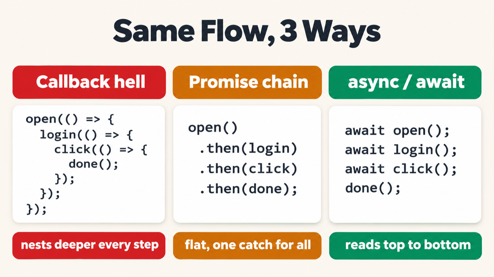

**Concept:** When each async step needs the previous one to finish, each callback goes inside the last one and the code drifts to the right. This is called callback hell, or the pyramid of doom (`151_CallBackHell.js`, `154_Pyramid_DOOM.js`).

**Why:** It is the problem promises and `async/await` were created to solve; `152_REAL_QA.js` shows how bad it gets with ten nested steps and an error check at every level.

**Q&A: why use this?**
- **Q: When do I reach for it?** A: Never on purpose. Learn to recognise it, because you will meet it in older Node code and libraries.
- **Q: What does it replace?** A: Nothing; promises (lesson 157) and `async/await` (lesson 162) replace it, and both read top to bottom.
- **Q: What's the gotcha?** A: Every level needs its own error check (`if (loginError) { ... return; }` in `152_REAL_QA.js`, the "error-first" callback style), and forgetting one silently loses the failure. `152_REAL_QA.js` only shows the shape: its functions are not defined, so running it throws `ReferenceError: loginUser is not defined`.

```mermaid
flowchart LR
    A["openBrowser"] -->|"callback"| B["goToLoginPage"]
    B -->|"callback"| C["enterCredentials"]
    C -->|"callback"| D["clickLogin"]
    D -->|"callback"| E["Test is Complete!"]
```

```js
// 19_Callback/151_CallBackHell.js (shortened: one helper instead of four copies)
function step(message, callback) {
    setTimeout(function () {
        console.log(message);
        callback();
    }, 500);
}

// THIS IS CALLBACK HELL
step("Step 1 - browser starting...", function () {
    step("Step 2: Login page loaded", function () {
        step("Step 3: Credentials entered", function () {
            step("Step 4: Login button clicked", function () {
                console.log("Test is Complete!");
            });
        });
    });
});
```

---

## Chapter 20: Promises

### 155: Promises: then, catch and finally

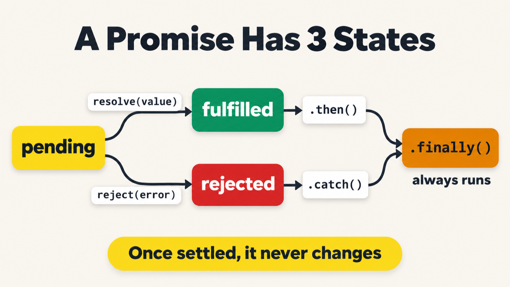

**Concept:** A promise is an object standing in for a result that isn't ready yet. It starts `pending`, then becomes `fulfilled` (`resolve(value)`) or `rejected` (`reject(error)`). `.then()` handles success, `.catch()` handles failure, and `.finally()` always runs.

**Why:** Every Playwright action (`page.goto()`, `page.click()`) returns a promise, so understanding promises is how you understand those calls.

**Q&A: why use this?**
- **Q: When do I reach for it?** A: Any work that finishes later: API calls, page actions, file reads. Use `finally` for cleanup that must run either way, such as closing a browser.
- **Q: What does it replace?** A: Passing success and error callbacks by hand (lesson 151). Java's `CompletableFuture` is the closest match.
- **Q: What's the gotcha?** A: A rejected promise with no `.catch()` crashes a Node script: `Promise.reject("boom")` ends with an `UnhandledPromiseRejection` error and exit code 1. And a promise settles only once: `resolve("first"); reject("second");` stays `"first"`.

```mermaid
flowchart LR
    P["pending"] -->|"resolve(value)"| F["fulfilled"]
    P -->|"reject(error)"| R["rejected"]
    F --> T[".then()"]
    R --> C[".catch()"]
    T --> FN[".finally()"]
    C --> FN
```

```js
// 20_Promise/155_Promise.js
let apiCall = new Promise(function (resolve, reject) {
    resolve({ status: 200, body: "User Data" });
});
apiCall.then(function (response) {
    console.log(response);          // { status: 200, body: 'User Data' }
});

let testRun = new Promise(function (resolve, reject) {
    reject("Assertion Failed");
});
testRun.then(function (data) {      // resolve goes here
    console.log(data);
}).catch(function (error) {         // reject goes here
    console.log(error);             // Assertion Failed
});

// 20_Promise/156_Promise_Finally.js
let call2 = new Promise(function (resolve, reject) {
    reject("error");
});
call2.then(function (data) {
    console.log(data);
}).catch(function (error) {
    console.log(error);             // error
}).finally(function () {
    console.log("I will be executed anyhow!!");
});
```

### 157: Chaining Promises

**Concept:** Each `.then()` returns a new promise, so steps can be chained in a flat line: return the next promise from one `.then()`, and the next `.then()` receives its result. One `.catch()` at the end handles a failure from any step.

**Why:** It turns callback hell into a readable list of steps: `157_Promise_Improve.js` is the same login flow as lesson 151, with no pyramid.

**Q&A: why use this?**
- **Q: When do I reach for it?** A: Several async steps in order, when you aren't using `async/await`. You will also read chains like this in existing code.
- **Q: What does it replace?** A: Nested callbacks, each with its own error check; a chain needs just one `.catch()`.
- **Q: What's the gotcha?** A: Forget the `return` inside a `.then()` and the next step gets `undefined` without waiting: `Promise.resolve(1).then(v => { v + 1 }).then(v => console.log(v))` prints `undefined`.

```mermaid
flowchart LR
    A["openBrowser()"] -->|".then"| B["goToLogin()"]
    B -->|".then"| C["enterCredentials()"]
    C -->|".then"| D["clickLogin()"]
    D --> F[".finally: Done execution!"]
    A -.->|"any step fails"| E[".catch"]
    D -.-> E
    E --> F
```

```js
// 20_Promise/157_Promise_Improve.js (shortened: one helper instead of four functions)
function step(message) {
    return new Promise(function (resolve) {
        resolve(message);
    });
}

step("Browser has been opened!")
    .then(function (msg) {
        console.log("Step 1", msg);
        return step("Login page loaded");
    }).then(function (msg) {
        console.log("Step 2 :", msg);
        return step("Credentials entered");
    }).then(function (msg) {
        console.log("Step 3 :", msg);
        return step("Logged in successfully");
    }).then(function (msg) {
        console.log("Step 4 :", msg);
    }).catch(function (error) {
        console.log("Error:", error);
    }).finally(function () {
        console.log("Done execution!");
    });
```

### 158: Promise.all, allSettled and race

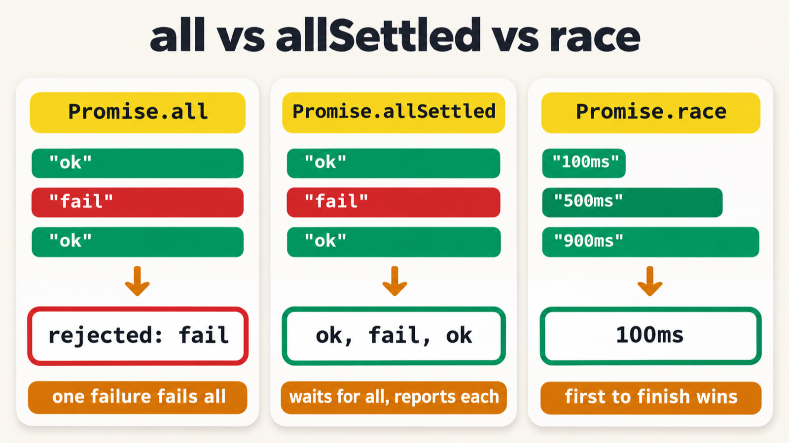

**Concept:** These combine several promises into one. `Promise.all` waits for all of them and rejects on the first failure, `Promise.allSettled` waits for all and reports each result, and `Promise.race` settles with whichever finishes first.

**Why:** Tests often run things together: several API health checks, or waiting for a response while clicking the button that triggers it.

**Q&A: why use this?**
- **Q: When do I reach for it?** A: `all` when every result is required, as in Playwright's `await Promise.all([page.waitForResponse(url), page.click("#save")])`; `allSettled` for a full pass/fail report; `race` for "first response wins" or a timeout.
- **Q: What does it replace?** A: Waiting for promises one at a time, which adds the times up: two 100 ms waits take about 200 ms in sequence, but about 100 ms with `Promise.all`.
- **Q: What's the gotcha?** A: `160_Promise.race.js` has a misplaced bracket: `setTimeout(function () { ... }), 100` never passes the delay, so both timers fire at once and the fast server wins only because it is listed first. Write `setTimeout(function () { ... }, 100)`. Also, `r.value || r.reason` in `159_Promise.Settle.js` prints `undefined` for a falsy value like `0`, so check `r.status` when values can be falsy.

```mermaid
flowchart TD
    Q{"What do you need?"} -->|"every result, stop on a failure"| A["Promise.all"]
    Q -->|"every outcome, pass or fail"| S["Promise.allSettled"]
    Q -->|"only the first to finish"| R["Promise.race"]
```

| Method | Waits for | Gives you | If one rejects |
|:-------|:----------|:----------|:---------------|
| `Promise.all` | All | Array of values | Rejects straight away |
| `Promise.allSettled` | All | Array of `{ status, value }` or `{ status, reason }` | Still reports all |
| `Promise.race` | The first to finish | That one's result | Rejects if the first to finish rejected |

```js
// 20_Promise/158_Promise.All.js
Promise.all([Promise.resolve("Auth Ok"), Promise.resolve("DB OK")]).then(function (results) {
    console.log("All checks:", results);    // All checks: [ 'Auth Ok', 'DB OK' ]
});
Promise.all([Promise.resolve("OK"), Promise.reject("DB DOWN"), Promise.resolve("OK")])
    .then(function (r) { console.log(r); })
    .catch(function (err) { console.log("Failed:", err); });   // Failed: DB DOWN

// 20_Promise/159_Promise.Settle.js
Promise.allSettled([Promise.resolve("Test A Passed!"), Promise.reject("Test B failed")])
    .then(function (results) {
        results.forEach(function (r, i) {
            console.log("Test " + (i + 1) + ":", r.status, "-", r.value || r.reason);
        });
    });
// Test 1: fulfilled - Test A Passed!
// Test 2: rejected - Test B failed

// 20_Promise/160_Promise.race.js (bracket fixed, and the slow server listed first)
let slowServer = new Promise(function (resolve) {
    setTimeout(function () { resolve("Slow 500ms"); }, 500);
});
let fastServer = new Promise(function (resolve) {
    setTimeout(function () { resolve("Fast 100ms"); }, 100);
});
Promise.race([slowServer, fastServer]).then(function (winner) {
    console.log("Winner:", winner);         // Winner: Fast 100ms
});
```

### 161: Promise Interview Questions

**Concept:** Short "what does this print?" drills from `161_IQ.js`: how values flow down a chain, where a thrown error lands, and when `.finally()` runs.

**Why:** These questions check whether you can follow a chain step by step, and they come up often in interviews.

**Q&A: why use this?**
- **Q: When do I reach for it?** A: Interview prep. Trace each step: a `.then()` receives whatever the previous `.then()` returned.
- **Q: What does it replace?** A: Guessing. The rules are short: a return value moves down to the next `.then()`, and an error jumps down to the next `.catch()`.
- **Q: What's the gotcha?** A: After a rejection or a `throw`, every `.then()` is skipped until the next `.catch()`, so `"This will NOT run"` really doesn't. And timing: even an already-resolved promise's `.then()` runs after the current code finishes, but before `setTimeout(fn, 0)`.

```mermaid
flowchart LR
    S["Promise.resolve('start')"] --> A[".then: logs start, then throws"]
    A -.->|"skipped"| B[".then: This will NOT run"]
    A -->|"the error jumps down"| C[".catch: Caught: Broke at step 2"]
```

| Code | Prints |
|:-----|:-------|
| `Promise.resolve(5).then(v => v * 10).then(v => console.log("Result:", v))` | `Result: 50` |
| `Promise.resolve(1)` with `.then` logging and returning `val + 1`, three times | `1`, `2`, `3` |
| `console.log("A"); setTimeout(() => console.log("C"), 0); Promise.resolve().then(() => console.log("B")); console.log("D");` | `A`, `D`, `B`, `C` |

```js
// 20_Promise/161_IQ.js (commented examples switched on)
let p = Promise.resolve(5);
p.then(function (val) {
    return val * 10;
}).then(function (val) {
    console.log("Result:", val);            // Result: 50
});

Promise.resolve("start")
    .then(function (val) {
        console.log(val);                   // start
        throw new Error("Broke at step 2");
    })
    .then(function () {
        console.log("This will NOT run");
    })
    .catch(function (err) {
        console.log("Caught:", err.message);   // Caught: Broke at step 2
    });

Promise.reject("Test failed")
    .then(function (data) {
        console.log("Data:", data);         // skipped
    })
    .catch(function (err) {
        console.log("Error:", err);         // Error: Test failed
    })
    .finally(function () {
        console.log("Cleanup done");        // Cleanup done
    });
```

---

## Chapter 21: Async and Await

### 162: async and await

**Concept:** `async` makes a function always return a promise. `await` pauses that function until a promise settles and hands back its value, so async code reads top to bottom like normal code.

**Why:** This is how modern Playwright tests are written: `await page.goto(url)`, then `await page.click("#login")`.

**Q&A: why use this?**
- **Q: When do I reach for it?** A: Anywhere you have promises, which means every Playwright action and API call.
- **Q: What does it replace?** A: `.then()` chains (lesson 157) and callback hell (lesson 151): same flow, written top to bottom.
- **Q: What's the gotcha?** A: Forget `await` and you get the promise instead of the value: `console.log(apiRequest())` prints `Promise { { status: 200 } }`. In Playwright, a missing `await` is a classic cause of flaky tests. And `await` inside a normal function is `SyntaxError: await is only valid in async functions and the top level bodies of modules`.

```mermaid
sequenceDiagram
    participant R as runAPIRequest()
    participant A as apiRequest()
    R->>A: await apiRequest()
    Note over R: runAPIRequest pauses here, other code can run
    A-->>R: { status: 200 }
    R->>R: console.log("API status:", response.status)
```

```js
// 21_Async_Await/162_Async_Await.js (plus the last line, showing a missing await)
// An async function always returns a promise.
// await reads the resolved value inside another async function.

function apiRequest() {
    return new Promise(function (resolve) {
        resolve({ status: 200 });
    });
}

async function runAPIRequest() {
    let response = await apiRequest();
    console.log("API status:", response.status);   // API status: 200
}

runAPIRequest();

console.log(apiRequest());   // Promise { { status: 200 } }: no await, so you get the promise
```

### 163: try, catch and finally

**Concept:** Inside an `async` function, a rejected promise acts like an error thrown at the `await` line: `catch` receives it, and `finally` always runs afterwards.

**Why:** Tests need to report a failed API call and still clean up, whether or not the step worked.

**Q&A: why use this?**
- **Q: When do I reach for it?** A: When a step can fail and you want to handle that yourself, like logging a `503` and carrying on. Put cleanup that must always happen in `finally`.
- **Q: What does it replace?** A: `.then().catch().finally()` chains (lesson 155). The keywords work like Java's `try/catch/finally`.
- **Q: What's the gotcha?** A: `try/catch` only catches what you `await`: `try { Promise.reject("nope"); } catch (e) {}` still crashes the script with exit code 1. And `.then()` only exists on a promise, so calling it on a normal function's result throws a `TypeError` (see the table). Also, `Promise.resolve` is not a constructor: `return new Promise.resolve("abc")` in `163_AA.js` throws `TypeError: Promise.resolve is not a constructor` as soon as the function is called, so write `Promise.resolve("abc")`. It doesn't show today only because the file never calls that function.

```mermaid
flowchart TD
    T["try: await Promise.reject('503 Service Unavailable')"] -->|"rejected"| C["catch: Error 503 Service Unavailable"]
    T -->|"resolved"| R["console.log('Result', result)"]
    C --> F["finally: Clean up!!"]
    R --> F
```

| Code | Result |
|:-----|:-------|
| Not `async`: `getTestResults().then(...)` | `TypeError: getTestResults(...).then is not a function` |
| `async`, no `()`: `getTestResults.then(...)` | `TypeError: getTestResults.then is not a function` |
| `async`, with `()`: `getTestResults().then(...)` | Works |

```js
// 21_Async_Await/163_AA.js (Promise.resolve without new, and the calls switched on)
async function getTestResults() {
    return Promise.resolve("abc");
}

getTestResults().then(function (results) {
    console.log(results);               // abc
});

async function test() {
    let r = await getTestResults();
    console.log(r);                     // abc
}
test();

async function testAPI() {
    try {
        let result = await Promise.reject("503 Service Unavailable");
        console.log('Result', result);  // skipped
    } catch (error) {
        console.log('Error', error);    // Error 503 Service Unavailable
    } finally {
        console.log("Clean up!!");      // Clean up!!
    }
}

testAPI();
```

### 164: await in a Playwright Test

**Concept:** A Playwright test body is an `async` arrow function, and `page` is a fixture that Playwright passes into it. Anything that returns a promise, like `page.goto()`, needs `await`.

**Why:** This is where the whole chapter pays off: every test you write uses it.

**Q&A: why use this?**
- **Q: When do I reach for it?** A: In every Playwright test. [playwright_page_methods_await.md](00_learning/playwright_page_methods_await.md) lists every `page` method and whether it needs `await`. Your own async helpers need it too: `let c = await getExmaple();` in `165_Playwright2.spec.ts`.
- **Q: What does it replace?** A: Selenium's blocking Java calls: `driver.get(url)` waits by itself, while in Playwright you write `await page.goto(url)`.
- **Q: What's the gotcha?** A: `node` can't run these files. The root package includes `@playwright/test`, but browser binaries must be installed with `npx playwright install`. Also, `page.goto("")` in `165_Playwright2.spec.ts` fails with `Cannot navigate to invalid URL`, so give it a real URL.

```mermaid
sequenceDiagram
    participant Runner as Playwright runner
    participant Test as Your async function
    participant Browser
    Runner->>Test: calls it with { page }
    Test->>Browser: await page.goto(url)
    Browser-->>Test: page loaded
    Test->>Browser: await expect(link).toBeVisible()
    Browser-->>Test: link is visible
    Test-->>Runner: test passed
```

```ts
// 21_Async_Await/164_Playwright.spec.ts (extended to show await and no await side by side)
import { test, expect } from '@playwright/test';

test('uses await in a Playwright test', async ({ page }) => {
    await page.goto('https://playwright.dev/');                     // Promise: await
    const link = page.getByRole('link', { name: 'Get started' });   // Locator: no await
    await expect(link).toBeVisible();                               // Promise: await
    console.log('url:', page.url());                                // string: no await
    console.log('title:', await page.title());                      // Promise<string>: await
});
```

### 166: Sequential vs Parallel

![Sequential vs parallel: await a(); await b(); await c(); runs one after another and takes about 3000ms; await Promise.all([a(), b(), c()]) runs them together and takes about 1000ms](assets/images/ch21-seq-vs-parallel.png)

**Concept:** Awaiting calls one after another runs them in sequence, so the times add up: three 1-second calls take about 3 seconds. Starting them together with `await Promise.all([...])` runs them in parallel, so the total is about as long as the slowest one.

**Why:** Parallel calls can make test setup and health checks much faster, while sequential calls keep steps that depend on each other in the right order.

**Q&A: why use this?**
- **Q: When do I reach for it?** A: Sequential when a step needs the last one (log in, then open the dashboard). Parallel when the calls are independent (checking the auth, user and payment services).
- **Q: What does it replace?** A: Awaiting unrelated calls one by one, which wastes time for no benefit.
- **Q: What's the gotcha?** A: `await` inside `forEach` doesn't wait: `forEach` finishes at once, so code after the loop runs before the items are done. Use `for...of` to go one at a time, or `Promise.all(list.map(...))` for parallel. And `Promise.all` rejects as soon as one call fails (lesson 158).

```mermaid
flowchart LR
    subgraph SEQ["Sequential: about 3000ms"]
        A1["Login<br/>1s"] --> A2["Dashboard<br/>1s"] --> A3["Report<br/>1s"]
    end
    subgraph PAR["Parallel: about 1000ms"]
        B1["Auth Service<br/>1s"]
        B2["User Service<br/>1s"]
        B3["Payment Service<br/>1s"]
    end
```

| | Sequential | Parallel |
|:--|:--|:--|
| Code | `await a(); await b(); await c();` | `await Promise.all([a(), b(), c()]);` |
| Three 1-second calls take | About 3000 ms | About 1000 ms |
| Use when | Steps depend on each other | Calls are independent |

```js
// 21_Async_Await/166_SEQ.executin.js and 167_Parallel_Ex.js (combined)
function apiCall(name) {
    return new Promise(function (resolve) {
        setTimeout(function () { resolve(name + ": 200 OK"); }, 1000);
    });
}

async function sequentialTest() {
    let start = Date.now();
    let r1 = await apiCall("Login");
    let r2 = await apiCall("Dashboard");
    let r3 = await apiCall("Report");
    console.log(r1, r2, r3);
    console.log("Sequential time: ~" + (Date.now() - start) + "ms");   // about 3000ms
}

async function parallelTest() {
    let start = Date.now();
    let [r1, r2, r3] = await Promise.all([
        apiCall("Auth Service"),
        apiCall("User Service"),
        apiCall("Payment Service")
    ]);
    console.log(r1, r2, r3);
    console.log("Parallel time: ~" + (Date.now() - start) + "ms");     // about 1000ms
}

sequentialTest().then(parallelTest);
```

### 168: Retry Pattern

**Concept:** A retry wraps a flaky call in a loop: `await` it inside `try/catch`, return on the first success, and give up after a set number of attempts.

**Why:** Test environments flake, and a retry separates a call that fails now and then from one that is really broken.

**Q&A: why use this?**
- **Q: When do I reach for it?** A: Waiting for an API that becomes ready eventually, or calling an unstable test environment. In Playwright, reach for the built-ins first: `expect(...).toPass()` and the `retries` config option.
- **Q: What does it replace?** A: Calling the API again by hand, or a fixed sleep that hopes the system is ready.
- **Q: What's the gotcha?** A: Retries can hide real bugs, so log every failed attempt. Also, `168_API_Flaky_Finder.js` describes retries in its comment but has no loop yet: `await createFlakyAPIs(1)` waits on a plain function, which returns straight away, and `s()` isn't awaited, so it logs `Promise { 'Attempt 1: success!' }`.

```mermaid
flowchart TD
    S["attempt 1"] --> C["await apiCall()"]
    C -->|"success"| R["return the result"]
    C -->|"rejected"| L{"attempts left?"}
    L -->|"yes"| C
    L -->|"no"| T["throw: Failed after 3 attempts"]
```

```js
// 21_Async_Await/168_API_Flaky_Finder.js (its createFlakyAPIs, plus the retry loop its comment describes)
function createFlakyAPIs(successAttempt) {
    let attempt = 0;
    return function () {
        attempt++;
        if (attempt < successAttempt) {
            return Promise.reject("Attempt " + attempt + ": failed");
        }
        return Promise.resolve("Attempt " + attempt + ": success!");
    };
}

async function retry(apiCall, maxAttempts) {
    for (let i = 1; i <= maxAttempts; i++) {
        try {
            let result = await apiCall();
            console.log(result);
            return result;
        } catch (err) {
            console.log(err);
        }
    }
    throw new Error("Failed after " + maxAttempts + " attempts");
}

async function retryTesting() {
    await retry(createFlakyAPIs(3), 3);   // succeeds after two failures
    await retry(createFlakyAPIs(5), 3).catch(e => console.log(e.message));   // runs out of retries
}
retryTesting();
```

### 169: Async Interview Questions

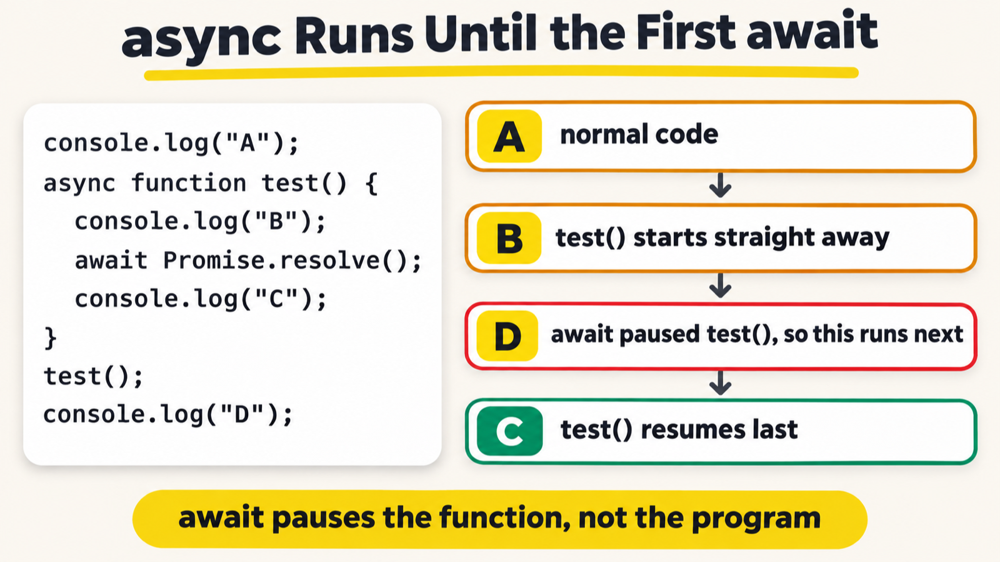

**Concept:** "What does this print?" drills from `169_IQ.js`, `170_IQ.js` and `171_IQ.js`. The key rule: an `async` function runs like normal code until its first `await`, then pauses while the code after the call carries on.

**Why:** `171_IQ.js` is a classic interview question, and working it out shows you understand how `await` really behaves.

**Q&A: why use this?**
- **Q: When do I reach for it?** A: Interview prep, and whenever logs come out in an order you didn't expect.
- **Q: What does it replace?** A: Guessing. Everything before the first `await` runs immediately; everything after it runs once the current code has finished.
- **Q: What's the gotcha?** A: `await` pauses only its own function, not the whole program. That is why `D` prints before `C` in `171_IQ.js`.

```mermaid
sequenceDiagram
    participant Main as Main code
    participant T as test()
    Main->>Main: prints A
    Main->>T: test()
    T->>T: prints B
    T-->>Main: hits await, hands back a promise
    Main->>Main: prints D
    Main-->>T: current code finished
    T->>T: prints C
```

| Drill | Prints |
|:------|:-------|
| `169_IQ.js`: `sayHello().then(...)` | `Hello, QA!` |
| `169_IQ.js`: `getStatus()` | `Status code: 200` |
| `169_IQ.js`: `testFlow()` | `Opened browser`, `Clicked login`, `Verified dashboard` |
| `170_IQ.js`: `riskyTest()` | `Test failed: Element not found` |
| `170_IQ.js`: `apiTest()` | `Status: 201`, `Body: Created`, `Test complete` |
| `171_IQ.js` | `A`, `B`, `D`, `C` |

```js
// 21_Async_Await/171_IQ.js
console.log("A");
async function test() {
    console.log("B");
    await Promise.resolve();
    console.log("C");
}
test();
console.log("D");
// A, B, D, C

// 21_Async_Await/170_IQ.js (first example switched on)
async function riskyTest() {
    try {
        let data = await Promise.reject("Element not found");
        console.log(data);                  // skipped
    } catch (err) {
        console.log("Test failed:", err);   // Test failed: Element not found
    }
}
riskyTest();
```

---

## Chapter 22: Export and Import

### 172: Named Exports and Imports

**Concept:** Putting `export` in front of a variable or function lets other files use it. `import { BASE_URL, formatUpperCaseString } from './testutils.js'` then pulls those exact names into another file.

**Why:** Test code gets split across files (URLs and config in one, helpers in another, tests elsewhere), and modules let each file share only what it means to.

**Q&A: why use this?**
- **Q: When do I reach for it?** A: Shared test data and helpers, such as one `BASE_URL` instead of a copy in every test. Playwright itself works this way: `import { test, expect } from '@playwright/test'`.
- **Q: What does it replace?** A: Copy-pasting the same constants into every file. It is like Java's `public` plus `import`.
- **Q: What's the gotcha?** A: Only exported names can be imported: `fname` in `testutils.js` has no `export`, so `import { fname }` fails with `does not provide an export named 'fname'`. In Node the path needs the `.js` extension. Node also prints a `MODULE_TYPELESS_PACKAGE_JSON` warning for these files; it's harmless, and adding `"type": "module"` to `package.json` would break the `require()` lessons in Chapter 08.

```mermaid
flowchart LR
    T["testutils.js<br/>export BASE_URL<br/>export formatUpperCaseString<br/>fname (not exported)"] -->|"import { BASE_URL, formatUpperCaseString }"| I["172_IE.js"]
    T -.->|"fname stays inside its file"| X["cannot be imported"]
```

```js
// 22_Export_Import/testutils.js
export let BASE_URL = "https://app.vwo.com";

export function formatUpperCaseString(sname) {
    return sname.toUpperCase();
}

let fname = "Pramod";   // not exported: stays inside this file

// 22_Export_Import/172_IE.js
import { BASE_URL, formatUpperCaseString } from './testutils.js';

console.log(BASE_URL);                          // https://app.vwo.com
console.log(formatUpperCaseString("Pramod"));   // PRAMOD
```

### 173: Renaming Imports with as

**Concept:** Two files can export the same name (`BASE_URL` in both `utils.js` and `testutils.js`). `import { BASE_URL as bul_util }` gives it a local name, so both can be used in one file.

**Why:** Name clashes are common once a project grows, for example an API base URL and a UI base URL.

**Q&A: why use this?**
- **Q: When do I reach for it?** A: When two modules export the same name, or when the exported name is unclear in the file that uses it.
- **Q: What does it replace?** A: Renaming the export in its own file, which breaks every other file that imports it.
- **Q: What's the gotcha?** A: The path must match the file exactly. `173.js` imports `./testutil.js`, but the file is `testutils.js`, so Node stops with `ERR_MODULE_NOT_FOUND` before printing anything.

```mermaid
flowchart LR
    U["utils.js<br/>BASE_URL = https://api.example.com"] -->|"as bul_util"| F["173.js"]
    T["testutils.js<br/>BASE_URL = https://app.vwo.com"] -->|"as bul_testtul"| F
```

```js
// 22_Export_Import/173.js (with the file name fixed to testutils.js)
import { BASE_URL as bul_util, formatTestName } from "./utils.js";
import { BASE_URL as bul_testtul } from "./testutils.js";

console.log(bul_util);                  // https://api.example.com
console.log(bul_testtul);               // https://app.vwo.com
console.log(formatTestName("login"));   // TC_LOGIN

// 22_Export_Import/utils.js (excerpt)
export let BASE_URL = "https://api.example.com";

export function formatTestName(name) {
    return "TC_" + name.toUpperCase();
}
```

### 174: Default vs Named Exports

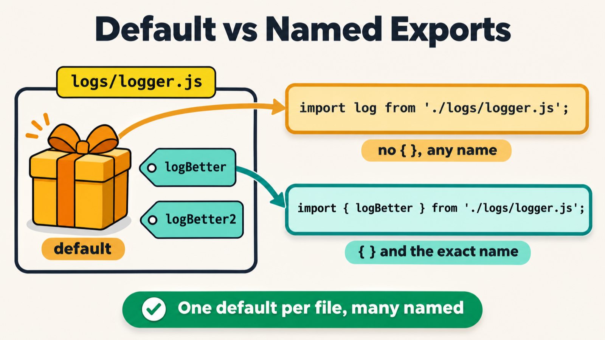

**Concept:** A file can have one `export default` (its main thing, imported without braces under any name you like) and any number of named exports (imported in braces by their exact name).

**Why:** It is the other half of the module system, and you will see both styles in every codebase, including Playwright's own `import { test, expect } from '@playwright/test'`.

**Q&A: why use this?**
- **Q: When do I reach for it?** A: A default for a file's one main thing (a logger, a page object class), and named exports for groups of helpers and constants. [default_vs_named_export_eli5.pdf](00_learning/default_vs_named_export_eli5.pdf) explains it with pictures.
- **Q: What does it replace?** A: Nothing; the two styles work together, and one import line can take both: `import log, { logBetter } from './logs/logger.js'`.
- **Q: What's the gotcha?** A: `import { log }` fails, because the default's function name is not a named export. Two `export default`s in one file is a `SyntaxError`. And this repo's `.gitignore` ignores every `logs/` folder, so `logs/logger.js` had to be added with `git add -f`; without it, `174_Logs.js` would break for anyone who clones the repo.

```mermaid
flowchart LR
    L["logs/logger.js"] -->|"export default log"| D["import log from ...<br/>no { }, any name"]
    L -->|"export logBetter, logBetter2"| N["import { logBetter } from ...<br/>{ } and the exact name"]
```

| | Default export | Named export |
|:--|:--|:--|
| How many per file | One | As many as you want |
| Import with | `import log from './logs/logger.js'` | `import { logBetter } from './logs/logger.js'` |
| Name on import | Anything you like | The exact name, or rename with `as` |

```js
// 22_Export_Import/logs/logger.js (excerpt)
export default function log(message) {
    console.log("[LOG] " + message);
}

export function logBetter(message) {
    console.log("-----------");
    console.log("[LOGS] " + message);
    console.log("-----------");
}

// 22_Export_Import/174_Logs.js
import log from './logs/logger.js';                        // default: no { }, any name
import { logBetter, logBetter2 } from './logs/logger.js';  // named: { } and exact names

log('Starting');                                    // [LOG] Starting
logBetter("Starting the TC of the app.vwo.com");    // the message between two dashed lines
```

---

## Chapter 23: Classes and Objects

### 175: Class and Objects

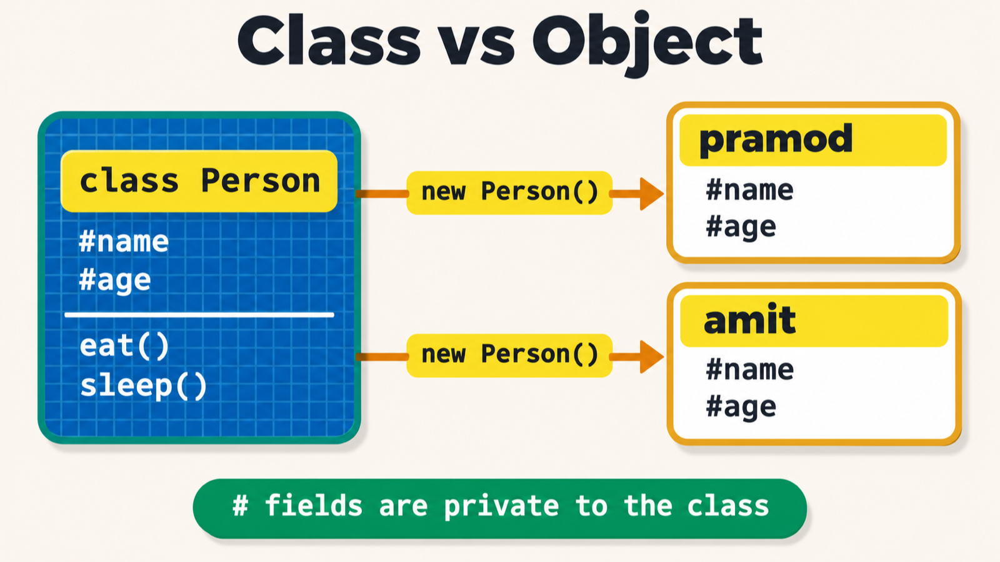

**Concept:** A class is a blueprint. It lists the data each object holds (fields like `#name`) and what each object can do (methods like `eat()`). `new Person()` builds a separate object from that blueprint every time.

**Why:** Playwright's Page Object Model is built from classes (`class LoginPage { ... }` with locators as fields and actions as methods), and `utils.js` already sketches one in its comments.

**Q&A: why use this?**
- **Q: When do I reach for it?** A: Whenever several things share a shape: users, test-data builders and page objects.
- **Q: What does it replace?** A: Java classes, with less ceremony: no types, `#` instead of `private`, and methods without the `function` keyword.
- **Q: What's the gotcha?** A: `#` fields really are private: `pramod.#name` outside the class is a `SyntaxError`, and `pramod["#name"]` is just `undefined`. Each `new` makes a different object, so `pramod === amit` is `false`. Calling `Person()` without `new` throws a `TypeError`, and using a class above its declaration throws a `ReferenceError`.

```mermaid
flowchart LR
    C["class Person<br/>#name, #age<br/>eat(), sleep()"] -->|"new Person()"| P["pramod"]
    C -->|"new Person()"| A["amit"]
    P -.-|"pramod === amit is false"| A
```

```js
// 23_Class_Objects/175_Class.js (plus a constructor, so the objects hold data)
class Person {
    // Attributes | Instance variables | Data members | Properties
    #name;
    #age;

    constructor(name, age) {
        this.#name = name;
        this.#age = age;
    }

    // Behaviour | Methods | Member functions
    eat() { return this.#name + " is eating"; }
    sleep() { return this.#name + " is sleeping"; }
}

const pramod = new Person("Pramod", 30);   // object -> new Person(), object ref -> pramod
const amit = new Person("Amit", 28);

console.log(pramod.eat());      // Pramod is eating
console.log(amit.sleep());      // Amit is sleeping
console.log(pramod === amit);   // false: two separate objects
// console.log(pramod.#name);   SyntaxError: #name is private to the class
```

---

## Chapter 24: Playwright

### Your First Playwright Project

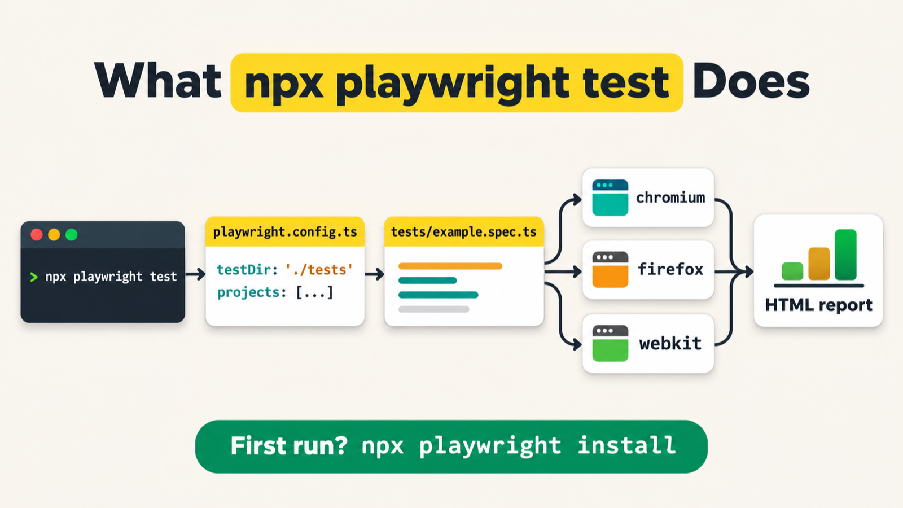

**Concept:** `24_Playwright/` is a complete Playwright test project. `package.json` installs `@playwright/test`, `playwright.config.ts` says where the tests live and which browsers to use, and `tests/example.spec.ts` holds two tests. `npx playwright test` runs every test in every browser project.

**Why:** This is where the JavaScript chapters turn into test automation: functions, arrow functions, `async/await` and imports all appear in these few lines.

**Q&A: why use this?**
- **Q: When do I reach for it?** A: Every Playwright project starts from this layout; it's what `npm init playwright@latest` generates. Run the commands from inside `24_Playwright/`, since it has its own `package.json`.
- **Q: What does it replace?** A: The Selenium + TestNG setup from Chapter 00: no driver binaries to manage, built-in auto-waiting, and the test runner and assertions in one package.
- **Q: What's the gotcha?** A: The config has 3 browser projects, so the 2 tests run 6 times, and each browser has to be downloaded once with `npx playwright install`. On this machine, Chromium passed but Firefox and WebKit failed with `Executable doesn't exist ... npx playwright install`. Also, the `html` reporter opens a report in your browser when a test fails; add `--reporter=line` to stay in the terminal.

```mermaid
flowchart LR
    CMD["npx playwright test"] --> CFG["playwright.config.ts<br/>testDir: './tests'<br/>3 projects"]
    CFG --> SPEC["tests/example.spec.ts<br/>2 tests"]
    SPEC --> B1["chromium"]
    SPEC --> B2["firefox"]
    SPEC --> B3["webkit"]
    B1 --> R["HTML report"]
    B2 --> R
    B3 --> R
```

| Config setting | Value | What it means |
|:---------------|:------|:--------------|
| `testDir` | `'./tests'` | Where the test files live |
| `fullyParallel` | `true` | Tests inside a file run in parallel |
| `forbidOnly` | `!!process.env.CI` | A forgotten `test.only` fails the CI run |
| `retries` | `process.env.CI ? 2 : 0` | Retry twice on CI, never locally (the ternary from lesson 28) |
| `workers` | `process.env.CI ? 1 : undefined` | One worker on CI, Playwright's default locally |
| `reporter` | `'html'` | An HTML report in `playwright-report/` |
| `use.trace` | `'on-first-retry'` | Record a trace when a test is retried |
| `projects` | chromium, firefox, webkit | Which browsers the tests run in |

```ts
// 24_Playwright/tests/example.spec.ts
import { test, expect } from '@playwright/test';

test('has title', async ({ page }) => {
  await page.goto('https://playwright.dev/');

  // Expect a title "to contain" a substring.
  await expect(page).toHaveTitle(/Playwright/);
});

test('get started link', async ({ page }) => {
  await page.goto('https://playwright.dev/');

  // Click the get started link.
  await page.getByRole('link', { name: 'Get started' }).click();

  // Expects page to have a heading with the name of Installation.
  await expect(page.getByRole('heading', { name: 'Installation' })).toBeVisible();
});
```

```bash
cd 24_Playwright
npm install                                               # installs @playwright/test
npx playwright install                                    # downloads the browsers (first time only)
npx playwright test                                       # 2 tests x 3 browsers = 6 runs
npx playwright test --project=chromium --reporter=line    # one browser, terminal output
npx playwright show-report                                # opens the last HTML report
```

---

## Learning Notes

Short explainers kept in [00_learning/](00_learning/), written while working through the lessons.

| Note | What it explains |
|:-----|:-----------------|
| [default_vs_named_export_eli5.pdf](00_learning/default_vs_named_export_eli5.pdf) | Default vs named exports explained like you are 5, with pictures (2 pages). [Default vs Named Exports.pdf](00_learning/Default%20vs%20Named%20Exports.pdf) is the same explainer saved from the browser in landscape. |
| [chatAt_vs_At_string.md](00_learning/chatAt_vs_At_string.md) | `charAt(i)` vs `at(i)` on strings: negative indexes, out-of-range results, with comparison tables |
| [playwright_page_methods_await.md](00_learning/playwright_page_methods_await.md) | Every method and property on Playwright's `page` (118 members, v1.65.0): what it returns and whether it needs `await` |
| [rarely_needed_string_methods.md](00_learning/rarely_needed_string_methods.md) | `isWellFormed`, `toWellFormed`, `normalize`, `valueOf`, and the legacy HTML wrappers you should never use |
| [object_reference_copy_eli5.html](00_learning/object_reference_copy_eli5.html) | Why `let b = a` changes `a`, explained like you are 5 with step-by-step diagrams. GitHub shows HTML as source, so download it or open it locally in a browser. |

---

## Coming Up

- **Chapter 23: Classes and Objects** and **Chapter 24: Playwright** continue.
- Then TypeScript.
